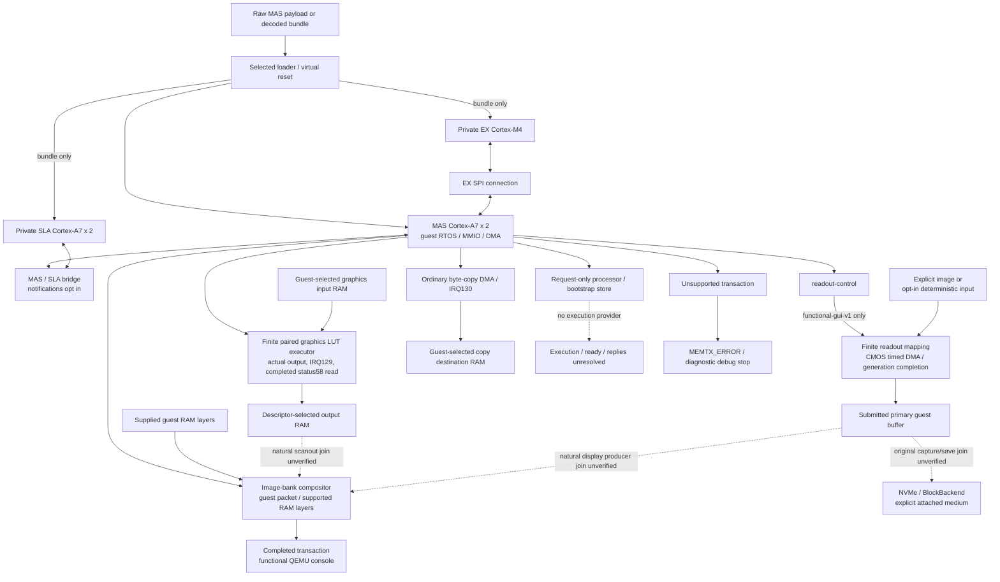

# Nikon firmware emulation on QEMU

This repository contains a diagnostic QEMU machine for unchanged Nikon Z7II C1.70 firmware components. It adds Nikon machines, devices, peers, and native tests beside a pinned upstream QEMU checkout. The machine is intended to make firmware execution and device contracts observable while each assumption is recorded and bounded.

The project is a software model of selected firmware interfaces. It does not claim a recovered BootROM, a complete board flash, a physical sensor or display specification, or real camera performance. The embedded Z7II machine has an explicit, replaceable `boot-shim=functional-v1` loader profile; unchanged firmware has not yet naturally reached its first GUI frame. Unknown register fields, access widths, commands, and addresses remain errors until a source-backed contract and a focused test exist. Functional-model acceptance and physical-camera fidelity are separate results.

## Supported machine types

This repository is organized as a Nikon firmware family emulator. The first
complete camera target is the Z7II; the other machine types are reusable
component or software-domain profiles and do not claim a complete camera boot.

| Machine type | Domain and CPU | Current role | Status |
|---|---|---|---|
| `z7ii-mas-diagnostic` | Z7II MAS, Cortex-A7 SMP | Main camera startup, peer wiring, capture, display, and storage integration | Primary development target; original firmware has not reached a verified GUI first frame |
| `nikonsla` | SLA software domain, Cortex-A7 | Standalone decoded SLA loading and private peripheral contracts | Supported standalone profile; not a complete camera board |
| `nikonex` | EX component, Cortex-M4 | Independent EX firmware and device contract tests | Supported component profile |
| `nikonvr` | VR software profile, RX62N | Independent RX software and peripheral tests | Supported software profile |

New Nikon bodies or component domains should add a named machine under
`hw/nikon/machines` and a focused qtest before they are described as supported.

## Firmware input modes

The combined Z7II run is the target for system-level startup. Use the
`bundle=` machine property with a validated decoded container to load the five
component records (`EX`, `TPJ`, `MAS`, `VR`, and `SLA`) into one composed machine:

```sh
work/build/qemu/qemu-system-arm \
  -M z7ii-mas-diagnostic,bundle=/absolute/path/to/decoded-container.bin \
  -smp cpus=2,maxcpus=5
```

Normal-LCD development uses one explicit functional hardware composition root:

```sh
work/build/qemu/qemu-system-arm \
  -M z7ii-mas-diagnostic,bundle=/absolute/path/to/decoded-container.bin,functional-profile=functional-gui-v1 \
  -smp cpus=2,maxcpus=5
```

`functional-gui-v1` currently selects the accepted `functional-v1` loader and
connects the MAS/SLA opt-in notification endpoints before either bridge is
realized, and joins readout-control requests to the existing CMOS timing/DMA
engine. That join validates the finite C1.70 mapping, writes only the submitted
primary buffer and publishes generation-checked completion. An explicit
PGM/PPM source is used when configured; otherwise this opt-in profile selects
the deterministic CMOS provider. It does not inject guest event objects, task
state or a prefilled UI. Missing physical-camera evidence, exact Bayer fidelity
or full GPU precision does not block functional implementation. Omitting the
property keeps strict notification and readout-provider boundaries.

The raw `-bios mas-component.payload.bin` form is a focused MAS-only diagnostic
input. It is useful for isolating MAS startup and RTOS behavior, but it is not a
replacement for the combined bundle path. `nikonsla`, `nikonex`, and `nikonvr`
are standalone component or software-domain machines used for isolation and
contract tests; they do not replace the composed Z7II machine.

This repository starts after Nikon package decoding. Its input contract is the
complete decoded five-component container; outer-package decryption, signature
verification, and component decoding belong to the upstream firmware intake
pipeline and are outside this QEMU project. The bundle loader refuses partial
or ambiguous component input before any component becomes visible to a machine.

## Scope and boundaries

- QEMU can and must implement complete finite deterministic hardware behavior for unchanged firmware. A functional model may implement CMOS/readout/service/graphics state machines, DMA, IRQs and scanout without claiming exact physical behavior. Only direct guest-software outcome injection is forbidden: writing guest event or status state to force success, invoking guest callbacks or ISRs, manipulating the guest PC or task state, or presenting a prefilled, fixed or host-drawn UI.
- The primary ARM machine is `z7ii-mas-diagnostic`. It supports both the raw MAS diagnostic input and the validated five-component bundle. A raw MAS payload is not a complete update package. `nikonsla` is a separate ARM software-domain machine; `nikonex` and `nikonvr` cover the component profiles listed above.
- CPU reset, ROM loading, RAM, MMIO, DMA, GIC, timers, storage, serial, input, processing, and display paths are implemented only where their firmware-facing contracts are known.
- CMOS input is an independent, guest-configured transport endpoint. It accepts mode, crop, scale, format, byte geometry, buffer rotation, exposure, period, readout timing, and opaque source fields; it preserves unknown words and can sample an explicitly supplied binary PGM/PPM image into the guest-configured buffers. The deterministic byte source requires explicit opt-in through fixtures or `functional-gui-v1`. This is a functional transport contract, not a recovered sensor specification.
- Eye proximity input is a separate I2C device contract. It never supplies image rows, CMOS completion, ISP data, or a display frame. Its register access can be exercised independently; measurement values, physical wiring, and an interrupt producer remain unbound.
- SDES channel/global control, `capture-control`, and `readout-control` retain their source-backed MMIO fields, command/status publication, buffer descriptors, and request boundaries. The explicit `functional-gui-v1` profile now joins a bounded readout mapping to CMOS primary-buffer DMA and generation-checked completion; capture/SDES and downstream ISP/display joins remain independent boundaries.
- The display path composes supplied guest buffers and can publish a QEMU console image after a completed transaction. A rendered image is not evidence of the original camera menu or LCD.
- The 8x8 fixture is transport-only. It checks packet and buffer delivery through the declared seam; it is not a CMOS, ISP, display, or complete-camera-startup fixture.
- Storage uses QEMU's mature NVMe and `BlockBackend` paths with an explicitly attached medium. It does not assert a particular card, filesystem image, capacity, or physical bus implementation.
- Unsupported transactions return `MEMTX_ERROR`, record the first offending CPU/PC/address/direction/width, and request a QEMU debug stop. An architectural exception or an instruction fetch outside mapped memory can stop through upstream ARM handling before the asynchronous request is processed.

## Architecture and startup flow

The detailed CPU, memory, device, and runtime pipeline diagrams are in
[`docs/architecture.md`](docs/architecture.md). The parameter matrix and
evidence classification are maintained in
[`docs/startup/cpu_board.md`](docs/startup/cpu_board.md).



Solid arrows show implemented functional contracts, including opt-in model
assumptions; dashed arrows identify unverified runtime joins or absent
providers. The bundle instantiates MAS, SLA and EX CPUs in one ARM process.
VR uses a separate RX QEMU profile, and TPJ has a separate GNU NDS32 runner
under `sim/nds32`; neither is automatically started by the bundle loader.
External peers require explicit transport attachment.

The readout join validates the primary destination, stride, span and the two
accepted C1.70 format pairs before timed CMOS DMA. Secondary ranges are
validated but not written. Busy requests, stale generations, cancellation and
reset preserve ownership boundaries. This is a functional mapping, not a
recovered sensor format, timing law, GIC route or CMOS-to-ISP/display path.

Graphics stream counts 28/211 are 64-bit units, yielding full 224/1688-byte
snapshots. The finite LUT executor validates the supported program family,
reads a 128x128 input and writes a 32x32 result before raising IRQ129. Its
post-completion offset `0x58` read reports bit26 clear; other status semantics,
fences, IRQ131 and other program families remain unsupported. Ordinary
byte-copy IRQ130 and image-bank composition/console publication are separate
implemented paths. No graphics output buffer is presumed to be a screen.

The MAS request-only processor at PA `0x2c040000` plus bootstrap view
`0x04294000` still has no execution provider. Historical original experiments
naturally timed out there; earlier full-stream receipts also predate the LUT
executor and retain pending graphics work. See [runtime evidence](docs/runtime/coprocessor.md)
and [native receipts](docs/validation/native.md) for those historical results.
No new original-firmware GUI result is implied by the current source graph.
D100/D200/C0A0 retain bounded scalar state with no event/completion side effect;
C010 and PA `0x2c012000` remain strict boundaries. The `1046bfxx` image-start
chain belongs to the registered `tftdbg` command, not natural startup.

The [detailed architecture](docs/architecture.md) records memory ownership,
CPU/IRQ wiring, notification hypotheses and the remaining producer/consumer
joins. Complete boot and a naturally produced original GUI first frame remain
unverified. The guest owns callbacks, event objects, task state, display
packets and save decisions.

## Dependencies and build

The `qemu/` submodule is the official QEMU source pinned to `v11.1.2` (`4fc49f46dc95d4a27de2509e7fceb2931e91faeb`). Keep that checkout clean; the project-owned source is under `hw/nikon`, `include/hw/nikon`, `tests/qtest/nikon`, and `tests/unit/nikon`.

Install CMake 3.24 or newer, a C compiler, Make, Meson/Ninja, `pkg-config`, GLib, pixman, and the Python packages required by the upstream QEMU build. Then run:

```sh
git submodule update --init --recursive
make -j8
make check
make bench
```

The root Makefile asks CMake to compose an ignored source view and then invokes QEMU's normal configure and generated build. The default executables are `work/build/qemu/qemu-system-arm` and `work/build/qemu/qemu-system-rx`. Build directories and source views can be moved without changing the source tree:

```sh
make configure \
  CONFIGURE_FLAGS='--target-list=arm-softmmu,rx-softmmu --enable-tcg \
    --disable-docs --disable-tools --disable-user --disable-guest-agent --disable-werror'
make BUILD_DIR=/absolute/path/to/build -j8
```

No firmware is downloaded by the build. Keep extracted images, logs, sockets, and debugger scripts in the ignored `work/` directory.

## Run the original MAS model

Use an extracted MAS component payload. The machine also accepts synthetic diagnostic images used by qtests, but a synthetic image does not represent original firmware behavior.

```sh
mkdir -p work/runs/r1
work/build/qemu/qemu-system-arm \
  -M z7ii-mas-diagnostic \
  -accel tcg,thread=single \
  -bios /absolute/path/to/mas-component.payload.bin \
  -display none -serial none -monitor none -S \
  -gdb unix:work/runs/r1/gdb.sock,server=on,wait=off \
  -qmp unix:work/runs/r1/qmp.sock,server=on,wait=off \
  -D work/runs/r1/qemu.log -d guest_errors,int
```

The `-S` option leaves the CPUs paused for reset inspection. Use the upstream GDB stub for registers and memory, and QMP for `query-status`, `query-cpus-fast`, resume/stop, and device inspection. Use a short per-run socket path on macOS. For a focused one-core fixture, pass `-smp 1`; use the machine default when observing the original two-core handshake.

Record the input hash, command line, QMP status, GDB registers, first stopped access, and exit status in the run directory. A bounded stop, a debugger breakpoint, or a process exit is an observation; it is not proof of complete boot.

## QEMU workflow

1. **Define the input.** Keep the original component bytes unchanged and record their length and digest. Synthetic fixtures must identify their generated payload and purpose.
2. **Start at reset.** Confirm the reset PC, CPU state, loader range, and initial RAM assumptions before adding a device response.
3. **Follow the bus.** Let the guest perform MMIO, DMA, copies, cache-visible handshakes, IRQ acknowledgement, and task setup. Add only finite, source-backed register ranges and values.
4. **Exercise the contract.** Add or update a native qtest/unit fixture for normal transactions, reset, cancellation, invalid widths, absent inputs, and boundary addresses. Keep transport, processing, display, and storage fixtures independent.
5. **Run unchanged firmware.** Re-run the same payload and capture the next natural stop. A new stop location is progress only when the preceding guest work and all required acknowledgements are visible in the receipt.
6. **Classify the result.** Report model coverage, fixture success, original-firmware progress, and physical-camera validation as separate outcomes.

Detailed contracts and observations live under [`docs/`](docs/), with the source layout in [`docs/layout.md`](docs/layout.md) and build ownership in [`docs/build.md`](docs/build.md). Device pages state the exact mapped range, accepted widths, reset assumptions, interrupt behavior, and unsupported cases.

## Tests and acceptance

`make check` runs the Nikon qtest suite and native unit fixtures in the configured QEMU build. `make bench` runs the native performance fixture. Focused runs can be selected through the upstream generated test target, for example:

```sh
make check MTESTARGS='nikon_usio nikon_vr'
make check MTESTARGS='nikon --test-args="-p /arm/nikon/processing/complete"'
```

The suite covers synthetic ARM execution, reset and loader checks, RAM and bus boundaries, device state machines, real DMA copies, GIC IRQ delivery, peer transport, processing buffers, display composition, and storage against an attached block backend. Fixtures contain no private credentials and do not require original firmware bytes.

Use these acceptance levels when reporting a result:

| Level | Evidence | What it establishes |
|---|---|---|
| Build | Clean submodule and successful `make` | The configured source graph compiles and links. |
| Fixture | Focused qtest/unit receipt with exit status | The declared synthetic contract works for the tested inputs and boundaries. |
| Original firmware | Unchanged payload, command, stop PC/access, and registers | The guest reached the recorded point under the stated virtual assumptions. |
| Display or storage result | Completed transaction plus QMP pixels or backend byte checks | The modeled endpoint produced the checked output. It does not identify the physical camera path. |
| Physical camera | Independent hardware procedure and receipt | Hardware behavior beyond this QEMU model. |

Do not turn an unknown-field stop into a successful default. Do not describe the 8x8 transport fixture, a synthetic frame, or a QEMU console image as complete camera startup.

## Repository map

- [`hw/nikon/machines`](hw/nikon/machines): machine composition, CPU domains, memory maps, and IRQ wiring.
- [`hw/nikon/devices`](hw/nikon/devices): finite QOM/SysBus, PCI, DMA, input, processing, display, and storage models.
- [`hw/nikon/components`](hw/nikon/components): validated component-container views and loaders.
- [`include/hw/nikon`](include/hw/nikon): public device and machine interfaces.
- [`tests/qtest/nikon`](tests/qtest/nikon) and [`tests/unit/nikon`](tests/unit/nikon): native functional and boundary fixtures.
- [`docs/`](docs): source-backed protocols, startup observations, validation receipts, and model limits.

Contributions should keep the upstream submodule untouched, add a focused contract and test for each new behavior, and state the evidence boundary in the corresponding documentation.
