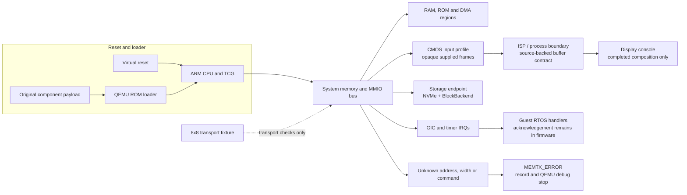

# Nikon firmware emulation on QEMU

This repository contains a diagnostic QEMU machine for unchanged Nikon Z7II C1.70 firmware components. It adds Nikon machines, devices, peers, and native tests beside a pinned upstream QEMU checkout. The machine is intended to make firmware execution and device contracts observable while each assumption is recorded and bounded.

The project is a software model of selected firmware interfaces. It does not claim a complete camera boot, a recovered BootROM, a complete board flash, a physical sensor or display specification, or real camera performance. Unknown register fields, access widths, commands, and addresses remain errors until a source-backed contract and a focused test exist. Physical-camera validation is a separate acceptance result.

## Scope and boundaries

- The supported ARM machine is `z7ii-mas-diagnostic`. Its default image is an extracted MAS component payload, not a complete update package.
- CPU reset, ROM loading, RAM, MMIO, DMA, GIC, timers, storage, serial, input, processing, and display paths are implemented only where their firmware-facing contracts are known.
- CMOS input is an explicit opaque frame source. The ISP/process path accepts supplied buffers and preserves the guest-visible transaction and IRQ boundary; it does not identify a real sensor, Bayer layout, codec, or physical ISP.
- The display path composes supplied guest buffers and can publish a QEMU console image after a completed transaction. A rendered image is not evidence of the original camera menu or LCD.
- The 8x8 fixture is transport-only. It checks packet and buffer delivery through the declared seam; it is not a CMOS, ISP, display, or complete-camera-startup fixture.
- Storage uses QEMU's mature NVMe and `BlockBackend` paths with an explicitly attached medium. It does not assert a particular card, filesystem image, capacity, or physical bus implementation.
- Unsupported transactions return `MEMTX_ERROR`, record the first offending CPU/PC/address/direction/width, and request a QEMU debug stop. An architectural exception or an instruction fetch outside mapped memory can stop through upstream ARM handling before the asynchronous request is processed.

## Architecture and startup flow



The diagram describes the model's boundaries, not a claim that every edge occurs during an original firmware run. The guest must perform its own copies, initialization, event acknowledgement, and task transitions. Host code does not prefill buffers, inject RTOS flags, or manufacture a menu result.

## Dependencies and build

The `qemu/` submodule is the official QEMU source pinned to `v11.1.2` (`4fc49f46dc95d4a27de2509e7fceb2931e91faeb`). Keep that checkout clean; the project-owned source is under `hw/nikon`, `include/hw/nikon`, `tests/qtest/nikon`, and `tests/unit/nikon`.

Install CMake 3.24 or newer, a C compiler, Make, Meson/Ninja, `pkg-config`, GLib, pixman, and the Python packages required by the upstream QEMU build. Then run:

```sh
git submodule update --init --recursive
make -j8
make check
make bench
```

The root Makefile asks CMake to compose an ignored source view and then invokes QEMU's normal configure and generated build. The default executables are `work/build/qemu/qemu-system-arm` and `work/build/qemu/qemu-system-rx`. Build directories and source views can be moved without changing the source tree:

```sh
make configure \
  CONFIGURE_FLAGS='--target-list=arm-softmmu,rx-softmmu --enable-tcg \
    --disable-docs --disable-tools --disable-user --disable-guest-agent --disable-werror'
make BUILD_DIR=/absolute/path/to/build -j8
```

No firmware is downloaded by the build. Keep extracted images, logs, sockets, and debugger scripts in the ignored `work/` directory.

## Run the original MAS model

Use an extracted MAS component payload. The machine also accepts synthetic diagnostic images used by qtests, but a synthetic image does not represent original firmware behavior.

```sh
mkdir -p work/runs/r1
work/build/qemu/qemu-system-arm \
  -M z7ii-mas-diagnostic \
  -accel tcg,thread=single \
  -bios /absolute/path/to/mas-component.payload.bin \
  -display none -serial none -monitor none -S \
  -gdb unix:work/runs/r1/gdb.sock,server=on,wait=off \
  -qmp unix:work/runs/r1/qmp.sock,server=on,wait=off \
  -D work/runs/r1/qemu.log -d guest_errors,int
```

The `-S` option leaves the CPUs paused for reset inspection. Use the upstream GDB stub for registers and memory, and QMP for `query-status`, `query-cpus-fast`, resume/stop, and device inspection. Use a short per-run socket path on macOS. For a focused one-core fixture, pass `-smp 1`; use the machine default when observing the original two-core handshake.

Record the input hash, command line, QMP status, GDB registers, first stopped access, and exit status in the run directory. A bounded stop, a debugger breakpoint, or a process exit is an observation; it is not proof of complete boot.

## QEMU workflow

1. **Define the input.** Keep the original component bytes unchanged and record their length and digest. Synthetic fixtures must identify their generated payload and purpose.
2. **Start at reset.** Confirm the reset PC, CPU state, loader range, and initial RAM assumptions before adding a device response.
3. **Follow the bus.** Let the guest perform MMIO, DMA, copies, cache-visible handshakes, IRQ acknowledgement, and task setup. Add only finite, source-backed register ranges and values.
4. **Exercise the contract.** Add or update a native qtest/unit fixture for normal transactions, reset, cancellation, invalid widths, absent inputs, and boundary addresses. Keep transport, processing, display, and storage fixtures independent.
5. **Run unchanged firmware.** Re-run the same payload and capture the next natural stop. A new stop location is progress only when the preceding guest work and all required acknowledgements are visible in the receipt.
6. **Classify the result.** Report model coverage, fixture success, original-firmware progress, and physical-camera validation as separate outcomes.

Detailed contracts and observations live under [`docs/`](docs/), with the source layout in [`docs/layout.md`](docs/layout.md) and build ownership in [`docs/build.md`](docs/build.md). Device pages state the exact mapped range, accepted widths, reset assumptions, interrupt behavior, and unsupported cases.

## Tests and acceptance

`make check` runs the Nikon qtest suite and native unit fixtures in the configured QEMU build. `make bench` runs the native performance fixture. Focused runs can be selected through the upstream generated test target, for example:

```sh
make check MTESTARGS='nikon_usio nikon_vr'
make check MTESTARGS='nikon --test-args="-p /arm/nikon/processing/complete"'
```

The suite covers synthetic ARM execution, reset and loader checks, RAM and bus boundaries, device state machines, real DMA copies, GIC IRQ delivery, peer transport, processing buffers, display composition, and storage against an attached block backend. Fixtures contain no private credentials and do not require original firmware bytes.

Use these acceptance levels when reporting a result:

| Level | Evidence | What it establishes |
|---|---|---|
| Build | Clean submodule and successful `make` | The configured source graph compiles and links. |
| Fixture | Focused qtest/unit receipt with exit status | The declared synthetic contract works for the tested inputs and boundaries. |
| Original firmware | Unchanged payload, command, stop PC/access, and registers | The guest reached the recorded point under the stated virtual assumptions. |
| Display or storage result | Completed transaction plus QMP pixels or backend byte checks | The modeled endpoint produced the checked output. It does not identify the physical camera path. |
| Physical camera | Independent hardware procedure and receipt | Hardware behavior beyond this QEMU model. |

Do not turn an unknown-field stop into a successful default. Do not describe the 8x8 transport fixture, a synthetic frame, or a QEMU console image as complete camera startup.

## Repository map

- [`hw/nikon/machines`](hw/nikon/machines): machine composition, CPU domains, memory maps, and IRQ wiring.
- [`hw/nikon/devices`](hw/nikon/devices): finite QOM/SysBus, PCI, DMA, input, processing, display, and storage models.
- [`hw/nikon/components`](hw/nikon/components): validated component-container views and loaders.
- [`include/hw/nikon`](include/hw/nikon): public device and machine interfaces.
- [`tests/qtest/nikon`](tests/qtest/nikon) and [`tests/unit/nikon`](tests/unit/nikon): native functional and boundary fixtures.
- [`docs/`](docs): source-backed protocols, startup observations, validation receipts, and model limits.

Contributions should keep the upstream submodule untouched, add a focused contract and test for each new behavior, and state the evidence boundary in the corresponding documentation.
