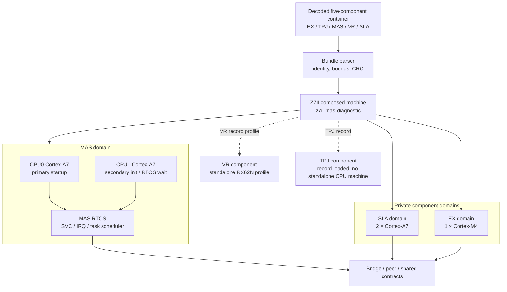
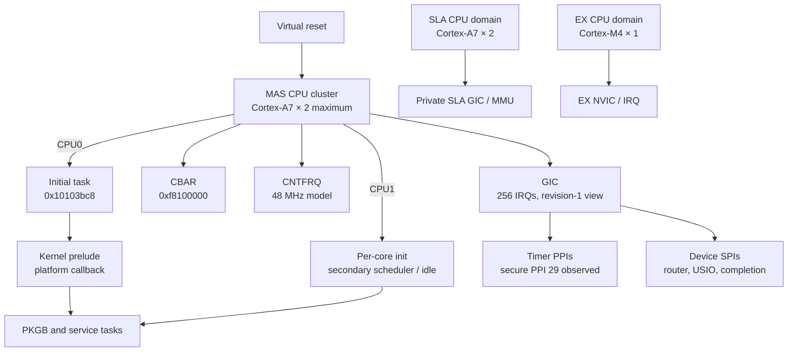
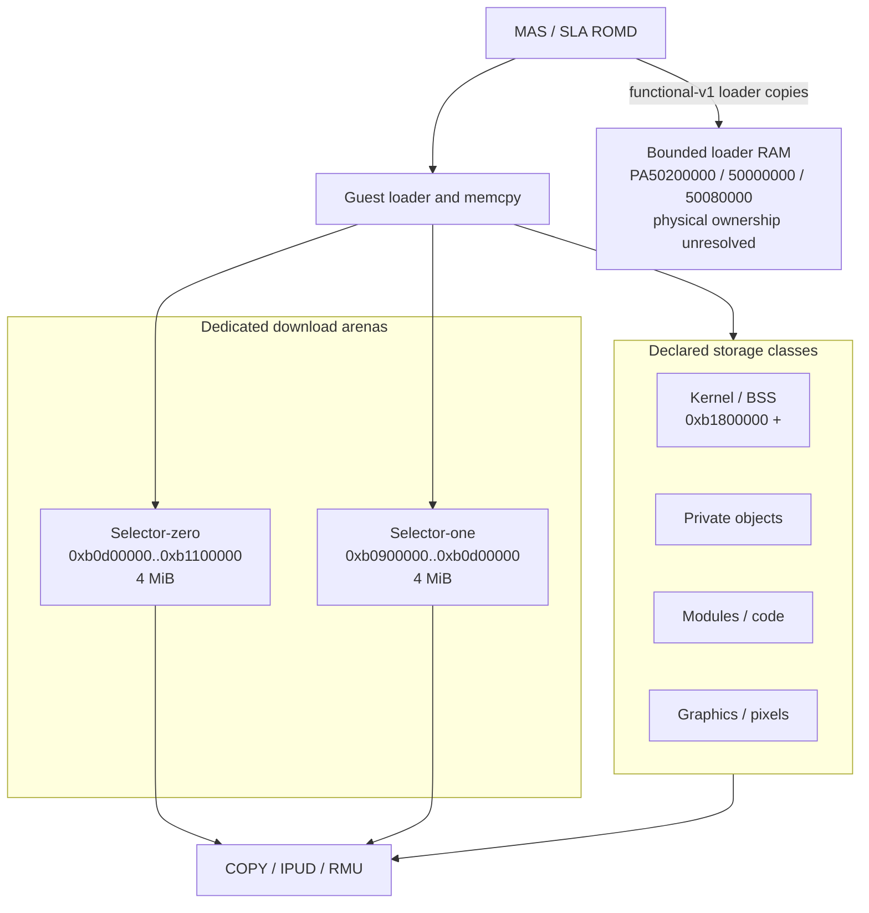
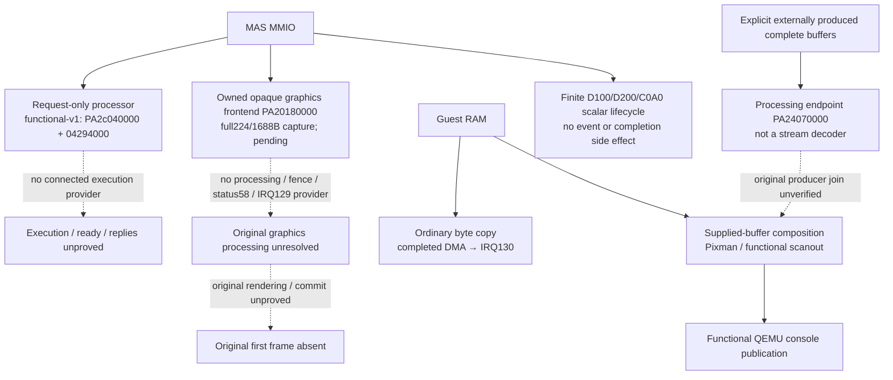

# Z7II QEMU architecture

This document describes the current composed Z7II machine, its standalone
component profiles, and the evidence boundary for each hardware pipeline. A
solid edge means the QEMU model has a bounded contract and a focused test. A
dashed edge means the firmware or hardware join is observed only partially.
It limits the physical-fidelity claim, not implementation: QEMU must provide
complete finite deterministic CMOS/readout/service/graphics/IRQ/scanout
behavior for unchanged firmware without waiting for exact Bayer, GPU or camera
evidence.

## Machine composition



The bundle path is the system-level input. `-bios` with a raw MAS component,
`nikonsla`, `nikonex`, and `nikonvr` are isolated diagnostic profiles. They are
useful for narrowing a contract and do not replace the composed machine.

## CPU and board parameters



CPU0 and CPU1 have different startup responsibilities. CPU0 creates and starts
the initial task; CPU1 can remain in a scheduler or event-wait boundary before
joining a role task. A CPU1 empty successor is therefore not a default-ready
failure. CPU model details remain separated into observed values, functional
assumptions, and unresolved silicon identity in the CPU evidence matrix.

## Memory and DMA ownership



The two 4 MiB download arenas are separate QEMU `MemoryRegion` owners. The
selector-one firmware range check extends to `0xb1000000`, but the proven model
owns the exact four-MiB arena `[0xb0900000, 0xb0d00000)`. Under
`functional-v1`, loader RAM already covers PA `0x50200000` (`0x27800` bytes),
`0x50000000` (`0x57e30`) and `0x50080000` (`0x69e70`). Experimental receipts
compare these loader extents byte-exactly; physical board decode/provider
ownership and framebuffer identity remain unresolved. This storage is
profile-qualified, not a general unknown-address RAM fallback.

## Runtime pipelines

### Boot and task pipeline

```mermaid
sequenceDiagram
  participant R as Reset / loader
  participant C0 as MAS CPU0
  participant C1 as MAS CPU1
  participant K as RTOS scheduler
  participant P as Historical peer EV3 setters
  participant B as Bridge notifications
  participant N as GUI producer VA10200c34
  participant G as GUI waiter EV3 mask0x10

  R->>C0: load MAS and reset
  R->>C1: release secondary core
  C0->>K: create and start initial task
  C1->>K: per-core init and scheduler wait
  C0->>K: select service / PKGB tasks
  P-->>K: masks0x1/0x2, wrapper LRs10200d0b/10200ceb; not GUI mask0x10
  B-->>N: notification-v1 default-off hypotheses only
  N-->>G: experimental EV3 mask0x10 setter
  G->>K: experimental wait returns naturally
```

Historical peer EV3 setters publish masks `0x1`/`0x2` through wrapper
`0x103610cc` with LRs `0x10200d0b`/`0x10200ceb`; neither satisfies the GUI
mask `0x10` wait produced by MAS VA `0x10200c34`. Mask `0x2` is not attributed
to `0x10200d06`: that observed call supplies mask `0x1`. Strict/default bridge
notifications still reject PA `0x2013e000`. Default-off `notification-v1`
experiments observe the mask `0x10` setter and natural wait return, but do not
qualify first-word reflection, cross-bank binding, reset or IRQ hypotheses.
The peer-ready/bridge/GPIO/USIO hardware join remains unverified. The former
[tracker #480](https://github.com/mashiro01/nightglass/issues/480) dependency is
closed: `0x42062002` is firmware-local and type-5 traffic is service negotiation.
[#482](https://github.com/mashiro01/nightglass/issues/482) and
[#485](https://github.com/mashiro01/nightglass/issues/485) are parallel and
unblocked.

### Image pipeline

```mermaid
flowchart TD
  Sensor[CMOS input contract]
  Capture[capture-control]
  Readout[readout-control]
  DMA[DMA / buffer rotation]
  ISP[Processing / ISP boundary]
  Frame[Framebuffer descriptor]
  Scanout[Display scanout]
  Save[Storage save]

  Sensor --> Capture
  Capture --> Readout
  Readout -. real C1.70 producer .-> DMA
  DMA -. source-backed frame .-> ISP
  ISP -. real callback / descriptor .-> Frame
  Frame -. first frame .-> Scanout
  Frame -. save request .-> Save
```

The CMOS, processing, display, and storage devices each have isolated tests.
The existing CMOS transport, graphics capture/completion, image-bank compositor
and scanout are implementation bases for joining this pipeline. A finite
functional producer, geometry, completion, IRQ and scanout path does not require
exact physical-camera evidence. The stronger claim that this is the original
physical image path remains unaccepted until its runtime joins are observed.

### Processor and graphics provider boundaries



The MAS-only request device retains configuration and the actual 16 KiB
bootstrap bytes, with no execution provider or automatic completion. Original
experimental runs take the ten-poll timeout/stop path and continue to graphics
configuration; this is not processor success or a proven SLA route.
The graphics frontend owns immutable opaque snapshots, not decoded results.
Descriptor extents56/422 are 32-bit words and register counts28/211 are
64-bit units: full lengths224/1688 bytes. The corrected frontend captures
`8*units64` within a functional 128-KiB bound per stream. Recorded native receipts
pass 29 fixtures / 247 subtests; two experimental original-bundle runs match the
producer-bounded full inputs while retaining pending tokens1/2 and the
ordinal10 wait, without a wait return, IRQ129 or frame. The old56/422-byte
captures remain historical prefixes; shared-length hash matches were not
independent full-bound proof. Historical and corrected identities remain in
[the runtime study](runtime/coprocessor.md) and [native receipts](validation/native.md).
Ordinary copy IRQ130 and supplied-buffer composition are implemented endpoints,
not proof of the original graphics provider. Together with stream capture,
completion, the image-bank compositor and scanout, they are bases for a complete
finite deterministic provider rather than reasons to stop. D200 zero and the
C0A0 bit gate are finite retained scalar contracts with no event side effect;
their physical meaning remains unknown. C010 and PA `0x2c012000` remain strict
errors. Static Thumb recovery places the previously ranked `1046bfxx` image-start
route under the registered `tftdbg` command handler, not the natural startup
path.

## Current implementation boundaries

| Pipeline | Current evidence | Remaining functional or fidelity boundary |
|---|---|---|
| CPU startup | CPU0 initial task and PKGB roles observed | CPU/board parameter matrix |
| Loader COPY | Both 4 MiB arenas; bounded500*/502* RAM under functional-v1 | Physical ownership/provider, not missing storage in this profile |
| EV3 | Historical peer setters masks0x1/0x2 (wrapper LRs10200d0b/10200ceb); GUI mask0x10 producer VA10200c34; experimental progression | Strict PA2013e000; notification hypotheses unqualified |
| Processor | MAS-only request/bootstrap storage; natural experimental timeout | Finite execution/ready/reply provider remains to implement |
| Graphics streams | Corrected owned full224/1688B capture; native receipts and experimental producer-bound matches; requests remain pending | Finite processing/fence/status58/IRQ129 provider remains to implement |
| Ordinary copy/composition | Implemented DMA IRQ130 and supplied-buffer console publication | Original stream/guest producer join unverified as a fidelity claim |
| Display/control scalar lifecycle | D100/D200/C0A0 finite source-bounded contracts | C010 and PA2c012000 remain strict; physical meanings unresolved |
| CMOS/readout | Device contracts and fixtures exist | Finite original-firmware-facing producer and DMA completion remain to implement |
| Display | GUI acceptance test reports explicit `UNMET` | Functional framebuffer and scanout callback remain to implement; physical LCD fidelity is separate |

Every unknown remains an explicit fault or receipt. Hardware models may produce
causal status, IRQ and scanout results through their finite state machines. They
must not force a guest-software outcome by writing guest event/status state,
invoking a guest callback or ISR, manipulating the guest PC or task state, or
presenting a prefilled, fixed or host-drawn UI. A transport fixture remains
separate from a camera specification.
