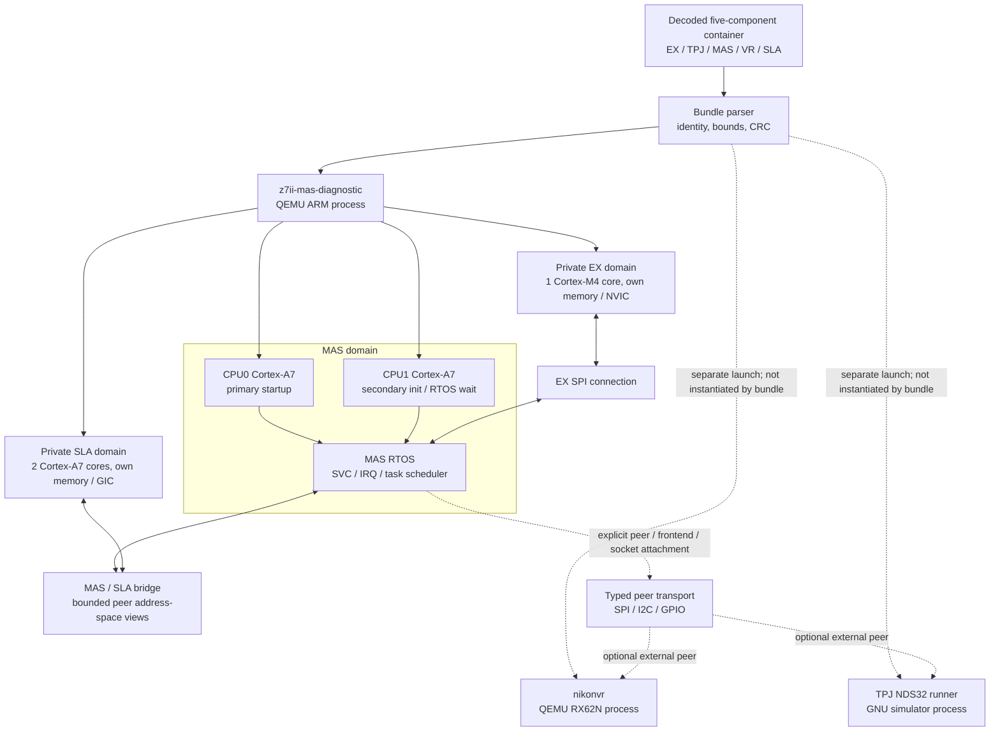
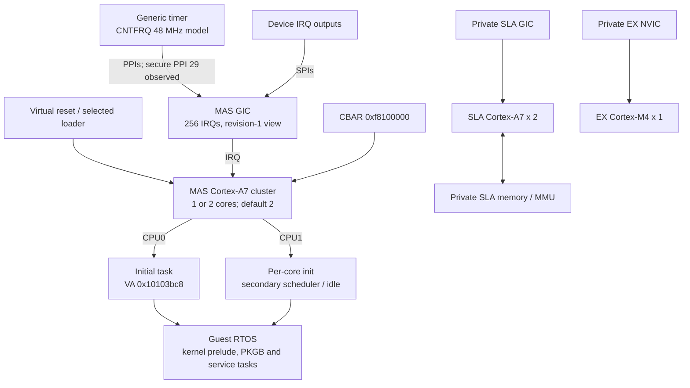
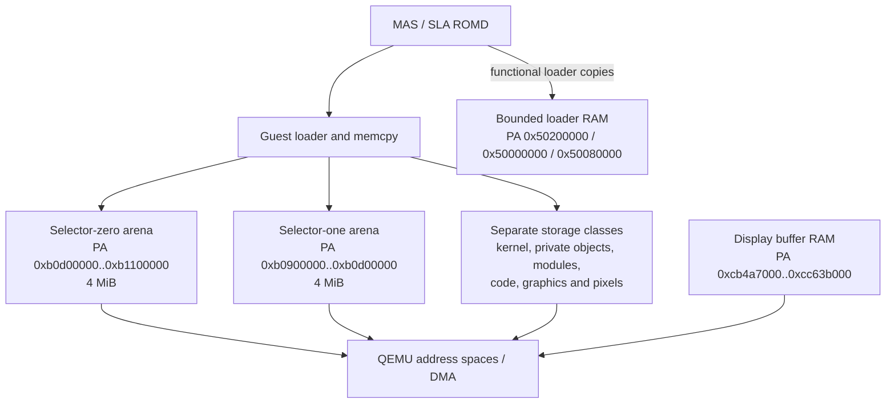
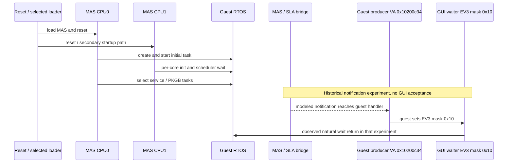
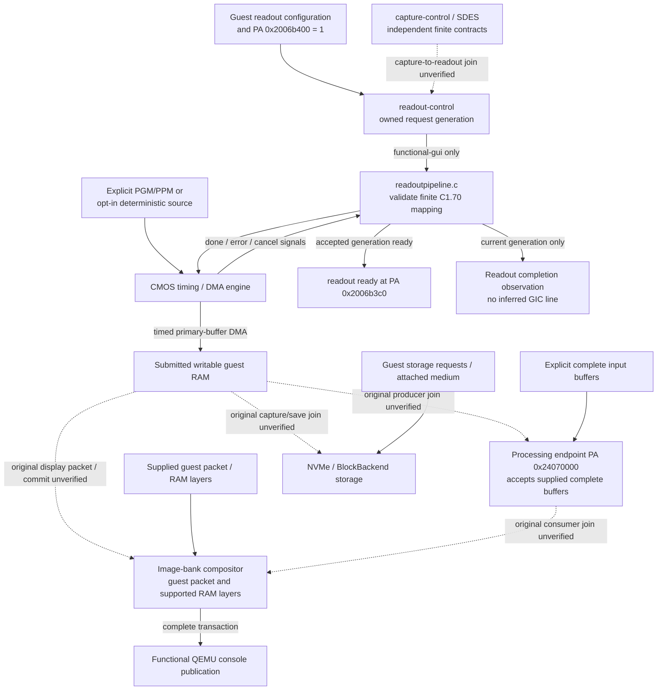
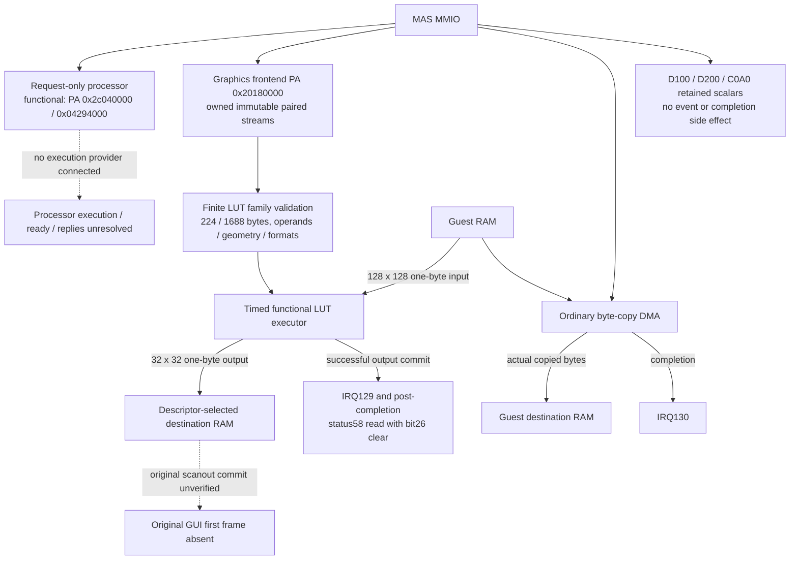

# Z7II QEMU architecture

This document describes the composed Z7II machine and its separate execution
providers. Solid arrows show implemented composition, data flow or device
signals, including explicitly selected functional assumptions. Dashed arrows
show optional external integration or runtime/physical joins still unverified;
their labels distinguish the two. Neither kind of arrow proves original
firmware startup or physical-camera fidelity. Historical runtime receipts are
identified separately from the current implementation.

## Machine composition

The bundle is validated as a whole before component publication. Only MAS,
SLA and EX CPUs are instantiated in the composed ARM machine. VR and TPJ
records are retained by the parser; execution requires separate providers and
explicit transport attachment. The GNU TPJ runner exists under `sim/nds32`,
built through `make tpj`; it is not a QEMU NDS32 machine or an automatically
started bundle CPU. See [NDS32 execution](startup/system.md) and
[peer transport](devices/peer.md).

`-bios` with a raw MAS component and the `nikonsla`, `nikonex`, `nikonvr`
machines are isolated diagnostic profiles. They do not replace the bundle
path. With two MAS cores, the composed machine has five ARM CPUs; MTTCG needs
`-smp cpus=2,maxcpus=5` to reserve capacity for private SLA/EX cores.

## CPU and board parameters

CPU0 creates and starts the initial task. CPU1 may remain in a scheduler or
wait boundary before joining a role task; an empty successor is not a missing
ready producer. CPU choices, reset state and board values remain classified
in the [CPU evidence matrix](startup/cpu_board.md). This is a functional TCG
model, not a model of cache latency, branch prediction or silicon pipelines.

## Memory and DMA ownership

The two 4 MiB arenas are separate `MemoryRegion` owners. The selector-one
firmware range check extends to `0xb1000000`; the modeled arena ends at
`0xb0d00000`. Under `functional`, loader RAM covers PA `0x50200000`
(`0x27800` bytes), `0x50000000` (`0x57e30`) and `0x50080000` (`0x69e70`).
Historical experimental receipts compare these loader extents byte-exactly.
Physical backing/provider ownership and framebuffer identity remain unresolved.
Display-buffer RAM provides storage only; guest code owns pointers, descriptors
and pixels. These finite regions are not an unknown-address RAM fallback.

## Runtime pipelines

### Boot and task pipeline

Historical peer setters publish EV3 masks `0x1`/`0x2` (wrapper LRs
`0x10200d0b`/`0x10200ceb`); these do not satisfy the GUI mask `0x10` wait.
Strict/default bridge notifications reject PA `0x2013e000`.
`functional-gui` selects `boot-shim=functional` and enables both MAS/SLA
notification endpoints before realization. It also attaches the functional
readout pipeline below. Notification wiring remains a functional hypothesis,
not a recovered physical bank/reset/IRQ contract. Historical experimental wait
returns do not prove complete boot under the latest profile.

The former [tracker #480](https://github.com/mashiro01/nightglass/issues/480)
dependency is closed: `0x42062002` is firmware-local and type-5 traffic is
service negotiation. [#482](https://github.com/mashiro01/nightglass/issues/482)
and [#485](https://github.com/mashiro01/nightglass/issues/485) are unblocked.

### Readout, image, display and storage

The implemented profile maps `3e8/3ec/3f0` to primary destination/stride/span,
validates the secondary destination/stride without writing it, and accepts
only format pairs `00400040` and `00010001`. Functional samples are two bytes;
width is stride/2 and height is span/stride. The CMOS engine performs actual
timed DMA. Busy requests are rejected, stale generations cannot complete,
and cancellation/reset stop pending work. Strict/default profiles leave this
join disconnected. No physical pixel format, sensor timing, secondary-plane
producer, GIC route or downstream ISP/display join is inferred. See the
[readout mapping](devices/readout/profile.json),
[controller contract](devices/sensor/protocol.md#buffer-selectors-and-readout-parameters)
and [pipeline fixtures](../tests/qtest/nikon/cmos.c).

Image-bank composition and console publication already exist independently;
the missing acceptance is the original guest's natural producer/commit path,
not the existence of a functional compositor. The diagnostic frame descriptor
is opt-in and is not wired as a CMOS-to-display handoff. See
[image transactions](devices/banks/image.md) and
[GUI acceptance](startup/display.md).

### Processor and graphics execution

The request-only processor retains the actual 16 KiB guest bootstrap and has
no execution provider. Historical experimental runs naturally time out; that
is not processor success or an SLA execution route.

The graphics frontend captures `8*units64` bytes with a functional 128-KiB
bound per stream. The supported program family requires the full 224/1688-byte
pair and validates its fingerprint, geometry, formats, 12-bit LUT entries,
backing and non-overlapping operands. A virtual timer samples the 128x128
input at `(4x,4y)`, applies the two LUTs and writes the 32x32 output before
IRQ129. Offset `0x58` is readable as zero only after successful completion;
other status states, fences, IRQ131 and other command families remain
unsupported. Reset cancels pending work. This is a finite functional law,
not recovered physical GPU precision or a screen rendering claim. See
[graphics transfer](devices/transfer/protocol.md) and its
[qtest](../tests/qtest/nikon/transfer.c) /
[unit fixtures](../tests/unit/nikon/transfer.c).

The 29-fixture/247-subtest receipt and the two full-stream original-bundle
experiments in [native receipts](validation/native.md) predate this executor.
Those runs retained pending streams and produced no IRQ129 or frame; their
results are historical, not measurements of current execution. No new
original-firmware result is claimed by these diagrams.

D200 zero and C0A0 bit0 are bounded retained scalar contracts. C010 and
PA `0x2c012000` remain strict errors. Static Thumb recovery places the
`1046bfxx` image-start route under `tftdbg`; it is not natural-startup evidence.

## Current implementation boundaries

| Pipeline | Implemented contract / recorded evidence | Remaining boundary |
|---|---|---|
| CPU startup | MAS CPU0/CPU1 roles observed; private SLA/EX instantiated | Physical CPU/board parameter qualification |
| External components | Standalone RX VR and GNU NDS32 TPJ providers; typed peer transport | Explicit launch/wiring; no automatic five-component CPU integration |
| Loader COPY | Two 4 MiB arenas; bounded 500*/502* RAM under functional | Physical backing/provider identity |
| EV3 | GUI mask0x10 producer; historical experimental wait return; profile enables notifications | Strict PA2013e000; physical notification contract unqualified |
| Processor | MAS-only request/bootstrap storage; historical natural timeout | Execution/ready/reply provider |
| Graphics | Full paired capture, finite LUT execution, output DMA, IRQ129 and post-completion status58 read | Other programs/formats, fences, IRQ131, other status semantics and original scanout join |
| Copy/composition | Byte-copy DMA IRQ130; supplied-layer composition and console publication | Natural original producer/commit chain |
| Display scalars | D100/D200/C0A0 finite contracts | C010, PA2c012000 and physical meanings |
| CMOS/readout | Opt-in finite mapping, timed primary DMA and generation-checked completion; rejection/cancel/reset fixtures | Strict profile disconnected; secondary output, physical formats/timing, GIC and downstream joins |
| GUI acceptance | Observation fixture explicitly reports missing evidence as `UNMET` | Natural source pixels, guest commit, completion and first console frame; interaction separately |

Hardware models may produce causal status, IRQ and scanout through finite
state machines. They must not force guest-software outcomes by writing guest
event/status state, invoking callbacks or ISRs, manipulating PC/task state,
or supplying a prefilled, fixed or host-drawn UI. Fixture success, unchanged
firmware progress, complete boot and physical evidence remain separate.
