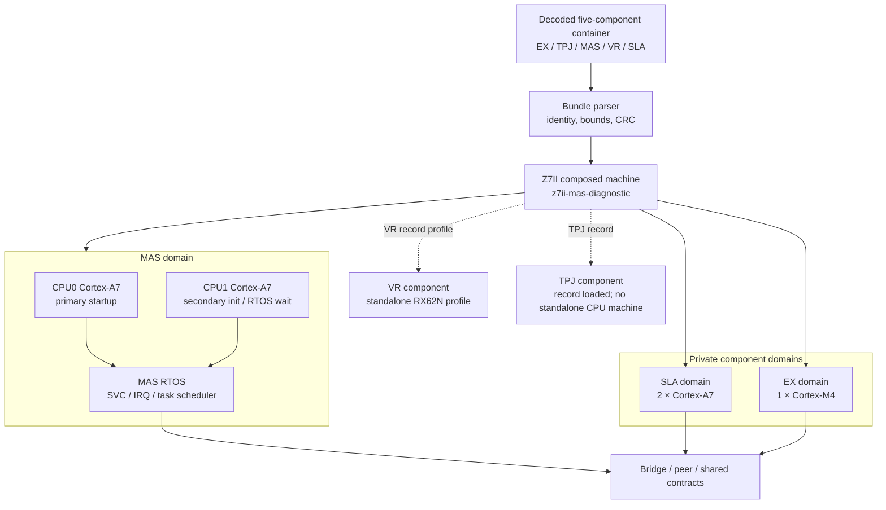
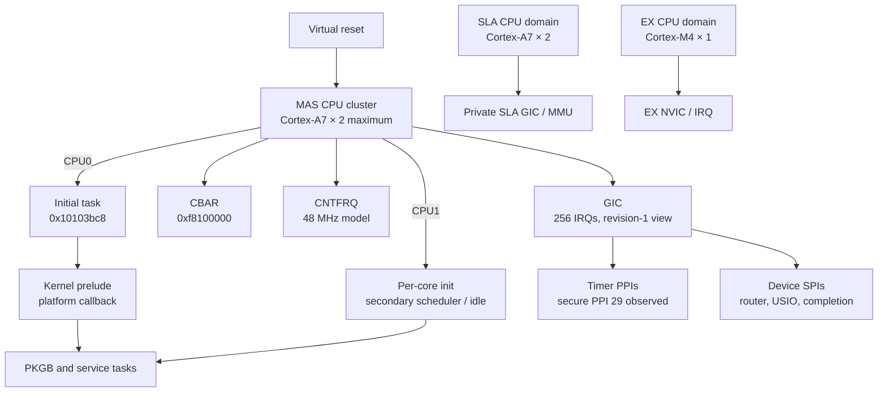
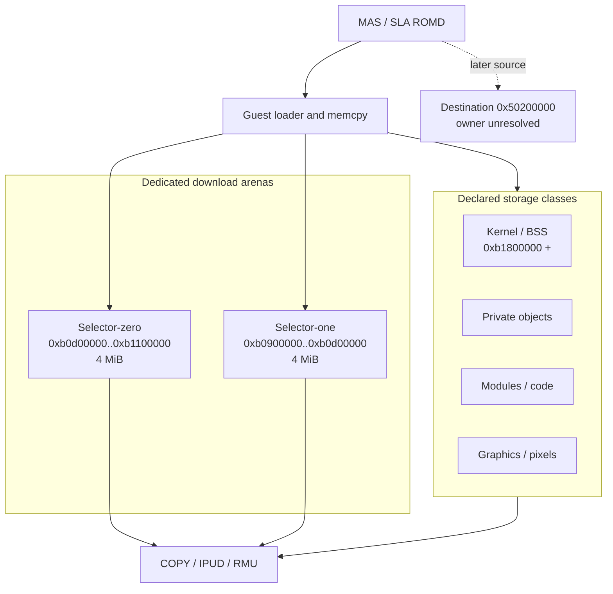
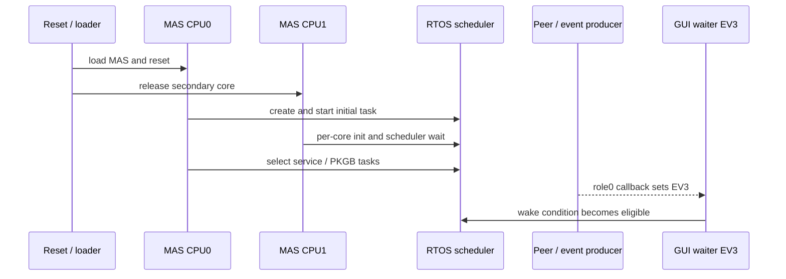

# Z7II QEMU architecture

This document describes the current composed Z7II machine, its standalone
component profiles, and the evidence boundary for each hardware pipeline. A
solid edge means the QEMU model has a bounded contract and a focused test. A
dashed edge means the firmware or hardware join is observed only partially.

## Machine composition



The bundle path is the system-level input. `-bios` with a raw MAS component,
`nikonsla`, `nikonex`, and `nikonvr` are isolated diagnostic profiles. They are
useful for narrowing a contract and do not replace the composed machine.

## CPU and board parameters



CPU0 and CPU1 have different startup responsibilities. CPU0 creates and starts
the initial task; CPU1 can remain in a scheduler or event-wait boundary before
joining a role task. A CPU1 empty successor is therefore not a default-ready
failure. CPU model details remain separated into observed values, functional
assumptions, and unresolved silicon identity in the CPU evidence matrix.

## Memory and DMA ownership



The two 4 MiB download arenas are separate QEMU `MemoryRegion` owners. The
selector-one firmware range check extends to `0xb1000000`, but the proven model
owns the exact four-MiB arena `[0xb0900000, 0xb0d00000)`. The later
`0x50200000` COPY destination is kept as an error boundary until its MMU,
board decode, and provider contract are recovered.

## Runtime pipelines

### Boot and task pipeline



The EV3 setter edge is runtime-observed. The peer-ready, bridge, GPIO, and
USIO path before that callback remains a separate evidence boundary.

### Image pipeline

```mermaid
flowchart TD
  Sensor[CMOS input contract]
  Capture[capture-control]
  Readout[readout-control]
  DMA[DMA / buffer rotation]
  ISP[Processing / ISP boundary]
  Frame[Framebuffer descriptor]
  Scanout[Display scanout]
  Save[Storage save]

  Sensor --> Capture
  Capture --> Readout
  Readout -. real C1.70 producer .-> DMA
  DMA -. source-backed frame .-> ISP
  ISP -. real callback / descriptor .-> Frame
  Frame -. first frame .-> Scanout
  Frame -. save request .-> Save
```

The CMOS, processing, display, and storage devices each have isolated tests.
The complete original-firmware image path is not accepted until the runtime
producer, descriptor geometry, completion event, scanout, and save edge are all
observed.

## Current frontier

| Pipeline | Current evidence | Next boundary |
|---|---|---|
| CPU startup | CPU0 initial task and PKGB roles observed | CPU/board parameter matrix |
| Selector-zero/one COPY | Both 4 MiB arenas modeled and tested | `0x50200000` owner and provider |
| EV3 | Role0 callback to setter observed | Peer-ready/bridge precondition |
| CMOS/readout | Device contracts and fixtures exist | Original firmware producer and DMA completion |
| Display | GUI acceptance test reports explicit `UNMET` | Real framebuffer and scanout callback |

Every unknown remains an explicit fault or receipt. The emulator does not
advance a guest PC, synthesize an event, prefill a framebuffer, or convert a
transport fixture into a camera specification.
