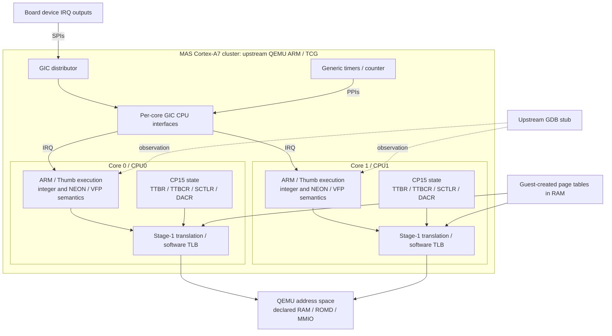
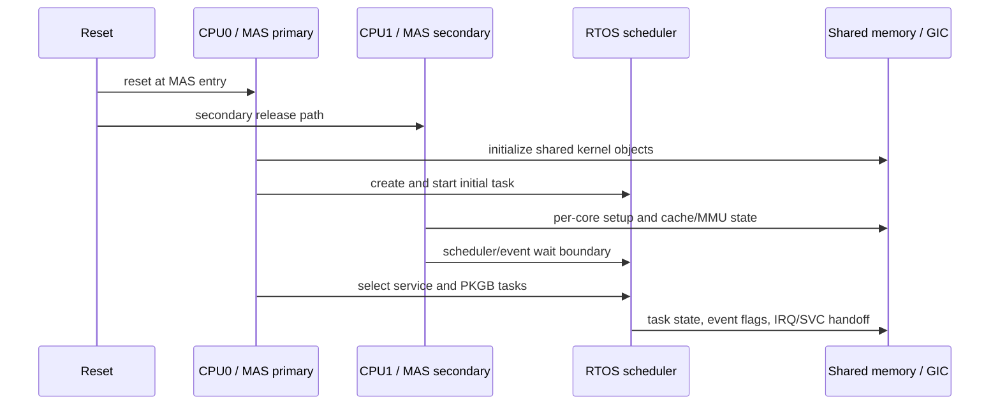

# Z7II CPU and board compute architecture

This diagram shows the QEMU Cortex-A7 execution model and board IRQ wiring.
Z7II-specific values are separately identified as C1.70 runtime observations
or explicit functional assumptions. It does not identify the Nikon SoC die
or claim a recovered physical microarchitecture.

## CPU execution and interrupt wiring

This is an execution and wiring diagram, not a physical microarchitecture.
TCG implements instruction and architectural state semantics; the project does
not model branch-predictor pipelines, cache latency or SCU timing. IRQ flow is
from device outputs through the GIC to a CPU, independently of memory traffic.

The firmware-facing Z7II values currently used by the project are:

| Area | Current value | Evidence class |
|---|---|---|
| MAS cores | 2 Cortex-A7 software participants | C1.70 `TSysPrNum`/`TKerPrNum` and runtime SMP traces |
| CPU0 role | Initial task creation, kernel prelude, service-task scheduling | Direct runtime trace |
| CPU1 role | Per-core initialization, scheduler/event wait, later role task | Direct runtime trace |
| CBAR | `0xf8100000` | Firmware/runtime contract used by the model |
| GIC | 256 IRQ lines, revision-1 active-view compatibility | Firmware RMW behavior and GIC receipt |
| Generic counter | `CNTFRQ=48 MHz` | Runtime machine contract |
| Secure timer | PPI 29 observed in the MAS domain | IRQ trace |
| MMU | ARMv7-A stage-1 translation with guest-created L1 sections | TTBR/PTE receipts |
| Debug | GDB stub and hardware watchpoints used for observation | Tooling evidence, not guest hardware identity |

The exact silicon part number, CPU PLL frequency, cache sizes, external memory
controller timing, and physical interconnect are still unresolved. The public
SC2000 four-core and 650/660 MHz references are not used as Z7II facts.

## CPU startup and ownership

An empty CPU1 successor is a valid startup/affinity boundary. It must not be
repaired by returning a synthetic task, writing a ready bit, or manufacturing
an interrupt. The `functional` profile already provides bounded RAM for the
`0x50200000` descriptor-driven COPY. Its physical backing/provider identity
remains unresolved; this does not imply missing model storage or a CPU1 fault.

## References

- [Arm: The top five things to know about Cortex-A7](https://developer.arm.com/community/arm-community-blogs/b/architectures-and-processors-blog/posts/the-top-5-things-to-know-about-cortex--a7)
- [Arm Cortex-A7/A15 MPCore documentation](https://developer.arm.com/documentation/ddi0503/i/hardware-description/cortex-a15-a7-mpcore-test-chip)
- [Project CPU/board evidence matrix](../startup/cpu_board.md)
