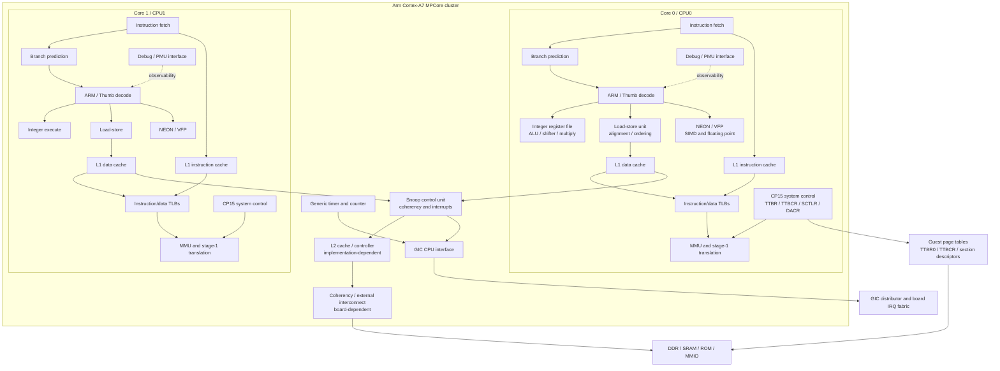
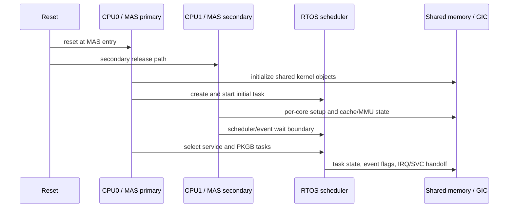

# Z7II CPU and board compute architecture

This diagram separates the generic Arm Cortex-A7 MPCore structure from the
Z7II-specific values observed in C1.70 runtime traces or selected as explicit
QEMU functional assumptions. It does not identify the Nikon SoC die or claim
that every optional Cortex-A7 block is present in the camera.

## CPU cluster and internal units

The generic blocks above come from the Cortex-A7 MPCore programming model. The
firmware-facing Z7II values currently used by the project are:

| Area | Current value | Evidence class |
|---|---|---|
| MAS cores | 2 Cortex-A7 software participants | C1.70 `TSysPrNum`/`TKerPrNum` and runtime SMP traces |
| CPU0 role | Initial task creation, kernel prelude, service-task scheduling | Direct runtime trace |
| CPU1 role | Per-core initialization, scheduler/event wait, later role task | Direct runtime trace |
| CBAR | `0xf8100000` | Firmware/runtime contract used by the model |
| GIC | 256 IRQ lines, revision-1 active-view compatibility | Firmware RMW behavior and GIC receipt |
| Generic counter | `CNTFRQ=48 MHz` | Runtime machine contract |
| Secure timer | PPI 29 observed in the MAS domain | IRQ trace |
| MMU | ARMv7-A stage-1 translation with guest-created L1 sections | TTBR/PTE receipts |
| Debug | GDB stub and hardware watchpoints used for observation | Tooling evidence, not guest hardware identity |

The exact silicon part number, CPU PLL frequency, cache sizes, external memory
controller timing, and physical interconnect are still unresolved. The public
SC2000 four-core and 650/660 MHz references are not used as Z7II facts.

## CPU startup and ownership

An empty CPU1 successor is a valid startup/affinity boundary. It must not be
repaired by returning a synthetic task, writing a ready bit, or manufacturing
an interrupt. The current next CPU investigation is the board owner behind the
`0x50200000` descriptor-driven COPY, not the CPU1 scheduler itself.

## References

- [Arm: The top five things to know about Cortex-A7](https://developer.arm.com/community/arm-community-blogs/b/architectures-and-processors-blog/posts/the-top-5-things-to-know-about-cortex--a7)
- [Arm Cortex-A7/A15 MPCore documentation](https://developer.arm.com/documentation/ddi0503/i/hardware-description/cortex-a15-a7-mpcore-test-chip)
- [Project CPU/board evidence matrix](../startup/cpu_board.md)
