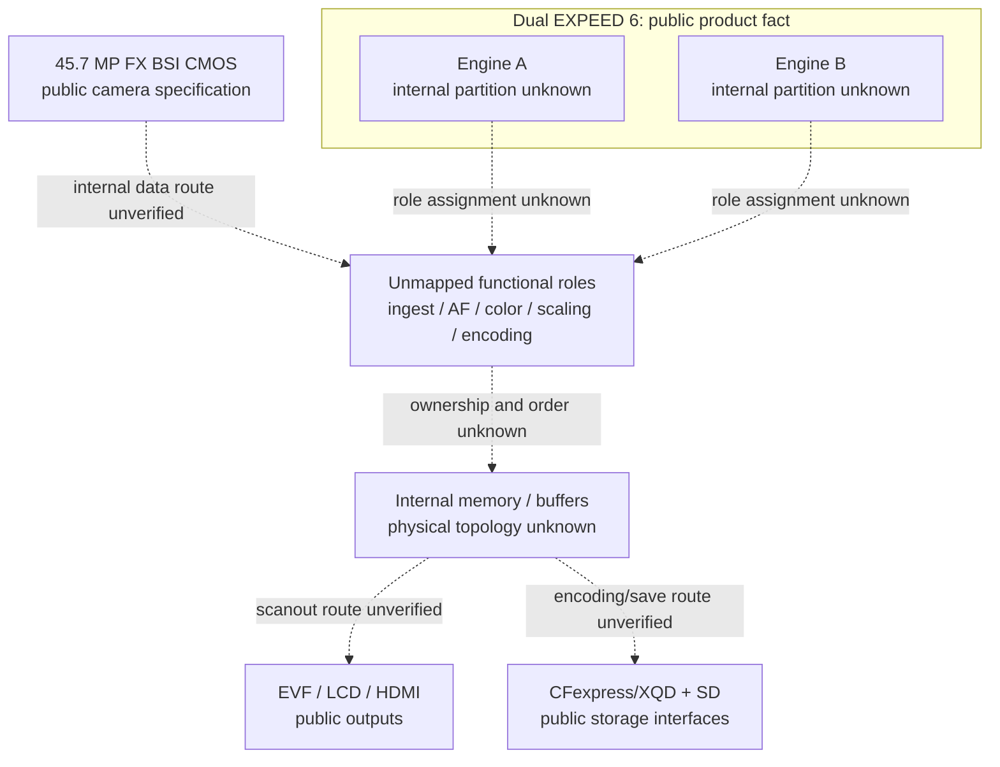
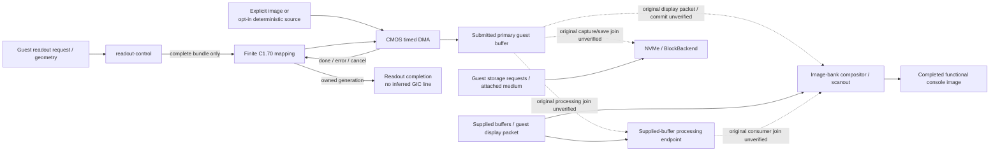

# Z7II EXPEED 6 image-processing architecture

Nikon publicly states that the Z7II uses two EXPEED 6 image-processing
engines. Nikon publishes camera capabilities and external interfaces, but does
not publish an EXPEED 6 RTL block diagram or internal firmware ABI. The diagram
below therefore separates public product facts, QEMU source-backed interfaces,
and functional roles that remain hypotheses until C1.70 runtime evidence binds
them to a producer and a buffer.

## End-to-end image path

Dashed edges describe possible internal relationships, not recovered wiring
or an established processing order. The two public engines are not identified
with the MAS/SLA CPU domains or with particular QEMU devices.

### Evidence tiers

| Block or edge | Status in this project |
|---|---|
| Dual EXPEED 6 engines | Public Nikon fact; internal partition is unknown |
| Z7II sensor resolution and external formats | Public Nikon specification |
| CMOS exposure/readout control | Opt-in C1.70 readout mapping drives timed CMOS primary DMA and generation completion; physical controller/IRQ semantics remain unverified |
| DMA and frame buffers | QEMU transport models exist; original framebuffer producer is not yet observed |
| AF / eye / animal detection | Public camera capability; internal EXPEED block and firmware path unresolved |
| Demosaic, denoise, color, tone, lens correction | Functional roles only; no public Nikon block map |
| JPEG/NEF/movie encoding | External behavior is public; internal engine ownership and codec path unresolved |
| EVF/LCD/HDMI scanout | Output capability is public; original scanout callback/framebuffer not yet observed |
| Card save path | QEMU NVMe/BlockBackend endpoints are testable; original capture/save join remains unverified |

## QEMU evidence boundary

Solid edges are implemented functional contracts; they do not identify silicon
blocks. Strict/default readout remains disconnected. The opt-in mapping writes
only the validated primary destination and does not implement the secondary
plane or recover physical Bayer format/timing. Graphics also has a separate
finite paired LUT executor with actual output and IRQ129; its output is not
presumed to be a framebuffer. See the [current architecture](../architecture.md)
for processor and graphics boundaries.

The remaining runtime acceptance is the original guest's natural producer,
processing/display packet, completion and first scanout frame. Image-bank
composition and console publication already exist as isolated functional
contracts. A synthetic frame or an 8x8 transport fixture does not establish
original GUI startup or a recovered EXPEED block diagram.

## Public references

- [Nikon: Dual EXPEED 6 Q&A](https://nij.nikon.com/support/faq/products/article?articleNo=000059926)
- [Nikon USA: Z7II/Z6II launch release](https://www.nikonusa.com/press-room/z7ii-z6ii)
- [Nikon Z7II technical specifications](https://www.nikonusa.com/p/z-7ii/1653/overview)

These sources establish the external product claims only. They do not identify
the internal EXPEED 6 block diagram, memory protocol, firmware task ownership,
or ASIC implementation.
