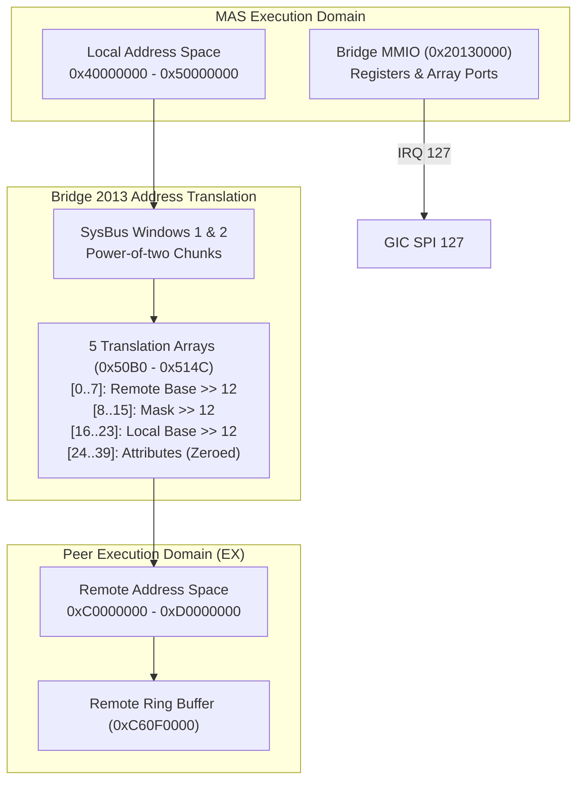

# Inter-Domain Bridge 2013 Protocol

The Bridge 2013 controller at physical address `0x20130000` implements inter-processor address translation, communication routing, and synchronization handshakes between the MAS domain and peer execution engines (such as the EX image processing domain).

## Hardware Architecture

The controller exposes 64 KiB of control MMIO at `0x20130000` and two independent translation windows (`SysBus` memory regions 1 and 2):

### Register Layout

| Offset | Register Name | Access | Width | Description |
|---|---|---|---|---|
| `0x4120` / `0x4124` | `BRIDGE_LANE_CTRL` | R/W | 32-bit | Dual-bank lane control pairs. |
| `0x4908` | `BRIDGE_POLL_STAT` | R | 32-bit | Bank 0 completion polling status (Bit 0). |
| `0x50B0` - `0x514C` | `BRIDGE_MAP_ARRAY` | W | 32-bit | 40 configuration words forming the 5 region translation arrays. |
| `0x829C` | `BRIDGE_EVENT_ACK` | W | 32-bit | Peer event acknowledgment strobe port. |
| `0xC128` | `BRIDGE_LANE_SEL` | R/W | 32-bit | Lane selection register (bits [3:0] and [15:12]). |
| `0xC13C` | `BRIDGE_HANDSHAKE` | W | 32-bit | Configuration handshake port (`0x02` initiates handshake). |
| `0xC5E0` | `BRIDGE_RESET` | W | 32-bit | Reset strobe (cancels lane and control timers, clears pending). |
| `0xC908` | `BRIDGE_PEER_READY` | R | 32-bit | Bank 1 peer readiness register (Bit 2). |
| `0xD020` | `BRIDGE_IRQ_STAT` | R | 32-bit | IRQ pending status: Bit 1 = request done, Bit 5 = handshake done. |
| `0xD024` | `BRIDGE_IRQ_MASK` | R/W | 32-bit | IRQ mask register. |
| `0xD028` | `BRIDGE_IRQ_ACK` | W1C | 32-bit | Write-1-to-Clear interrupt acknowledge port. |

## Address Translation Pipeline

Translation maps transactions from local MAS memory to remote peer memory:
1. **Descriptor Emission**: Firmware formats up to 8 region translation descriptors. For each entry $i \in [0, 7]$:
   - `Array[i] = remote_base >> 12`
   - `Array[8 + i] = ~(chunk_length - 1) >> 12`
   - `Array[16 + i] = local_base >> 12`
   - `Array[24 + i] = 0` (Attributes)
   - `Array[32 + i] = 0` (Attributes)
2. **Translation**: When a transaction enters the translation window, the bridge matches the local address against active descriptors and dispatches downstream accesses into the peer's private `AddressSpace`.

## Synchronization Lifecycle

1. **Lane Activation**: Writing lane selector `0xC128` starts a 10 µs virtual timer. Upon expiration, lane status progresses to state `3`.
2. **Handshake `0xC13C = 2`**: Once lanes are configured, writing `0x02` to `0xC13C` triggers a 10 µs synchronization delay, asserting bit 5 in `BRIDGE_IRQ_STAT` and raising GIC IRQ 127.
3. **Interrupt Handling**: Firmware ISR reads `0xD020`, confirms bit 1 (transfer done) or bit 5 (handshake), and acknowledges via `0xD028`.
