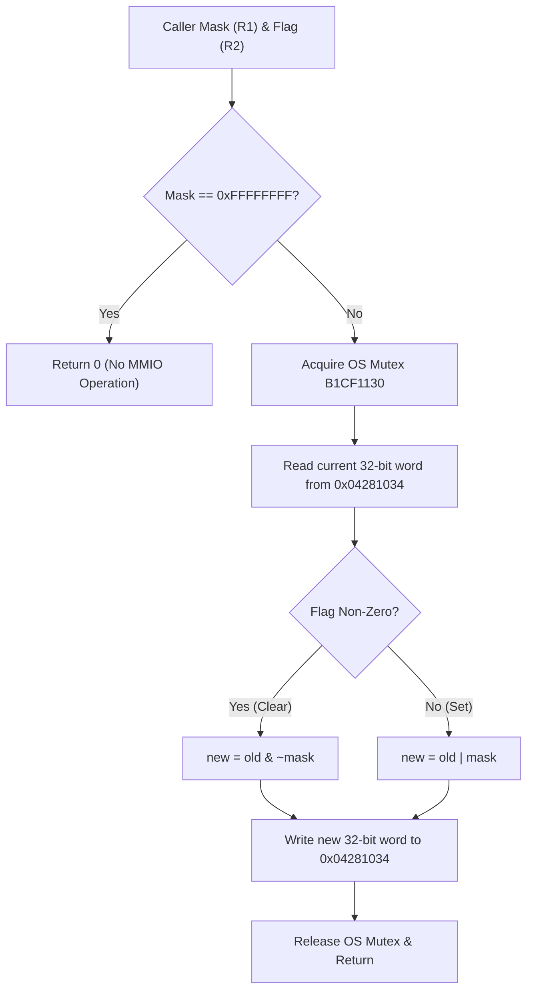

# Word-Mask Configuration Register

The word-mask register at offset `0x034` (`0x04281034`) provides whole-word configuration masking for peripheral sub-blocks.

## Hardware Specification

| Offset | Physical Address | Register Name | Width | Access | Default |
|---|---|---|---|---|---|
| `0x034` | `0x04281034` | `CLK_WORD_MASK` | 32-bit | R/W | `0x00000000` |

### Protocol Rules
- **Access Constraint**: Aligned 32-bit transactions only. Unaligned or sub-word operations return `MEMTX_ERROR`.
- **Atomic Modification**: Firmware encapsulates read-modify-write sequences within an OS mutex (`0xb1cf1130`). When flag is non-zero, the mask is cleared via bit-clear (`BIC`); when flag is zero, the mask is asserted via bitwise OR.
- **Independence**: `CLK_WORD_MASK` is independent of the stop banks (`+0x038..+0x04c`) and bit-control registers (`+0x058..+0x05c`). SET/CLEAR aliases do not affect this register.
- **Reset**: System reset clears the configuration word to `0x00000000`.
