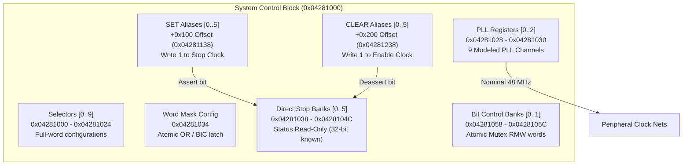

# Clock and Gate Controller Architecture

The Nikon EXPEED System Control and Clock Controller resides at physical base address `0x04281000`. It governs peripheral clock distribution, phase-locked loop (PLL) channels, clock gating stop states, whole-word masking, and mutex-protected bit-control banks across the camera SoC.

## Register Layout

All accesses require strictly aligned 32-bit transactions. Non-32-bit widths or access to undefined holes return `MEMTX_ERROR`.

| Offset | Register Name | Access | Width | Description |
|---|---|---|---|---|
| `0x000` - `0x024` | `CLK_SEL[0..9]` | R/W | 32-bit | Ten selector configuration words controlling subsystem clock routing. |
| `0x028` | `PLL_CTRL0` | R/W | 32-bit | PLL control word 0 (writable mask `0x7ffffffe`, channels 0 to 5). |
| `0x02C` | `PLL_CTRL1` | R/W | 32-bit | PLL control word 1 (writable mask `0xffff0073`, channels 6 and 7). |
| `0x030` | `PLL_CTRL2` | R/W | 32-bit | PLL control word 2 (writable mask `0x3f07ff07`, channel 8). |
| `0x034` | `CLK_WORD_MASK` | R/W | 32-bit | Whole-word configuration mask with atomic OR/BIC operations. |
| `0x038` - `0x04C` | `CLK_STOP[0..5]` | R | 32-bit | Direct readback of the 6 clock stop banks. Read requires all 32 bits known. |
| `0x058` - `0x05C` | `CLK_BIT_CTRL[0..1]` | R/W | 32-bit | Two mutex-protected bit-control registers. |
| `0x138` - `0x14C` | `CLK_STOP_SET[0..5]` | W | 32-bit | Write-1-to-Set stop mask aliases (asserts clock gating / disables clock). |
| `0x238` - `0x24C` | `CLK_STOP_CLR[0..5]` | W | 32-bit | Write-1-to-Clear stop mask aliases (deasserts clock gating / enables clock). |

## Clock Stop Banks & Mask Aliases

The SoC peripheral clock gates are organized into six 32-bit banks (totaling up to 192 controllable clock lines):
- **Direct Stop Readback (`+0x038` to `+0x04C`)**: A read returns the current gating state (bit = `1` means clock stopped; bit = `0` means clock running). To ensure guest safety, reads are rejected until guest initialization has determined all 32 bits of the target bank.
- **SET Aliases (`+0x138` to `+0x14C`)**: Writing a mask `M` sets `stopped[bank] |= M`. This disables (gates) the clock lines corresponding to the asserted bits.
- **CLEAR Aliases (`+0x238` to `+0x24C`)**: Writing a mask `M` clears `stopped[bank] &= ~M`. This un-gates (enables) the corresponding clock lines.
- Writing to direct stop offsets (`+0x038..+0x04C`) or reading from the aliases (`+0x138..+0x24C`) is invalid and raises a bus fault.

## PLL Channel Modeling

The controller exposes 9 discrete PLL channels driven by an independent nominal 48 MHz master virtual clock:
1. Gating bits in `PLL_CTRL0..2` trigger channel enable/disable transitions.
2. A virtual lock interval of 10 microseconds is scheduled upon channel activation.
3. Once locked, downstream clocks update their frequency to 48 MHz (`NOMINAL_HZ`). Disabling immediately halts the clock output (`0 Hz`).
