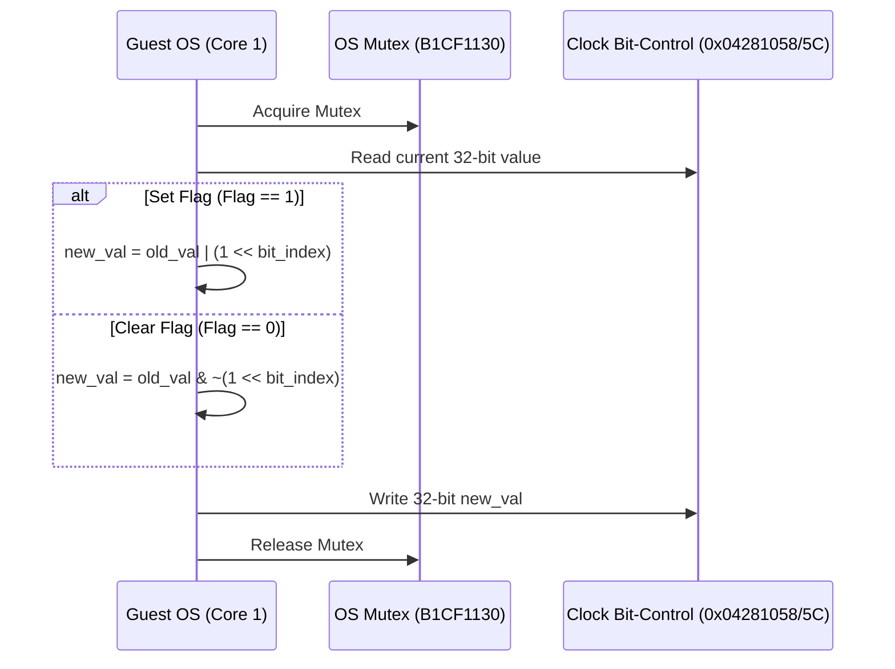

# Two-Bank Bit-Control Registers

The system control controller provides two dedicated 32-bit registers for atomic bitwise modification at physical addresses `0x04281058` (Bank 0) and `0x0428105c` (Bank 1).

## Hardware Specification

| Offset | Physical Address | Register Name | Description |
|---|---|---|---|
| `0x058` | `0x04281058` | `CLK_BIT_CTRL0` | Bit-control bank 0 (selected when encoded input bits [19:16] == 0) |
| `0x05c` | `0x0428105c` | `CLK_BIT_CTRL1` | Bit-control bank 1 (selected when encoded input bits [19:16] != 0) |

### Access Rules
- **Access Width**: Strictly aligned 32-bit read and write. Sub-word accesses or unaligned offsets trigger `MEMTX_ERROR`.
- **State Retention**: Each bank retains its 32-bit state independently. State is preserved across software read-modify-write sequences.
- **Reset Behavior**: Device reset clears both registers to `0x00000000`.
- **Side Effects**: Bit modifications update internal control state without generating spurious interrupts or modifying unrelated clock gating aliases.
