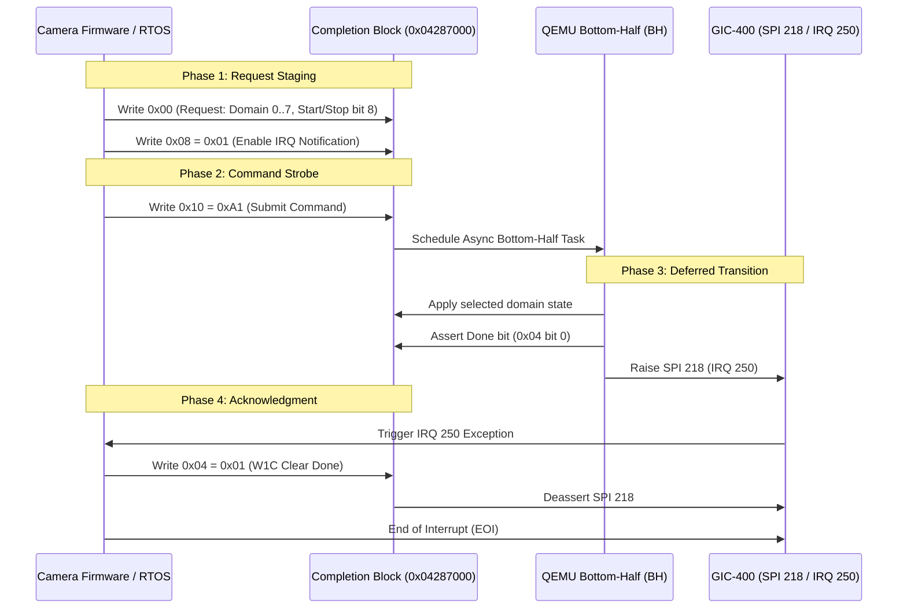

# Deferred Completion Controller

The Deferred Completion Controller at physical address `0x04287000` manages asynchronous domain transitions, power-state requests, and event completions, notifying the CPU via GIC IRQ 250 (SPI 218).

## Register Layout

All accesses require aligned 32-bit operations.

| Offset | Register Name | Width | Access | Description |
|---|---|---|---|---|
| `0x00` | `COMP_REQ` | 32-bit | R/W | Staged request word. Bits [14:12] select domain (0..7); bit 8 indicates start/stop; bits [7:4] select mode. |
| `0x04` | `COMP_STATUS` | 32-bit | R/W1C | Status and acknowledge. Bit 0 indicates completion done. Write 1 to clear. |
| `0x08` | `COMP_IRQ_EN` | 32-bit | R/W | Interrupt notification enable (`0` = polling only, `1` = raise IRQ 250). |
| `0x0C` | `COMP_DOMAIN_STAT` | 32-bit | R | Domain applied state vector. |
| `0x10` | `COMP_CMD` | 32-bit | W | Command submission port. Writing `0xA1` initiates the deferred transition. |

## Protocol & Operational Rules

1. **Submission Prerequisite**: Both `COMP_REQ` (`+0x00`) and `COMP_IRQ_EN` (`+0x08`) must be initialized prior to issuing command `0xA1`.
2. **Asynchronous Execution**: Writing `0xA1` schedules a QEMU bottom-half (`BH`). The bottom half transitions the domain's applied state, sets bit 0 in `COMP_STATUS`, and raises SPI 218 if notification was enabled.
3. **W1C Acknowledgment**: Firmware writes `1` to `+0x04` to clear the done status and lower the interrupt line.
4. **Domain Isolation**: An independent instance of the completion controller is mapped in the SLA domain's private address space at `0x04287000` to prevent cross-domain state corruption.
