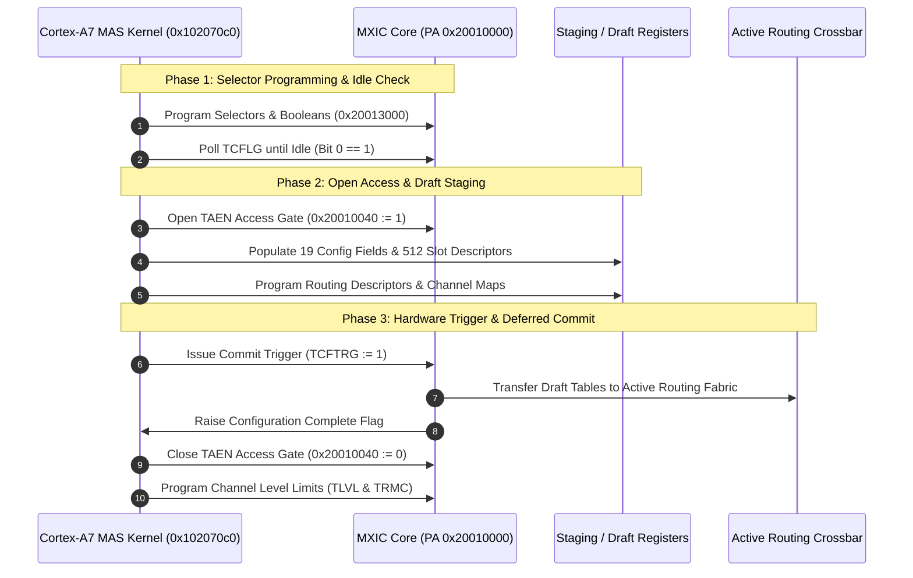

# MXIC interconnect configuration and active read-view protocol

This specification details the register read-view switching protocol (`TRVSW`), draft staging tables, and transaction commit lifecycle for the MXIC memory crossbar configuration engine (`config.c`), mapped at `PA 0x20010000`.

## Architecture and configuration transaction lifecycle

The MXIC crossbar routes memory transactions across multiple CPU domains, DMA engines, and imaging coprocessors. Reconfiguration employs a staged draft commit model:

## Read-view switch register (`TRVSW` at `0x20010044`)

The `TRVSW` register determines which register view is exposed during MMIO read operations:

| Value | Active Read View | Operational Behavior |
|---|---|---|
| `0` | Default Hardware View | MMIO reads expose internal hardware register status and live counter values |
| `1` | Active Staged Readback | MMIO reads return staged configuration values and readback latches |

### Operational rules
1. **No Write Gating**: Setting `TRVSW = 1` selects readback multiplexing; it does not inhibit write transactions. Draft registers, slot descriptors, and routing selectors remain writable.
2. **Draft Isolation**: Changes written to draft tables do not alter active bus arbitration or routing paths until hardware commit trigger `TCFTRG` is asserted.
3. **Completion Acknowledgment**: The commit process is hardware-timed. When complete, `TCFLG` returns to idle (`1`), permitting `TAEN` to close safely.
