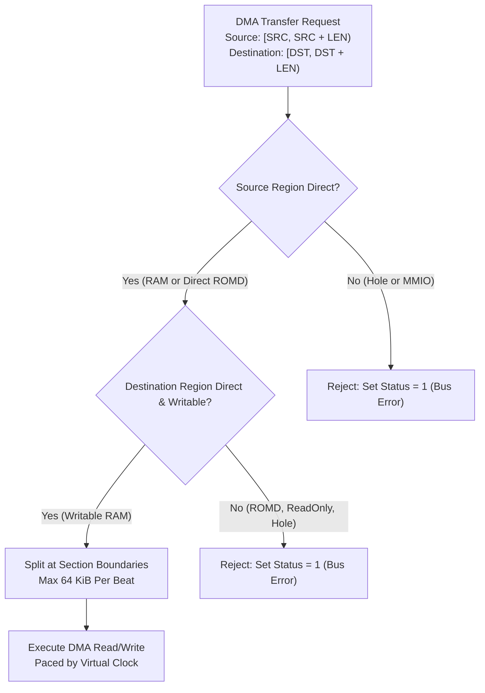

# Memory Domain Validation & Direct ROMD Transfers

The Four-Channel Copy Engine integrates direct address space qualification to ensure safe, high-speed DMA across heterogeneous memory regions.

## Memory Region Classification Rules

1. **Source Regions**:
   - **System RAM**: Direct reads accepted.
   - **ROMD Firmware Sections**: Direct read access accepted. The copy engine bypasses `MemTxAttrs.memory` restrictions, enabling direct DMA copies from read-only flash/ROM representations into execution RAM.
   - **MMIO & Holes**: Strictly rejected; DMA does not generate peripheral side effects.
2. **Destination Regions**:
   - **System RAM**: Writable RAM accepted.
   - **ROMD & Read-Only Aliases**: Strictly rejected; flash images cannot be overwritten via the copy engine.
3. **Section Boundary Splitting**:
   - Transfers crossing multiple contiguous memory regions are automatically partitioned at section boundaries, ensuring accurate memory translation without reading past mapped extents.
