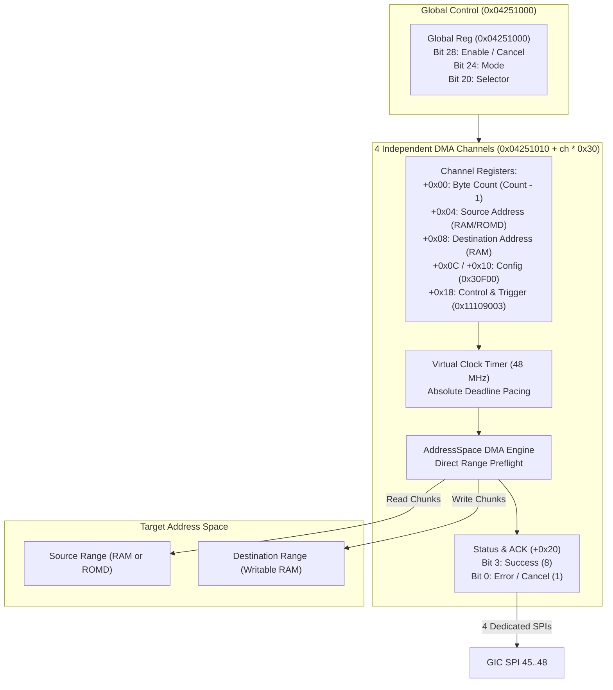

# Four-Channel Memory Copy Engine

The Nikon Four-Channel Memory Copy Engine at `0x04251000` provides high-throughput direct memory access (DMA) transfers across system RAM, ROMD images, and domain-private memory spaces, generating per-channel completion interrupts via GIC SPI 45 through 48.

## Register Layout

All accesses require aligned 32-bit operations.

### Global Control (`0x04251000`)
- **Bit 28**: Master enable / cancel. Writing 0 immediately halts all active channel timers and sets status to cancellation (`status = 1`).
- **Bits 24 & 20**: Global transfer modes and routing configuration.

### Channel Register Window (`0x04251010 + channel * 0x30`)

| Offset | Register Name | Access | Width | Description |
|---|---|---|---|---|
| `+0x00` | `DMA_COUNT` | R/W | 32-bit | Transfer byte count minus one (`len - 1`). Reads return remaining residual bytes. |
| `+0x04` | `DMA_SRC` | R/W | 32-bit | Source physical address (must resolve to direct RAM or ROMD). Advances with transfer. |
| `+0x08` | `DMA_DST` | R/W | 32-bit | Destination physical address (must resolve to writable RAM). Advances with transfer. |
| `+0x0C` | `DMA_SRC_CFG` | R/W | 32-bit | Source stride and transfer configuration (standard: `0x00030F00`). |
| `+0x10` | `DMA_DST_CFG` | R/W | 32-bit | Destination stride and transfer configuration (standard: `0x00030F00`). |
| `+0x14` | `DMA_AUX_CFG` | R/W | 32-bit | Auxiliary configuration register (standard: `0x00000000`). |
| `+0x18` | `DMA_CTRL` | R/W | 32-bit | Channel control & trigger. Writing `0x11109003` initiates mode 1 transfer. |
| `+0x20` | `DMA_STATUS` | R/W0C | 32-bit | Status & ACK: Bit 3 = Success (`0x8`), Bit 0 = Error/Cancel (`0x1`). Clear by writing 0. |

## Transfer Pipeline & Virtual Timing

1. **Preflight Extent Validation**: Before initiating DMA, the engine verifies that the entire source range exists as readable RAM or ROMD, and the destination range exists as writable RAM. Invalid targets trigger error `status = 1` without writing any bytes.
2. **Deterministic Virtual Deadlines**: Transfer duration is paced by a nominal 48 MHz virtual Clock:
   $$\text{deadline} = \text{start\_time} + \text{clock\_ticks\_to\_ns}(\text{bytes}) + 1\,\text{ns}$$
   Callbacks commit in 64 KiB chunks, preventing host scheduling jitter from affecting guest-observed throughput.
3. **Completion & Interruption**: Upon reaching the terminal deadline, the engine sets status `0x8` and raises the channel's dedicated GIC interrupt (SPI 45 for Ch 0, SPI 46 for Ch 1, SPI 47 for Ch 2, SPI 48 for Ch 3).
4. **W0C Acknowledgment**: Firmware clears the status by writing `0` to `+0x20`.
