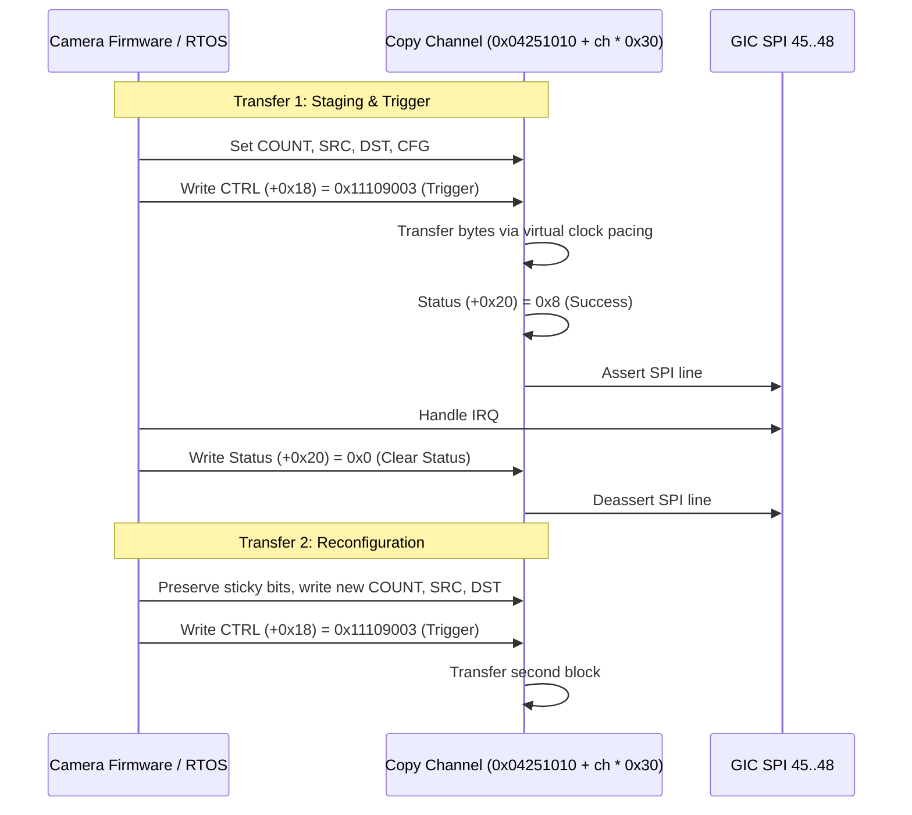

# DMA Channel Reconfiguration & Lifecycle

The Four-Channel Copy Engine supports channel reconfiguration, sticky control preservation, and sequential multi-transfer workflows.

## Channel Reconfiguration Rules

1. **Sticky Control Bit Preservation**:
   - The setup method modifies only bits matching mask `0x00F09110` using ARM Bit Field Insert (`BFI`) instructions.
   - Sticky global mode bits (such as bit 28 and bit 24) are preserved across sequential transfers.
2. **Reconfiguration While Idle**:
   - Reconfiguring channel registers while the channel is idle (`status == 0` or after a completed transfer) is fully supported.
   - Modifying channel configurations while a DMA transfer is actively in flight is strictly prohibited and returns `MEMTX_ERROR`.
3. **Cancellation Semantics**:
   - Clearing low bit 2 while maintaining bit 28 cancels the active channel transfer. Cancellation sets error status `0x1` and stops virtual timer progression without corrupting target RAM.
