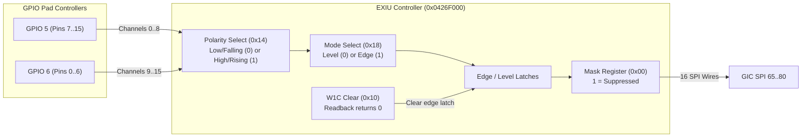

# External Interrupt Unit (EXIU) Architecture

The External Interrupt Unit (EXIU) at `0x0426F000` provides 16 independent hardware interrupt channels for external keypad, button, and peripheral events, routing them directly from GPIO pad controllers to GIC SPI lines 65 through 80.

## Register Layout

All accesses require aligned 32-bit operations. Upper 16 bits of each register are reserved or unused.

| Offset | Register Name | Width | Access | Description |
|---|---|---|---|---|
| `0x00` | `EXIU_MASK` | 16-bit | R/W | Interrupt mask register. Bit `1` suppresses the corresponding GIC SPI line. |
| `0x04` | `EXIU_SRCSEL` | 16-bit | R/W | Source select register. `0` selects external pad input; software triggers reject. |
| `0x08` | `EXIU_REQ` | 16-bit | R | Filtered interrupt status (`latched_pending & ~mask`). |
| `0x0C` | `EXIU_RAW` | 16-bit | R | Raw interrupt status (`latched_pending`). |
| `0x10` | `EXIU_CLEAR` | 16-bit | R/W1C | Interrupt clear register. Write-1-to-Clear edge latches. Reads return `0x0000`. |
| `0x14` | `EXIU_POL` | 16-bit | R/W | Polarity select. `0` = active low / falling edge; `1` = active high / rising edge. |
| `0x18` | `EXIU_MODE` | 16-bit | R/W | Trigger mode. `0` = level-sensitive; `1` = edge-sensitive. |
| `0x1C` | `EXIU_SWREQ` | 16-bit | W | Software trigger port. |

## Channel Routing and GIC Mapping

The camera firmware assigns indices 84..99 in the COPY0 table to EXIU channels 0..15:

| EXIU Channel | Source Pin | GIC SPI Line | GIC Interrupt ID |
|---|---|---|---|
| Channel 0 .. 8 | GPIO Port 5, Pins 7 .. 15 | SPI 65 .. 73 | IRQ 97 .. 105 |
| Channel 9 .. 15 | GPIO Port 6, Pins 0 .. 6 | SPI 74 .. 80 | IRQ 106 .. 112 |

## Interrupt Lifecycle & Clear Semantics

1. **Edge Detection**: A pad transition matching the configured polarity in `EXIU_POL` latches an edge event, even if masked in `EXIU_MASK`.
2. **Level Detection**: If configured for level mode, the request remains asserted as long as the external line remains active. Writing to `EXIU_CLEAR` while the level is still asserted will immediately re-assert the request.
3. **Command Readback**: The clear register (`0x10`) acts as a command strobe. Synchronous reads of `EXIU_CLEAR` return `0x0000` without side effects, supporting firmware read-modify-write clear patterns (`read | (1 << ch) -> write`).
