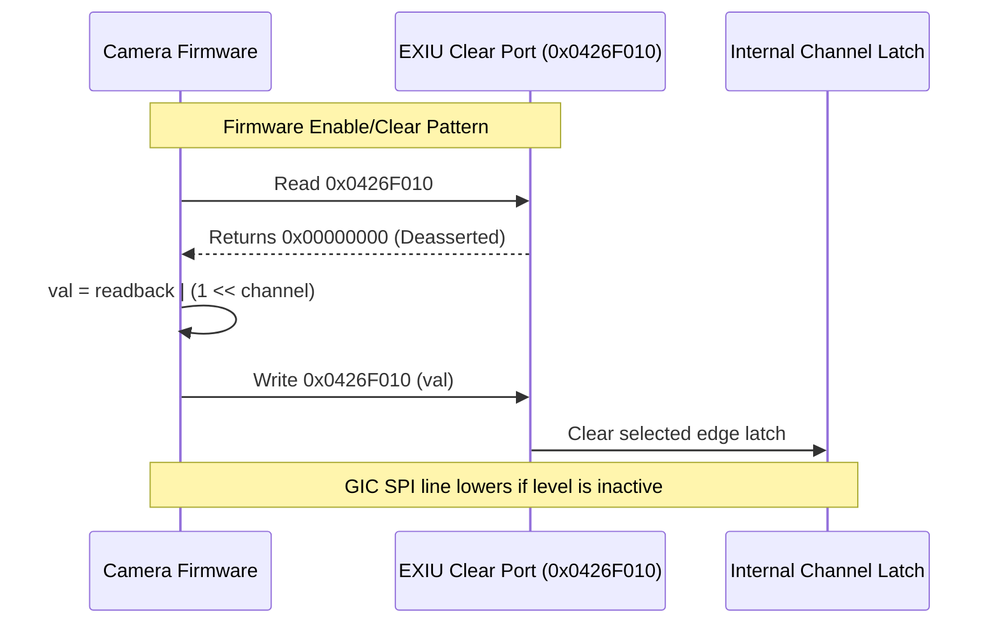

# EXIU Command Port and Readback Semantics

The EXIU clear register at offset `0x10` (`0x0426F010`) functions as an atomic command strobe port with specific readback semantics.

## Protocol Specifications

1. **Synchronous Consumption**: Clear commands take effect immediately upon write transaction execution.
2. **Read Port Behavior**: Reads of the command port return deasserted zero (`0x0000`). This matches the Socionext Milbeaut and Linux sni-exiu driver implementations, ensuring that read-modify-write patterns execute predictably without re-clearing unrelated channels.
3. **Level Persistence**: For channels configured in level-sensitive mode (`EXIU_MODE = 0`), if the underlying GPIO pin remains asserted, the interrupt request line re-asserts immediately following the write transaction.
