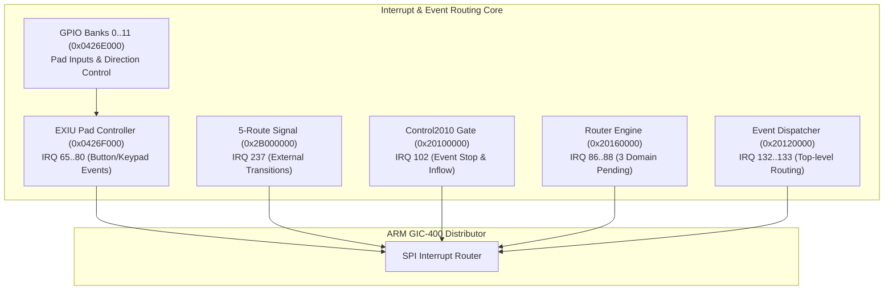

# Startup IRQ and Event Device Dependencies

This specification catalogs the eight interconnected event, routing, and interrupt controller devices on the Nikon EXPEED SoC, detailing their hardware addresses, implemented register operations, and interrupt mappings.

## Device Functional Matrix

| Device Subsystem | Base Address | Mapped Interrupts | Implemented Operational Families |
|---|---|---|---|
| **Control2010 Gate** | `0x20100000` | GIC SPI 102 | External event admission gate (`0x04`), 20 µs async stop drain with confirmation (`0x18.bit0`), 3 banked mask/raw/W1C domains, runtime RMW words (`0x30`, `0x34`). |
| **Router Engine** | `0x20160000` | GIC SPI 86..88 | 2 selector groups, 6 lane configuration fields, whole-word OR/BIC masking, 3 raw/W1C domains, 11 software callback slots. |
| **Event Dispatcher** | `0x20120000` | GIC SPI 132..133 | Sparse byte configuration, 9 child masks, 4 child input banks, raw/W1C top-level dispatch. |
| **5-Route Signal** | `0x2B000000` | GIC SPI 237 | 5 external level inputs, 1 MHz debounce prescaling, rising/falling edge latches, OR_IRQ aggregation, `0x28000000` opaque configuration latch. |
| **EXIU** | `0x0426F000` | GIC SPI 65..80 | 16 independent pad channels, GPIO 5/6 routing, polarity/mode selection, active-level persistence, self-clearing command readback. |
| **GPIO Controller** | `0x0426E000` | Direct to EXIU | 12 ports $\times$ 16 pins, PDR/DDR/EPCR/PUD banks, atomic bitmask writes, physical pad level outputs. |
| **Status Engine** | `0x20110000` | GIC SPI 229 | Packet setters `0x08`/`0x0C`, full-word configuration `0x10`/`0x14`, retained status words. |

## Startup Ordering and Event Chains

1. **Gate Stop Handshake**: Firmware writes `0` to `0x20100004` $\to$ internal timer finishes drain and asserts bit 0 in pending `0x18` $\to$ raises GIC SPI 102 $\to$ ISR at `0x103BCE38` calls callback with `R1.bit0` $\to$ callback sets RTOS event flag `F0.bit2` $\to$ unblocks waiting coordinator task.
2. **DMA Interconnect**: Audio, HDMAC, 4-Channel Copy, and Fill controllers assert independent dedicated interrupts (Copy: SPI 45..48, Fill: SPI 103..104, HDMAC: SPI 142..157, Audio: SPI 167..168).
