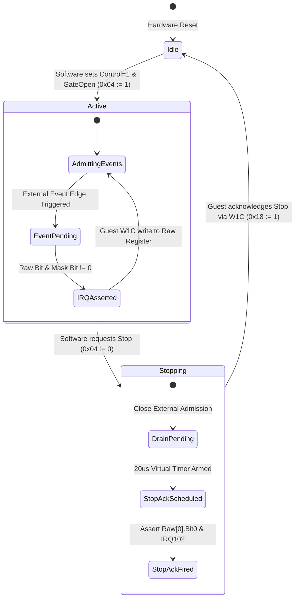

# Gate control and event router protocol (control2010)

This specification defines the hardware contract, register mapping, and stop lifecycle state machine for the Nikon multi-domain event gate controller (`gate.c`), mapped at `PA 0x20100000` and connected to GIC IRQ 102.

## Hardware architecture and stop lifecycle

The gate controller arbitrates external event lines, applies multi-word mask filters, and coordinates the hardware stop/drain handshake required during subsystem shutdown.

## Register map

The device occupies aperture `[0x20100000, 0x20102928)`. Accesses must be 32-bit aligned; accesses to unmapped holes or unaligned offsets return `MEMTX_ERROR`.

| Offset | Register Name | Access | Reset | Functional Description |
|---|---|---|---|---|
| `0x00` | `CTRL` | RW | `0x00000000` | Master controller enable and operational mode |
| `0x04` | `GATE` | RW | `0x00000000` | External event admission gate: bit 0 close, bit 1 open |
| `0x08` | `GLOBAL_RESET` | RW | `0x00000000` | Global deassert and controller reset release |
| `0x0c` | `MASK0` | RW | `0x00000000` | Domain 0 interrupt enable mask (32 bits) |
| `0x10` | `MASK1` | RW | `0x00000000` | Domain 1 interrupt enable mask (32 bits) |
| `0x14` | `MASK2` | RW | `0x00000000` | Domain 2 interrupt enable mask (32 bits) |
| `0x18` | `RAW0` | R/W1C | `0x00000000` | Domain 0 raw pending status / Write-1-to-Clear |
| `0x1c` | `RAW1` | R/W1C | `0x00000000` | Domain 1 raw pending status / Write-1-to-Clear |
| `0x20` | `RAW2` | R/W1C | `0x00000000` | Domain 2 raw pending status / Write-1-to-Clear |
| `0x2000..0x2118` | `INPUT_GRP` | RW | `0x00000000` | Input stage configuration and parameter channels |
| `0x2200..0x23fc` | `MAP_TABLE` | RW | `0x00000000` | Two 64-word event routing and mapping tables |
| `0x2600..0x2690` | `STAGE_PARAM` | RW | `0x00000000` | Staging parameters and masked timing registers |
| `0x2820..0x2924` | `CHANNEL_CFG` | RW | `0x00000000` | Configuration words for downstream hardware consumers |

## Interrupt generation law

Interrupt request line **IRQ 102** is the logical OR of all three masked status domains:

$$\text{IRQ}_{102} = \bigvee_{i=0}^{2} (\text{RAW}_i \land \text{MASK}_i) \neq 0$$

- **W1C Clearance**: Writing a bit `1` to `RAW_i` clears that specific pending bit. Writing `0` leaves pending state unchanged.
- **Reading**: Reads of `RAW_i` return the unfiltered current status without side effects.

## Stop handshake lifecycle

1. **Initiation**: Guest software executes RMW writing `0x04 := 0` to close the external event gate.
2. **Admission Gating**: External event transitions are immediately rejected and cannot assert new pending bits.
3. **Internal Stop Acknowledgment**: A virtual timer schedules completion after a nominal 20 microseconds, setting `RAW0[0]` (bit 0).
4. **Service Callback Execution**: Mask `MASK0[0]` admits IRQ 102 to the GIC; the guest ISR at `0x103bce38` handles the stop confirmation, allowing synchronization waits to complete cleanly.
