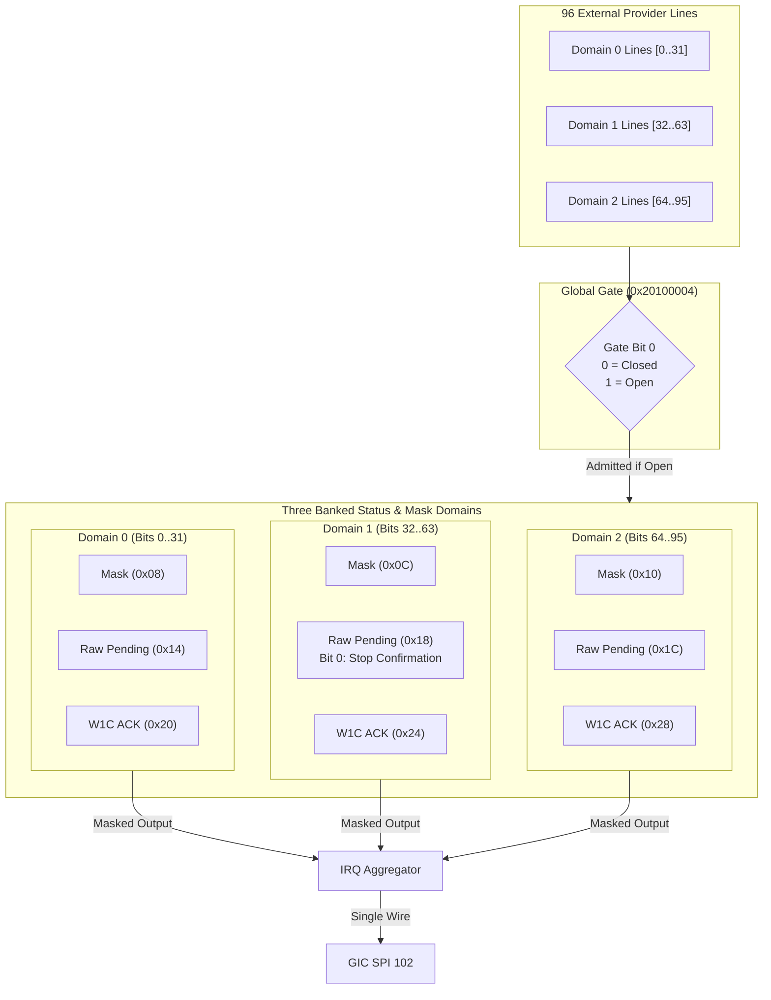

# Control2010 Event Gate and Inflow Routing

The Control2010 Gate controller at physical address `0x20100000` provides an inflow admission barrier and interrupt routing across three 32-bit pending event domains (96 channels total).

## Global Admission Gate (`0x20100004`)

- **Bit 0**: Master event inflow gate.
  - `0`: Gate closed. New external rising edges are dropped. Existing pending state and active mask settings are preserved.
  - `1`: Gate open. External input edges are admitted into the three raw pending domains.
- **Provider Tracking**: The controller monitors all 96 external provider line levels continuously, even when the gate is closed. Lines held active during closure do not synthesize spurious edges upon reopening.

## Banked Domain Register Map

All registers require strictly aligned 32-bit accesses.

| Domain | Mask Register | Raw Pending Register | W1C Acknowledge Register |
|---|---|---|---|
| **Domain 0** (Channels 0..31) | `0x08` | `0x14` | `0x20` |
| **Domain 1** (Channels 32..63) | `0x0C` | `0x18` (Bit 0 = Stop Done) | `0x24` |
| **Domain 2** (Channels 64..95) | `0x10` | `0x1C` | `0x28` |

### Acknowledgment Protocol
- Firmware ISR reads the raw status register (`0x14`, `0x18`, or `0x1C`) and writes back `1` to the corresponding bit in the W1C ACK register (`0x20`, `0x24`, or `0x28`) to clear the pending flag.
- The GIC SPI 102 line remains asserted as long as any unmasked pending bit in any of the three domains remains active.
