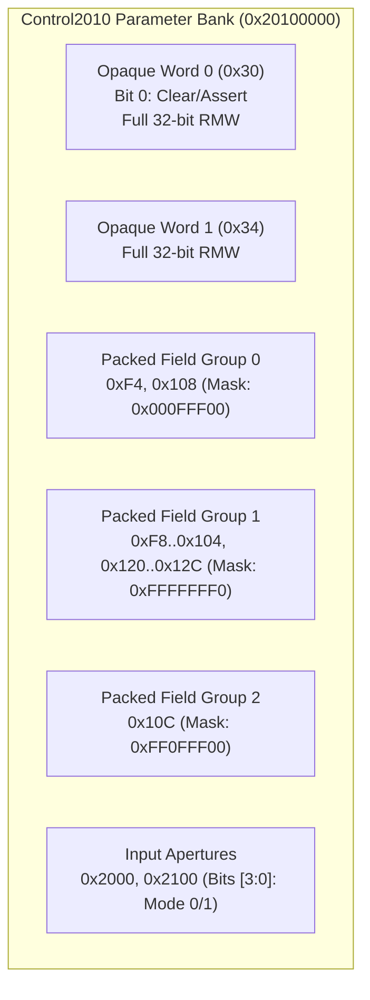

# Control2010 Runtime Packed Configuration

The Control2010 controller maintains a bank of sparse 32-bit registers for packed subsystem parameters, filter coefficients, and input aperture routing.

## Register Layout

All accesses require aligned 32-bit operations.

| Offset | Register Name | Width | Legal Mask | Description |
|---|---|---|---|---|
| `0x030` | `GATE_CFG_WORD0` | 32-bit | `0xFFFFFFFF` | Opaque 32-bit configuration word. Firmware performs bitwise OR/BIC operations. |
| `0x034` | `GATE_CFG_WORD1` | 32-bit | `0xFFFFFFFF` | Opaque 32-bit configuration word. |
| `0x0F4`, `0x108` | `GATE_PACKED_A` | 32-bit | `0x000FFF00` | Subsystem filter coefficients. |
| `0x0F8` - `0x104` | `GATE_PACKED_B` | 32-bit | `0xFFFFFFF0` | Channel parameter arrays. |
| `0x10C` | `GATE_PACKED_C` | 32-bit | `0xFF0FFF00` | Overlapping configuration word. |
| `0x120` - `0x12C` | `GATE_PACKED_D` | 32-bit | `0xFFFFFFF0` | Channel parameter arrays. |
| `0x2000`, `0x2100` | `GATE_IN_APERTURE`| 32-bit | `0xFFFFFFF1` | Input selector ports (bits [3:0] support mode values `0` and `1`). |

### Protocol Rules
- **State Preservation**: Writing to any packed register preserves unrelated fields outside the legal mask.
- **Access Restrictions**: Offsets outside the specified aperture or non-32-bit accesses trigger `MEMTX_ERROR`.
- **Reset**: Device reset initializes all configuration and packed parameter registers to `0x00000000`.
