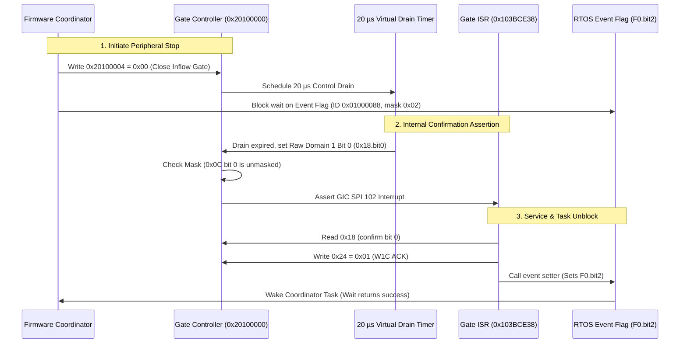

# Control2010 Stop Request and Event Confirmation

The Control2010 stop lifecycle allows the camera firmware to gracefully halt peripheral event inflows and synchronize background processing via an asynchronous internal confirmation interrupt.

## Hardware Stop Lifecycle

1. **Stop Initiation**: Writing `0` to `0x20100004` closes the external event inflow gate and initiates an internal 20 µs virtual drain timer.
2. **Coalescing**: If firmware writes `0` again while a drain is actively pending, the request coalesces without resetting the timer.
3. **Confirmation Latch**: Upon drain expiration, the controller latches bit 0 in raw domain 1 (`0x20100018`). Unlike external events, this internal confirmation is **not** blocked by the gate closure, ensuring that the firmware receives the completion event.
4. **Reopening**: Writing `1` to `0x20100004` while a drain is pending cancels the unfinished drain timer while preserving any already-latched confirmation flags.
