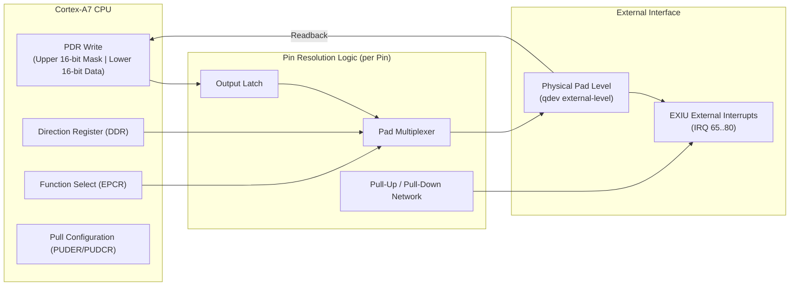

# Twelve-port masked GPIO and pad multiplexer protocol

This specification details the register architecture, upper-halfword write masking, and electrical pad simulation model for the 12-port GPIO controller (`gpio.c`), mapped at `PA 0x04282000`.

## Architectural block diagram

The controller provides 12 ports (0 through 11), each controlling 16 physical pins. Each pin can be independently configured for general-purpose output, input with pull-up/down resistors, or alternate hardware peripheral routing feeding the External Interrupt Unit (EXIU).



## Register bank memory mapping

The controller is partitioned into five distinct register banks with stride offsets:

| Bank Name | Base Address Offset | Stride | Access | Description |
|---|---|---|---|---|
| **`PDR`** | `0x04282000 + (port × 4)` | 4 bytes | RW | Port Data Register (Masked 32-bit atomic write) |
| **`DDR`** | `0x04282100 + (port × 4)` | 4 bytes | RW | Data Direction Register (0 = Input, 1 = Output) |
| **`EPCR`** | `0x04282200 + (port × 4)` | 4 bytes | RW | Extended Port Control (0 = GPIO, 1 = Alternate Function) |
| **`PUDER`** | `0x04282300 + (port × 4)` | 4 bytes | RW | Pull-Up/Down Enable (0 = Disabled, 1 = Enabled) |
| **`PUDCR`** | `0x04282400 + (port × 4)` | 4 bytes | RW | Pull-Up/Down Polarity (0 = Pull-Down, 1 = Pull-Up) |

## Upper-halfword masked write protocol

To support atomic bit modification without read-modify-write race conditions, writes to the `PDR` register use an upper-halfword bitmask:

$$\text{Bit } i \text{ updated if and only if: } \text{Value}[i + 16] = 1$$
$$\text{NewLatch}[i] = (\text{Value}[i + 16] \land \text{Value}[i]) \lor (\neg \text{Value}[i + 16] \land \text{OldLatch}[i])$$

Software writes:
```c
/* Atomically set pin 3 of port 6 without affecting other pins */
writel(0x04282018, (1 << (3 + 16)) | (1 << 3));
```

## Pad resolution and readback law

Reads from `PDR` return the active resolved electrical levels on the physical pads:

1. **Output Mode (`DDR = 1`, `EPCR = 0`)**: The pin exposes the internal output latch value.
2. **Driven Input Mode**: If an external provider publishes an explicit level via the `external-level` interface, that driven level takes precedence over internal pulls.
3. **Floating Input Mode**: When no external provider is attached, the level is determined by the pull configuration:
   - If `PUDER = 1` and `PUDCR = 1`: Resolved as high (`1`).
   - If `PUDER = 1` and `PUDCR = 0`: Resolved as low (`0`).
   - If `PUDER = 0`: Defaults to stable virtual low (`0`).
4. **EXIU Interrupt Forwarding**: Resolved pad levels are propagated directly to the External Interrupt Unit (`exiu.c`), triggering GIC interrupts 65..80 based on configured polarity and edge detection rules.
