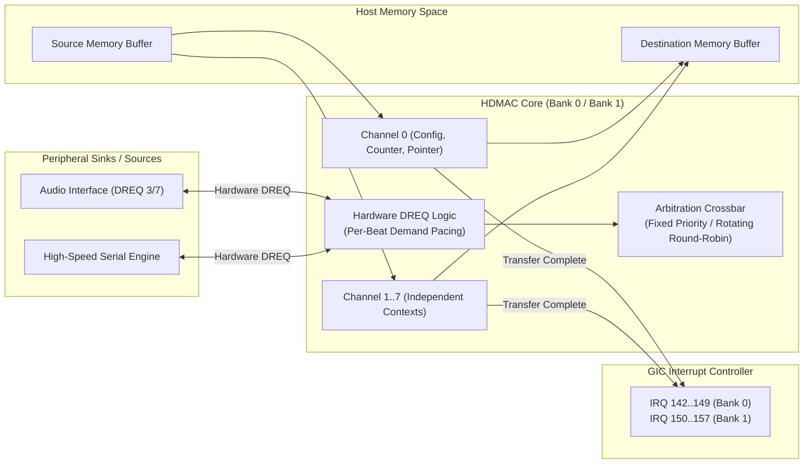

# High-definition DMA controller protocol (HDMAC)

This specification details the channel registers, transfer descriptors, hardware demand pacing (`DREQ`), and arbitration policies for the dual-bank HDMAC controller (`hdmac.c`).

## Architectural block diagram

The HDMAC provides 16 independent DMA channels divided across two banks, interfacing high-speed system memory with peripheral FIFOs (Audio, Serial, Imaging).

## Memory mapping and interrupt routing

The HDMAC provisions two identical 8-channel banks with separate physical apertures:

| Bank | Physical Base Address | Channel Extents | GIC Interrupt Range | Typical Hardware Endpoints |
|---|---|---|---|---|
| **Bank 0** | `0x2c000000` | Channels 0 .. 7 | IRQ 142 .. 149 | Memory copy, system staging, image buffer routing |
| **Bank 1** | `0x2c010000` | Channels 0 .. 7 | IRQ 150 .. 157 | Audio output streams (DREQ 3/7), serial FIFOs |

## Channel register structure

Each channel is addressed via a 32-byte stride offset (`+ (ch × 0x20)`):

| Offset | Register | Access | Reset Value | Functional Description |
|---|---|---|---|---|
| `+0x00` | `CSR` | RW | `0x00000000` | Channel Status & Control (Enable, Pause, Soft Reset, Busy) |
| `+0x04` | `SAR` | RW | `0x00000000` | Source Address Register (Physical 32-bit address) |
| `+0x08` | `DAR` | RW | `0x00000000` | Destination Address Register (Physical 32-bit address) |
| `+0x0c` | `TCR` | RW | `0x00000000` | Transfer Count Register (Remaining beats / transfer size) |
| `+0x10` | `CFG` | RW | `0x00000000` | Transfer Configuration (Burst width, increment mode, DREQ line) |
| `+0x14` | `ARB` | RW | `0x00000000` | Arbitration Priority (Fixed priority vs round-robin slot) |

## Hardware demand pacing (`DREQ`)

For peripheral transfers, transactions execute beat-by-beat governed by hardware handshaking:
1. **Flow Control Gate**: The DMA engine pauses transfer when the peripheral sink drops its `DREQ` request line (e.g., Audio FIFO full).
2. **Backpressure Propagation**: A held channel cannot consume host memory until every peripheral hold is released.
3. **Completion Signaling**: When `TCR` decrements to zero, the channel raises its dedicated GIC interrupt (e.g. IRQ 150 for Bank 1 Channel 0).

## Error and boundary rules
- Accesses targeting undefined channel offsets or unmapped bank addresses return `MEMTX_ERROR`.
- Soft reset clears channel configurations and aborts pending burst transfers without corrupting adjacent channel streams.
