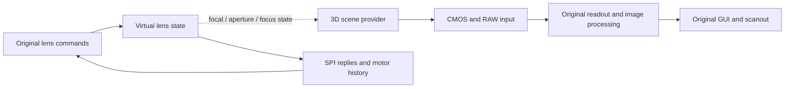

# Virtual lens and scene input

The virtual camera needs both a lens control endpoint and an image source.
The lens exchanges identity, optical parameters, configuration, calibration,
operation status and motor history with the original firmware. Scene pixels
enter the CMOS/readout path. A lens notification is not a rendered frame or GUI
readiness, and replacing a warning cannot establish either path.

`hw/nikon/devices/lens.c` implements an explicit, finite normal-family virtual
50 mm F2.8 lens with fixed focal length and iris. Its identity `7ffe` is a
virtual input, not a recovered
physical product identifier. This profile does not advertise optional lens
families or implement autofocus movement, variable zoom, physical optics or a
3D application bridge. Unsupported packets fail at the endpoint boundary.

## Source and board connections

All firmware addresses below are **MAS C1.70 VA** unless marked PA.

| Source fact | Interpretation and implementation boundary |
|---|---|
| `10384440 → 10384274 → 102f0de8` | Shared-message descriptor13 carries `03050011`, then LensService publishes `03050001`. Payload bytes2/7 update the original lens command state. This is separate from AppControl `05020101`. |
| Adapter `10206f60..10207080` | The provider at `b18a7c80` resolves to the board adapter at `b18a7d00`; its request endpoint uses the existing message serializer. No guest cache or callback is replaced. |
| `10382f02 → 10368b0a(3)` | The observed serial map selects CSIO3, whose low object identifies **PA `2c0a0300`**. The command endpoint attaches to that controller's upstream SSI bus. |
| GPIO resource93 | The observed object selects port6 bit0, physical input index96. `1038305a` consumes its falling-edge phases. The device publishes a phase edge after processing the actual header or complete payload. |
| `10383388 → 10243468` | The separate logical2/CSIO2 stream uses a null TX pointer and a real 21000-halfword receive ring. External words enter the actual slave FIFO and existing DMA path. |

Example explicit attachment to the diagnostic board:

```sh
-machine z7ii-mas-diagnostic,virtual-lens=on
```

An absent endpoint retains the existing disconnected SPI behavior. This input
does not assign an unknown EX GPIO as lens detection or change shutter GPIO169.
The normal LensService notification must still come from its original producer.

## Complete ordinary initialization group

`1038301c` receives a 72-byte **software descriptor**, not a wire packet.
`10382a64` produces an 8-byte header: marker55, sequence, request mode, command,
subcommand, LE16 `(payload_bytes-2)/2`, and a negative-byte-sum checksum.
Payloads likewise contain marker55 and a final checksum; their full byte sum
must be zero modulo256. The native SSI endpoint exchanges 16-bit words.

| Wire command | Complete TX/RX length | Finite virtual processing |
|---|---:|---|
| `1f:00` |4| Conditional pre-identification probe with header modeff; validate probe1/2 and declare the ordinary family |
| `10:00` |28| Virtual identity and bounded ordinary-family capabilities |
| `11:00` |74| Fixed parameter page with optional features unadvertised |
| `12:00` |66| Coherent50 mm/F2.8 focal endpoints and ordinary CPU-lens code |
| `13:00` |14| Validate/store the body configuration and commit it after modeled processing latency |
| `24:00` |7426| Full main calibration and neutral lens-specific correction sections |
| `24:10` |3468| Full secondary coefficient page |
| `15:00` |6| Status derived from the actual pending/configured state |
| `21:00` |6| Store the actual transmitted synchronization anchor |
| `20:00` |258| Current operation and optical status page |
| `20:01` |24| Ordinary secondary state page |
| `27:00` |6| Virtual query of the stored anchor; physical meaning remains unresolved |
| `16:00` |4| Validate/apply stream enable or disable |
| `a0:00..07` |24| Validate the complete zero-travel aperture request and zero tail |
| `a1:00` |10| Validate zero aperture travel and zero additional parameters |
| `a3:00..01` |4| Validate zero-travel aperture requests |
| `50:00` |4| Validate and process the source-selected mode request independently of configuration |
| `51:00` |4| Report actual mode processing busy/done state |

`10311c84` selects the pre-identification path through `10311442` when its
connection provider has not already admitted the lens. `1037bbfc` builds
`1f:00` with modeff and probe byte 1/2. Reply byte 1 bit 0 selects the ordinary
or alternate family; the virtual endpoint declares ordinary 0, with reply
byte 2 bit 0 set for its supported negotiation endpoint. `1034da8a` updates
the original strategy object and `1037c396` selects the subsequent header
mode. This is a device capability choice, not an unconditional command ACK.
The transmitted probe's byte2 must be zero in this finite profile. That is an
explicit input boundary, not a proven silicon-reserved field.

The model supports this group together rather than admitting one observed
address or individual reply at a time. It does not acknowledge nonzero aperture
travel, alternate-family commands or advertised capabilities without
their processing models.

`10311d02` and its completion handlers establish this initialization order.
The original status consumers remain responsible for progression. In particular,
`15:00` byte1 reports pending operation work, byte2 distinguishes unconfigured
state, and `20:00` bytes169/203 reflect the same configuration and pending work.
Configuration receipt does not immediately publish completed status.

The optical operating state is independent of that configuration handshake.
The original getter VA `1037a8c6`, selected for property12404 by `10345810`,
reads `20:00[216] & 3`: wire0/1 become logical1, wire2 becomes2 and wire3
becomes3. VA `10349e42` compares this state to3 for the ordinary lens family
and publishes `40000500`. VA `10357ee8` copies that property into admission
array element5, which `1033f312` requires for capture. The separate
`1035e7f0 → 10344fea → 10330fb0` path rejects ordinary lens families1/3
when the same property is false, recording exclusion reason1. These are
original capture/live-view dependencies, not host-selected GUI flags.

The virtual fixed optics have no retracting barrel. Their operating encoding
is therefore3 throughout reset, configuration and idle operation; this is a
declared finite mechanical input. Configuration busy still comes from actual
`13:00` processing and remains visible through `15:00`, `169` and `203`.
The old allzero reserved-field initialization incorrectly supplied wire0 at216,
which the original getter interpreted as logical1 and hence unavailable. The
native operating-state fixture checks independent optical availability and
configuration pending/commit/reset states through complete checksum-valid
wire replies. This does not implement autofocus or nonzero aperture travel.

## Mode request and completion query

This lens protocol's mode selector is not the body's photo/movie selection.
Its physical names are unresolved. The C1.70 software command table at VA
`119d8280/119d8298` selects wire `50/51`, each with four-byte TX/RX payloads.
VA `103130aa → 1030e65a(23) → 1037bd1a → 10377b0c` constructs byte1 as
`((4*arg0)&7)|(arg1&3)`. The inspected producer fixes arg0=0 and maps cached
values to arg1 in the complete set0/1/2. Byte2 is zero in this finite input
family; other selectors or nonzero byte2 reject without a completion edge.

The model records the requested selector after the whole valid packet, processes
it for a declared2 ms, then commits the selector and increments `mode-generation`.
There is no motor travel in this stationary virtual profile. A second request
during active processing rejects. The processing latency is a functional input,
not a physical lens measurement. Runtime diagnostics show both requested and
committed selectors; neither assigns an unsupported physical meaning.

VA `1031306a/1031305c` query51 and then the ordinary status page. VA `10312e64`
reads properties8204/8203/8205 from byte1 bits7/6/0. Busy7=1 with fault6=0
waits; other nonzero busy/fault combinations take the original error path.
Both clear permit completion. Bit0 selects a subsequent branch; zero is an
accepted normal branch, not the mode selector echoed back. The finite model
sets bit7 only while its actual mode timer is pending, leaves fault6 clear
and selects the explicit normal bit0=0 branch.

These commands do not clear configuration, stop history or modify the fixed
optical operating state. In the inspected sequence, the original state20
already calls `16:00` to stop streaming before state21 sends50. Configuration
and history therefore retain their separate contracts. Reset/unrealize cancel
mode processing even while the object remains referenced. Native fixtures
cover all three selectors, header-time busy snapshots, completion, independent
configuration/stream state, reserved fields and timer cancellation.

`13:00` preserves the 12 configuration bytes produced by the original packed
bitfields and two 32-bit parameters. This is a virtual configuration commit,
not a claim of mechanical movement. The explicit processing latency is 2 ms.
Header/payload processing produces a notify transition after 1 ms.
These latencies are functional input choices, not measured lens timing.
The same latency applies to every supported packet. The earlier 10-microsecond
profile intermittently retained four header RX words at the GPIO-driven
cancellation. The source-joined explanation is that the phase interrupt can
overtake the original RX handler in MTTCG; this ordering is an inference. The 1 ms phase
models finite controller processing below the source's 5 ms header wait; it
never inspects guest event state or waits for a requested callback. A native
deadline fixture checks both the pre-deadline high level and the subsequent
processing edge. This does not establish physical CPU or lens performance.

The original pre-transfer hook `103832dc` rewrites the `21:00` timestamp and
checksum before transmission. The endpoint stores those actual MOSI bytes;
it does not interpret the constructor's `ffffffff` placeholder as a movement.

## Optical fields and calibration

`1034afbe` joins the static lens fields to the EXIF lens specification.
The integer/fraction pairs at `12:00` offsets 7/5 and11/9 use a fraction
denominator 65535. Both integers are 50 and fractions zero for this fixed lens.
Offsets1/3 describe aperture at the two focal endpoints. Their APEX encoding
is `(LE16-384)/192`; both are 960 for Av3/F2.8. The second value is **not** a
closed-iris limit. The dynamic biased APEX fields at `20:00` offsets
1/9/15/162/164 and `20:01` offsets 1/3 also report 960. The relative fields at
`20:00` offsets197/199/201/204 report zero. Their exact consumers establish
these encodings; not every coordinate's physical name has been recovered.

`10395052 → 1034ca9e` selects policies labeled `ApertureFailureValue`,
`LvApexCalc` and `LvFirstAeCalc`. Command37 then reaches `10310f64`, rescales
the aperture target to denominator 192 and dispatches A0/A1/A3 as alternative
control encodings. These are ordinary aperture operations even with optional
capabilities zero. Offset 199 supplies the positive travel clamp; zero forces
zero closure travel for the fixed virtual iris. The finite model accepts only
complete zero-target, zero-parameter requests after configuration. An observed
original A0 buffer contains the full zero tail and valid checksum. Unknown
nonzero A0 tail or A1 parameters remain explicit errors.

Zero travel requires no actuator motion, changes no aperture coordinate and
leaves action busy bits4/3 at `20:00[203]` clear. This is distinct from a
nonzero motion acknowledged without processing. The original firmware still
receives and validates the complete response and polls its own status path.

The long calibration packets are complete initialized device replies. They
contain finite coefficients, not shortened acknowledgements or copied factory
tables. The following source paths qualify their chosen virtual contents:

| Section | Source-backed consequence of the chosen input |
|---|---|
| Main coefficient header0 | `103665c4 → 1036658c` selects the firmware's own Q10 unity gain curves and clears the lens-specific derived coefficients. Other user image settings remain firmware policy. |
|179-byte response block | `102cb62a` tests two81-byte zero spans. `102cb1e4` then selects its explicit no-apply path and Q15 unity factors. This is a sentinel, not a zero active matrix. |
|216-byte response block, representation1 | Three blocks encode higher-order radial polynomial coefficients. `1040e1d6` computes `r' = r × (1+d)`; zero coefficients give `d=0` and `r'=r`. The normal fit uses15 distinct nonzero source samples and a nonzero denominator. No identity-matrix guess is involved. |
| Secondary coefficient page | The page retains its full3456-byte finite coefficient storage and zero lens-specific polynomials. Header0 is not described as a proven disable flag. Original metadata/default/offset selection remains in the firmware. |

The secondary zero polynomial has a numerical source join: VA `102f8a72`
evaluates zero coefficients to zero; `102f8722/102f8494` select equal metadata
endpoints and take the branch without division, producing six zero polynomial
outputs. VA `102f833c` then produces two zero17-entry correction tables.
The alternative `102f86e6` default retains its geometric linear baseline while
adding zero correction. Thus the page does not erase body geometry or user
processing, and its finite zero input does not require a fabricated identity
table or factory coefficient array.

This is a coherent virtual calibration input for the cold-neutral functional
profile, not physical calibration accuracy or proof that every user correction
setting is equivalent to no correction. The original parsers and numerical
consumers still run.

## Real-time state and lifecycle

`16:00` can enable streaming only with an explicit `stream` controller link.
The virtual source supplies 42-byte records at a nominal 1 ms cadence, with
4-microsecond 16-bit clock words. These are declared virtual input clocks.
The receive controller must actually be enabled, released, in slave mode and
requesting that word width. A refused word stays pending without consuming
FIFO data, manufacturing a completion or overwriting a full receiver.

The whole record contains marker55 and a zero byte sum. Byte1 is a wrapping
history sequence. Bytes2..5 hold the stationary int32 motor coordinate0;
bytes6/7 contain coherent stationary status and no direction-limit assertion.
Byte8 and the two opaque32-bit fields at13/17 are defined zero for this virtual
stationary profile. Other bytes use the declared zero stationary input and are
checksum-covered; their physical roles are not all recovered.

VA `103834e0` validates history using marker55 and the complete checksum;
VA `10383506` consumes signed position bytes2..5 and the sequence. Position0
is not rejected. VA `10348c8c` decodes byte7 low two bits; the consumer
`1021e664 → 103c54f0 → 10348d38` treats1/2 as opposite direction limits and0
as neither limit. The selected stationary position0 and limit enum0 therefore
do not mean an invalid record or a forced completion. Physical meanings of
the remaining status subfields are not all recovered.

## Whole-profile coverage and unresolved fields

The normal profile covers identification and negotiation, static/dynamic optical
coordinates, actual configuration pending/commit, synchronization, both complete
calibration pages, stream control/history, eleven zero-travel aperture variants
and the50/51 request/query family together. Required normal capability bits at
`10:00[12]` are both set and all other bits clear: getters `10378a46/10378a64`
and initialization consumer `10311b58` require this value3. Clearing them to
hide a warning would break initialization. The CPU-family code at `12:00[25]`
is1, as decoded by `10378dfe`. Optional capability fields remain unadvertised;
unsupported commands and nonzero actuator travel remain errors.

The dynamic dispatcher contains known coordinates whose physical meaning is
still unresolved. They are not called reserved or silently equated with the
fixed iris:

| `20:00` byte offset | Property | Verified conversion of selected raw0 |
| --- | --- | --- |
|19|`10003000`|signed16(raw−384)/192 = −2|
|91|`10003001`|signed16(raw−384)/192 = −2|
|89|`10003002`|signed16(raw−384)/192 = −2|
|27|`10003003`|(raw−384)/192 = −2|
|23|`10003004`|(raw−384)/192 = −2|

VA `103468ea` and its getters establish these conversions. A conversion alone
does not prove absolute aperture: relative zero would encode384, while Av3
encodes960. These fields remain explicit virtual zero inputs with unresolved
physical semantics; no claim of complete physical lens fidelity is made.
The seven supported biased optical coordinates and four unbiased travel fields
listed above retain their independent consumer evidence. In particular, the
getter at offset162 uses unsigned16 subtraction; the selected960 avoids its
underflow domain. Additional physical names or features require a discriminating
consumer before changing these inputs.
`10348c8c` and `1037b886..1037b94e` establish the original field projection.
Motor coordinate is distinct from scene distance, focal length and aperture.

Stream acceptance counts only complete records actually clocked into the
native receiver. Disable pauses the producer while retaining an unfinished
record: re-enable resumes its remaining words, and repeated enable is
idempotent. Neither operation inserts another marker into an accepted prefix
or silently clears the receiver. Reset cancels its pending
word, phase and configuration timers. Reset restores the declared initial
profile. A bad header, checksum, length, unsupported command or invalid control
enters an explicit error state, reports the reason and produces no successful
phase edge. Reset is required to recover that failed session.

The read-only `completed`, `rejected`, `configuration-generation`,
`stream-frames`, `aperture-noops` and `runtime` properties expose device work and packet phases.
They are diagnostics, not guest
readiness or GUI completion.

## Scene-provider direction

The intended integration keeps the two inputs separate and coordinated:



The existing PGM/PPM provider is the reproducible scene input today. A future
3D application adapter should submit frames with explicit dimensions, format,
ownership and capture time to that input boundary; lens state should describe
the same capture generation. Pixels must continue through original acquisition,
processing and scanout. No host-rendered GUI or direct framebuffer replacement
is part of this design. No application-specific bridge is implemented here.

## Validation boundary

The native lens fixtures exercise the complete ordinary command transcript,
framing, optical endpoints, real configuration busy-to-complete processing,
synchronization, malformed packet rejection, partial reset and receiver-bound
stream lifecycle. They use the actual upstream SSI bus and native SPI receive
FIFO. These synthetic fixtures do not prove that unchanged original firmware
has accepted the virtual lens, published its GUI cache or displayed scene pixels.
The current original-run result is tracked separately in the
[startup frontier](../../validation/frontier.md).
