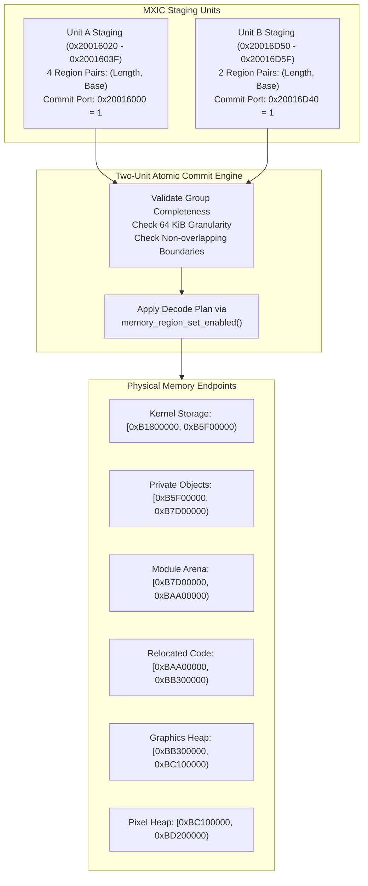

# MXIC DDR Memory Crossbar & Region Decode

The Memory Crossbar (MXIC) controller at `0x20016000` governs physical memory decoding, aperture gating, and dynamic routing between system interconnect masters and DDR RAM endpoints.

## Register Layout & Staging Ports

All registers require aligned 32-bit operations.

| Physical Address | Register Name | Unit | Width | Description |
|---|---|---|---|---|
| `0x20016000` | `MXIC_UNIT_A_COMMIT` | A | 32-bit | Unit A commit strobe. Writing `1` latches staged regions into active decode. |
| `0x20016020` - `0x2001603F` | `MXIC_UNIT_A_REG[0..3]` | A | 32-bit | Four (Length, Base) region pairs (64 KiB granularity). |
| `0x20016D40` | `MXIC_UNIT_B_COMMIT` | B | 32-bit | Unit B commit strobe. Writing `1` latches staged regions into active decode. |
| `0x20016D50` - `0x20016D5F` | `MXIC_UNIT_B_REG[0..1]` | B | 32-bit | Two (Length, Base) region pairs. |

## Decode Constraints & Endpoint Enablement

1. **Atomic Group Commits**: A new decode plan takes effect only when all constituent region fields of a unit are written and committed via the unit's commit port.
2. **Endpoint Coverage**: A DDR memory endpoint is enabled only when it is fully covered by an active region in both Unit A and Unit B. If a region plan leaves an endpoint uncovered or in conflicting overlap, access to that RAM region is dynamically withdrawn via `memory_region_set_enabled(false)`.
3. **Draft Staging Isolation**: Writing to draft registers does not alter active memory routing until the explicit commit write is executed.
