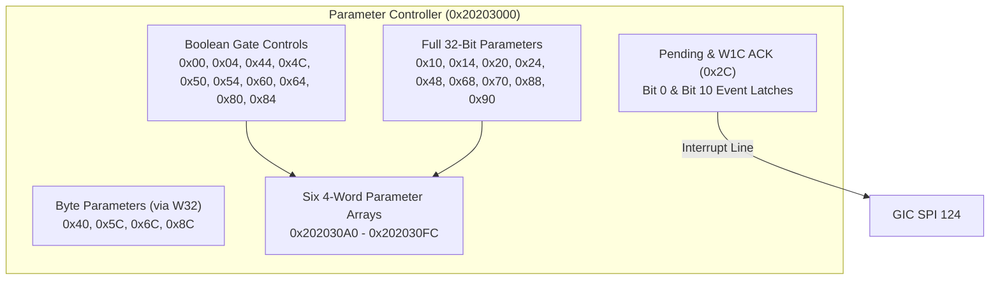

# Subsystem Parameter Controller (0x20203000)

The Parameter Controller at physical aperture `0x20203000` manages optical, sensor, and imaging subsystem parameters, providing structured array staging and event interruption via GIC SPI 124.

## Register Layout

All accesses require strictly aligned 32-bit operations within aperture `[0x20203000, 0x20203100)`.

| Offset | Register Name | Width | Access | Description |
|---|---|---|---|---|
| `0x00`, `0x04` | `PARAM_ENABLE0..1` | 32-bit | R/W | Subsystem gate enables (writing `0` or `1`). |
| `0x10`, `0x14` | `PARAM_COEFF0..1` | 32-bit | R/W | Primary 32-bit optical filter parameters. |
| `0x20`, `0x24` | `PARAM_CONFIG0..1` | 32-bit | R/W | Processing configuration words. |
| `0x2C` | `PARAM_PENDING_ACK`| 32-bit | R/W1C | Event status and clear: read returns pending bits; write 1 clears. |
| `0x40`, `0x5C` | `PARAM_SCALE0..1` | 32-bit | R/W | Scaling factors (byte values passed via word transactions). |
| `0x44`, `0x4C` | `PARAM_GATE0..1` | 32-bit | R/W | Channel enable gates. |
| `0x68`, `0x70` | `PARAM_STAGE0..1` | 32-bit | R/W | Pipeline stage thresholds. |
| `0x88`, `0x90` | `PARAM_LIMIT0..1` | 32-bit | R/W | Bound limits. |
| `0xA0` - `0xFC` | `PARAM_ARRAYS[0..5]`| 32-bit | R/W | Six consecutive 4-word parameter calibration arrays (24 words total). |

## Interrupt & Event Handling

1. **Event Latches**: Rising edges on external input lines latch into bits 0 and 10 of `PARAM_PENDING_ACK` (`0x2C`).
2. **Interrupt Assertion**: If any unmasked pending bit is active, the controller asserts GIC SPI 124.
3. **Acknowledgment**: Firmware ISR reads `0x2C`, extracts the active cause, writes back `1` to acknowledge and clear the latched bit, and notifies the waiting image processing service via event callback `0x41052C01`.
