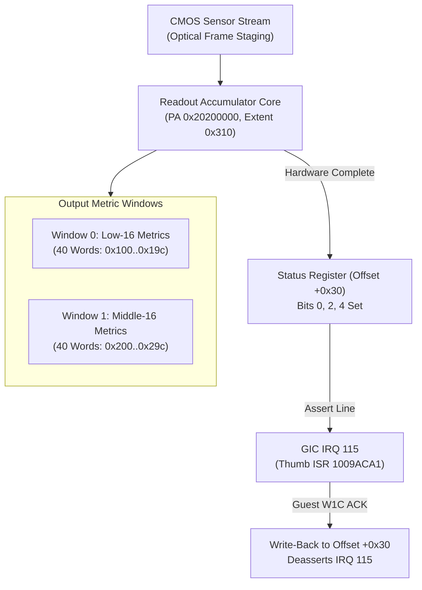

# SLA sensor readout engine protocol

This specification details the hardware register mapping, status synchronization, and result window layout for the SLA sensor readout engine (`readout.c`), mapped at SLA-private `PA 0x20200000` and connected to GIC IRQ 115.

## Architecture and readout pipeline

The readout engine captures processed optical frame metrics, accumulates multi-channel pixel statistics, and publishes structured result windows for the SLA optical control subsystem.

## Memory mapping and register layout

The device occupies a dedicated 784-byte aperture `[0x20200000, 0x20200310)`:

| Offset Range | Register Name | Access | Reset Value | Functional Description |
|---|---|---|---|---|
| `+0x00` | `CTRL` | RW | `0x00000000` | Master enable and stream control |
| `+0x04` | `STOP_REQ` | RW | `0x00000000` | Synchronous readout stream stop request |
| `+0x20..+0x28` | `CONFIG_WORDS` | RW | `0x00000000` | Primary configuration words (32-bit full masks) |
| `+0x30` | `STATUS` | R/W1C | `0x00000000` | Readout status: bits 0, 2, 4 indicate valid buffers |
| `+0x40..+0xbc` | `PARAM_BANKS` | RW | `0x00000000` | Staged timing and exposure coefficient matrices |
| `+0x100..+0x19c` | `RESULT_WIN0` | RO | `0x00000000` | 40-word primary metric output window |
| `+0x200..+0x29c` | `RESULT_WIN1` | RO | `0x00000000` | 40-word secondary metric output window |
| `+0x300` | `RESET` | WO | `0x00000000` | Local block soft reset |
| `+0x304..+0x30c` | `SHADOW_CTRL` | RW | `0x00000000` | Shadow register latches and commit triggers |

## Handshake and interrupt synchronization

1. **Request Submission**: Software writes shadow triggers to `+0x308` and `+0x30c`, initiating acquisition.
2. **Buffer Publication**: Upon completing frame metric accumulation, the engine writes 40 words to each result window (`+0x100..0x19c` and `+0x200..0x29c`), and asserts status bits 0, 2, and 4 at `+0x30`.
3. **Interrupt Generation**: GIC IRQ 115 fires; the guest ISR at `0x1009aca1` reads `+0x30`, writes the same word back (W1C) to clear the interrupt, and dispatches the callback with event identifier `0x41053001`.
4. **Boundary Rules**: Writing to result windows (`0x100..0x29c`) or accessing undefined offsets returns `MEMTX_ERROR`.
