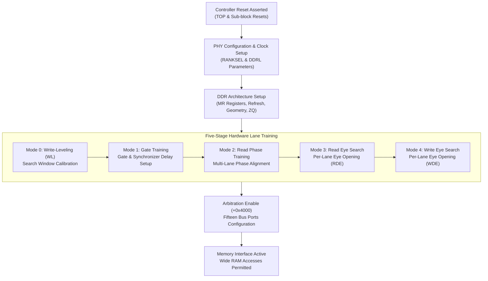

# Dual-bank SDI, PHY, and DDR memory controller protocol

This specification details the register interface, five-stage hardware calibration training sequence, and port arbitration contracts for the dual-bank SDI / DDR controller (`sdi.c`), mapped at `PA 0x20020000` (MAS domain) and `PA 0x20040000` (SLA domain).

## Architectural calibration and initialization flow

The DDR subsystem coordinates physical PHY layer configuration, DRAM timing initialization, iterative delay training across individual data lanes, and multi-port bus arbitration.

## Memory aperture mapping

Each SDI controller instance occupies a dedicated 64 KiB MMIO window:

| Domain | Base Address | End Address | Bus Master | Interrupt / Notification |
|---|---|---|---|---|
| **MAS SDI Bank** | `0x20020000` | `0x2002ffff` | Cortex-A7 Dual Core (CPU0/1) | Virtual Timer Done Flag |
| **SLA SDI Bank** | `0x20040000` | `0x2004ffff` | Cortex-A7 SLA Subsystem | Virtual Timer Done Flag |

### Register group layout
- `+0x0000..+0x0fff`: Master TOP configuration, clock multipliers, and rank selectors (`RANKSEL`).
- `+0x1000..+0x1fff`: Physical layer (PHY) timing parameters and auto-calibration delay lines.
- `+0x2000..+0x2fff`: DDR core control registers (Mode Registers `MR0..MR4`, geometry, ZQ calibration).
- `+0x3000..+0x3fff`: Five-mode training request registers and lane error status (`TRAINERR`).
- `+0x4000..+0x4fff`: 15-port memory bus arbitration and transaction priority crossbar.

## Training modes and error semantics

Iterative training requires strict sequential progression from Mode 0 to Mode 4:

| Mode | Target Operation | Required Applied Parameters | Error Condition & Flag |
|---|---|---|---|
| **Mode 0** | Write-Leveling (WL) | Programmed WL search window | Target delay out of window → `TRAINERR.WL_ERR = 4` |
| **Mode 1** | Gate Delay | Applied gate/synchronizer delays | Incomplete synchronizer setup → Gate fault |
| **Mode 2** | Read Phase | Applied phase alignment masks | Deserializer unlock → Phase fault |
| **Mode 3** | Read Eye (RDE) | Per-lane eye control enable & non-zero span | Zero search parameters → `TRAINERR.RDE_ERR` |
| **Mode 4** | Write Eye (WDE) | Per-lane eye control enable & non-zero span | Zero search parameters → `TRAINERR.WDE_ERR` |

### Deterministic functional timing
1. **Request Progression**: Writing a command request arms a QEMU virtual timer that signals hardware completion after a nominal 10 microseconds.
2. **Write-1-to-Clear (W1C)**: Completion flags must be acknowledged by explicit guest W1C stores before initiating the subsequent training stage.
3. **Reset Cancellation**: Asserting arbitration reset at `+0x4000` cancels active downstream port timers and clears applied states, while retaining completed PHY/DDR calibration results.
