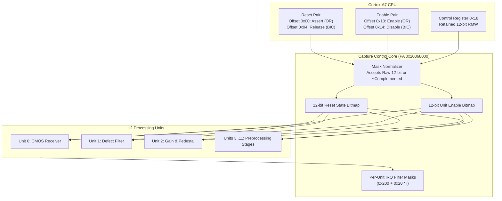

# Sensor capture-control registers and unit enable protocol

This specification details the capture-control peripheral (`PA 0x20068000`), governing hardware reset sequencing, unit enablement, complemented mask normalization, and interrupt filters across the 12 camera capture processing units.

## Architectural capture control block diagram

The capture controller orchestrates paired atomic operations for 12 processing blocks (CMOS interface, Bayer preprocessing, defect pixel correction, white balance gains, digital exposure compensation).

## Register map

The capture control aperture is mapped at `PA 0x20068000` with 32-bit aligned accesses:

| Offset | Register Name | Access | Reset Value | Functional Description |
|---|---|---|---|---|
| `0x00` | `RESET_SET` | WO | `0x00000000` | Assert reset for selected units (bit-wise OR) |
| `0x04` | `RESET_CLR` | WO | `0x00000000` | Release reset for selected units (bit-wise AND-NOT) |
| `0x10` | `ENABLE_SET` | WO | `0x00000000` | Enable selected capture units (bit-wise OR) |
| `0x14` | `ENABLE_CLR` | WO | `0x00000000` | Disable selected capture units (bit-wise AND-NOT) |
| `0x18` | `CONTROL` | RW | `0x00000000` | Retained 12-bit RMW operational flags |
| `0x20` | `PARAM0` | RW | `0x00000000` | Timing parameter word 0 (default initialized to 31) |
| `0x24` | `PARAM1` | RW | `0x00000000` | Timing parameter word 1 (default initialized to 15) |
| `0x28` | `STREAM_EN` | RW | `0x00000000` | Boolean capture stream enable (0 or 1) |
| `0x60` | `CONFIG` | RW | `0x00000000` | Subsystem configuration word |
| `0x70` | `SELECTOR` | RW | `0x00000000` | Mode and clock selector bits (valid mask `0x3a`) |
| `0x200 + 0x20*i` | `IRQ_MASK[i]` | RW | `0x00000000` | Independent interrupt filter masks for 8 causes |

## Complemented mask normalization law

Original firmware routines frequently pass bitwise-inverted masks (e.g. passing `~0x2bf = 0xfffffd40` from `10239756`):

1. **Admitted Envelopes**: The controller accepts either:
   - Plain 12-bit integer: bits `31..12` must be all zero (`0x00000xxx`).
   - 32-bit complemented integer: bits `31..12` must be all one (`0xfffffxxx`).
2. **Rejection Rule**: Masks with mixed high bits (e.g. `0x12345xxx`) are rejected with `MEMTX_ERROR` prior to updating hardware state.
3. **Target Selection**: Only the low 12 bits participate in setting or clearing unit state.
