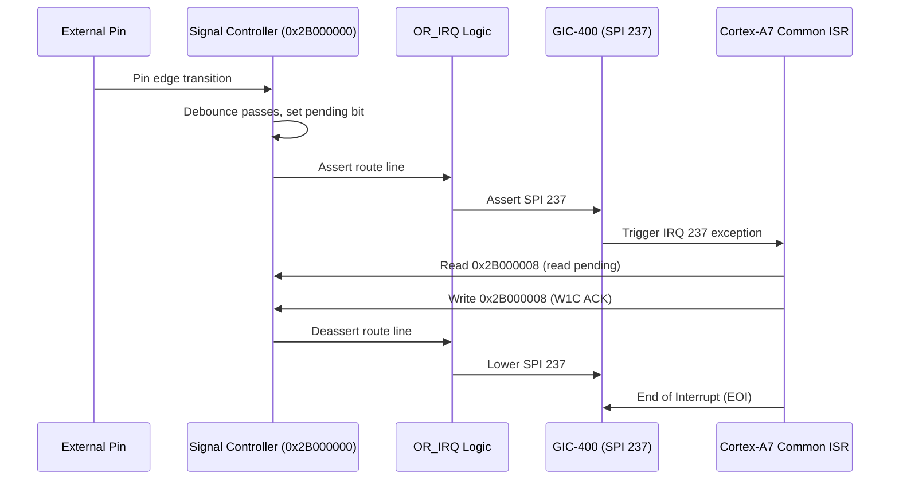

# Signal Interrupt Aggregation and External Configuration

The Five-Route Signal Controller combines five route outputs through an OR-gate into GIC SPI 237 and provides an auxiliary configuration aperture at `0x28000000`.

## Hardware Architecture

### GIC SPI 237 Aggregation
- Five distinct pending outputs from the sampling engine connect to a 5-input `OR_IRQ` device.
- The output of the `OR_IRQ` feeds GIC SPI 237 (GIC interrupt ID `237 + 32 = 269`).
- Clearing one route's pending bit does not lower SPI 237 if any other route remains asserted. Only when all active masked routes are cleared does the interrupt line deassert.

### Opaque Configuration Aperture (`0x28000000`)
- **Physical Range**: `[0x28000000, 0x28000004)` (4 bytes).
- **Access Rule**: Aligned 32-bit writes only. Reads or sub-word accesses return `MEMTX_ERROR`.
- **Boot Sequence**: Camera boot code in both MAS and SLA domains writes `0x0000000F` to `0x28000000` during initialization before enabling GIC SPI 237.
- **Side Effects**: The written value is latched; it produces no spontaneous interrupt or clock transition.

## SLA & MAS ISR Callback Dispatching

The camera OS maintains 5 callback slots mapped to physical edge cause pairs:

| Cause Pair | Physical Bits | Assigned Callback Slot | Event Argument |
|---|---|---|---|
| Pair 0 | Bits 0 / 1 | Slot 0 | `0x41090001` |
| Pair 1 | Bits 2 / 3 | Slot 1 | `0x41090001` |
| Pair 2 | Bits 4 / 5 | Slot 3 | `0x41090001` |
| Pair 3 | Bits 6 / 7 | Slot 4 | `0x41090001` |
| Pair 4 | Bits 8 / 9 | Slot 2 | `0x41090001` |
