# Five-Route Signal Controller

The Nikon Five-Route Signal Controller at `0x2B000000` samples, debounces, and latches external input transitions across five independent hardware routes, generating aggregated interrupts via GIC SPI 237.

```mermaid
flowchart LR
    subgraph Inputs ["5 External Input Pins"]
        P0["Pin 0"]
        P1["Pin 1"]
        P2["Pin 2"]
        P3["Pin 3"]
        P4["Pin 4"]
    end

    subgraph Sampling ["Sampling & Debounce Engine"]
        Gate["Sampling Gate (0x04)\nRoute 3 & 4 share bit 2"]
        Timer["1 MHz Debounce Timer\n1, 2, 4, or 8 ticks (0x14)"]
        Filter["Filter & Raw Status\nRaw [0:4], Filtered [8:12] (0x10)"]
    end

    subgraph EdgeDetect ["Edge Latching & Masking"]
        Edge["Edge Detector\nRising / Falling Pairs (0x0C)"]
        Pending["W1C Pending Latch (0x08)\n10 private edge bits"]
    end

    Inputs --> Gate
    Gate --> Timer
    Timer --> Filter
    Filter --> Edge
    Edge --> Pending
    Pending -->|"5 route wires"| OrIRQ["OR_IRQ Gate"]
    OrIRQ -->|"Single SPI"| GIC["GIC SPI 237"]
```

## Register Layout

All registers require strictly aligned 32-bit accesses within aperture `[0x2B000000, 0x2B00001C)`. Sub-word accesses or unaligned offsets return `MEMTX_ERROR`.

| Offset | Register Name | Access | Width | Description |
|---|---|---|---|---|
| `0x00` | `SIG_ROUTE_EN` | R/W | 32-bit | Route reset release and enable in logical bit order: `0, 1, 4, 2, 3`. Writing 0 holds route in reset; writing 1 releases sampling. |
| `0x04` | `SIG_GATE` | R/W | 32-bit | Sampling gate control: bits `4, 5, 3, 2, 2` (routes 3 and 4 share gate bit 2). 1 enables sampling. |
| `0x08` | `SIG_PENDING` | R/W1C | 32-bit | Edge pending status and clear. Read returns 10 raw edge pending bits; writing 1 clears corresponding pending bit. |
| `0x0C` | `SIG_EDGE_EN` | R/W | 32-bit | Rising/falling edge detection enable pairs: `(0,1), (2,3), (8,9), (6,7), (4,5)`. |
| `0x10` | `SIG_STATUS` | R | 32-bit | Line status: bits [4:0] = raw line levels; bits [12:8] = filtered debounced levels. |
| `0x14` | `SIG_DEBOUNCE` | R/W | 32-bit | Debounce enable bits and 2-bit clock prescalers at bits `8, 12, 24, 16, 20` (legal mask `0x0333331F`). |
| `0x18` | `SIG_CFG_LATCH` | R/W | 32-bit | General-purpose 32-bit configuration latch. |

## Debounce and Edge Detection Logic

1. **Nominal Sampling Clock**: Operates from an independent nominal 1 MHz clock.
2. **Prescaler Codes**:
   - `00b`: 1 tick (1 µs)
   - `01b`: 2 ticks (2 µs)
   - `10b`: 4 ticks (4 µs)
   - `11b`: 8 ticks (8 µs)
3. **Filtering**: A transition on an external pin triggers a debounce deadline. If the pin state remains stable until the deadline expires, the filtered status in `0x10` updates, latching the corresponding rising or falling edge in `SIG_PENDING`.
4. **W1C Acknowledgment**: The firmware ISR reads `0x08` and writes back the identical value to clear serviced edge latches.
