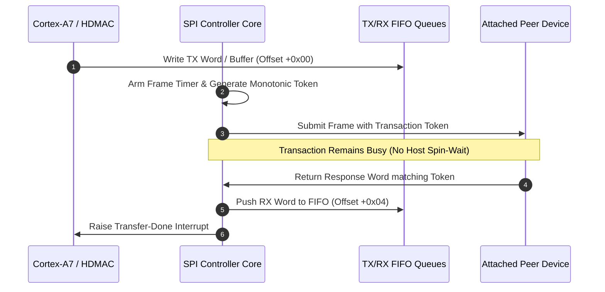

# Eleven-channel SPI master controller protocol

This specification details the FIFO geometry, asynchronous transaction tokens, HDMAC integration, and peer transport contracts for the 11-channel SPI master interface (`spi.c`).

## Architectural block diagram

The controller provides 11 independent SPI channels supporting synchronous serial peripheral interface (SSI) communication with coprocessors (VR domain on Port 4) and external sensors.

## Channel allocation and DMA mapping

The 11 channels are allocated across system coprocessors and optical sensors:

| SPI Port | Physical Role | Hardware HDMAC Pairing | DMA DREQ Lines |
|---|---|---|---|
| **Port 0** | Auxiliary Serial Interface | None (Polled / Interrupt) | N/A |
| **Port 1** | External Flash / Peripheral Bus | None (Polled / Interrupt) | N/A |
| **Port 2** | High-Speed Sensor Interface | HDMAC Bank 0 Channels 0/1 | DREQ 7 / 8 |
| **Port 3** | Lens Communication Bus | HDMAC Bank 0 Channels 2/3 | DREQ 9 / 10 |
| **Port 4** | VR Domain Coprocessor Interconnect | HDMAC Bank 0 Channels 4/5 | DREQ 11 / 12 |
| **Ports 5..10** | Peripheral & Diagnostic Ports | Unbound (Firmware Polled) | N/A |

## Register layout

Each SPI channel occupies a dedicated MMIO aperture:

| Offset | Register | Access | Reset Value | Functional Description |
|---|---|---|---|---|
| `+0x00` | `TXR` | WO | `0x00000000` | Transmit Data Register (Pushes word to TX FIFO) |
| `+0x04` | `RXR` | RO | `0x00000000` | Receive Data Register (Pops word from RX FIFO) |
| `+0x08` | `CTRL` | RW | `0x00000000` | Control Register (Master enable, clock phase/polarity, DMA gate) |
| `+0x0c` | `DIV` | RW | `0x00000000` | Clock Prescaler & Baud Rate Divider |
| `+0x10` | `STATUS` | RO | `0x00000000` | FIFO Occupancy, Transmission Busy, Overrun/Underflow Flags |
| `+0x14` | `IEN` | RW | `0x00000000` | Interrupt Enable Mask (TX empty, RX ready, Transfer done) |

## Token-based transaction model

To guarantee deterministic hardware behavior without blocking the QEMU main loop:
1. **Monotonic Tokens**: Each submitted frame carries a unique token. Late responses arriving after a channel reset or port closure cannot satisfy replacement transactions.
2. **Asynchronous Backpressure**: An accepted transaction remains busy until the peer explicitly completes the token. The controller never fabricates dummy zero replies for offline peers.
3. **Cancellation and Reset**: Disabling the channel (`CTRL.EN = 0`) preserves FIFO contents per hardware specification; closing the port or triggering a board reset flushes queues and cancels pending tokens.
