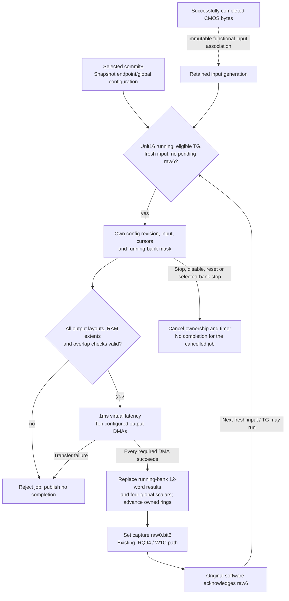

# Finite capture statistics processing

`statistics.c` supplies a complete-bundle-only functional processing profile.
It connects original unit16 commit/run, ten configured output routes,
completed CMOS input bytes, numerical result sinks and capture raw0.bit6.
It does not write software roots, queues, event objects, callbacks or GUI
pixels. Addresses below are board PAs, code/data symbols are original MAS
VAs, offsets/masks are hexadecimal, and dimensions/C indices are decimal.
Source projections and raw runs remain in
`run capturecompletion/`.

## One processing generation

The solid arrows describe the implemented finite transaction. The dashed
input association, grayscale arithmetic and 1ms latency are functional
hypotheses. Hardware completion and software root retirement remain distinct;
the device does not invoke the guest consumer itself.

While raw6 is pending, the next job is backpressured. ACK permits a later job
even if software did not read the preceding results; empty queues can discard
a completed frame.

## Established protocol and geometry

`1023c998 -> 1023a6c6/1023a07e -> 1020c802` programs the output family,
commits mask8 through the shared100/104 ports, then starts unit10 hex.
`1023a63c` supplies two address sets, initial slot, count-minus1 and stride.
`1020b16a` stores the bank parameter in endpoint3c bits2:1 independently of
bit0; `1020b1da` stores the two address sets. The current normal family has
four equal pointers within each sparse address set at endpoints2/3/4/9.
Unequal pointers describe an unimplemented layout, not extra buffers to fill.

| Endpoint | Dimension word | Encoding | Cell bytes / aligned pitch | Source metadata |
|---|---|---|---|---|
|0|`a278`|low8 columns, next8 rows|16 / align16|`102ce5aa`|
|1|`a2d0`|same|2 / align16|`102ce622`|
|2/3/4|`a2e8/a300/a318`|same|2 / align16|`102ce676`|
|5/6/7|`a338`|low10 columns, remaining rows|1 / align16|`102ce800`|
|8|`a354`|low11 columns, remaining rows|1 / align16|`102ce868`|
|9|`a370`|low10 columns, remaining rows|1 / align16|`102ce8e4`|

The cold-neutral source descriptors independently report30x20,30x20,
60x40,176x118,672x448 and384x256 respectively. In particular, `a268/a26c`
values30/18 are source ROI coordinates, not endpoint0 output dimensions.
The earlier audit's30x18 inference is superseded. The pool constructors
establish RGB-family plane displacements12000/24000 for kind19, and
5a00/b400 for kind20; each endpoint still receives its own programmed base.
No enclosing DDR class is mapped or written.

`10209f4a` reads the twelve bank results as four
`{signed24,unsigned29,unsigned17}` triples, reordered by original software.
The physical register orders are `{00,08,10}`, `{04,0c,14}`,
`{18,20,28}`, `{1c,24,2c}` relative to `a100` or `bf00`.
The two original service objects independently own units40/80 hex; only
effectively running banks receive new results. `10238a62 -> 1020c876(0)`
reads global result `a3e0` into kind18's descriptor+30. Selectors0..3 address
`a3e0/e4/e8/ec`; this does not identify endpoint0 or recover scalar meaning.

Raw6 reaches `102391b2 -> b1888164 / owner4 -> 10238d4a -> 10238c40`.
The latter may pop empty queues and return without reading either result
family. Therefore result-read masks cannot gate the next processing job.
Only actual queued roots can be retired through041a0002, pending40000 and
041a0008; a produced frame and a retired root are not interchangeable counts.

## Explicit functional assumptions

The provider copies completed, successfully owned primary CMOS DMA bytes
before another auxiliary request can overwrite their RAM. It retains no
borrowed guest pointer. The coordinator claims the latest such immutable
input once per eligible automatic TG rise, copies it for its job, and never
reuses that input generation, including after rejection/cancellation. This
associates auxiliary transport with processing input as a finite functional
hypothesis, not a recovered physical sensor topology. Inputs are LE16
grayscale with the existing transport geometry, bounded to4M samples.

Each destination cell covers its proportional input box. Upsampling uses
at least one input sample in each dimension. Wide integer integral sums
produce rounded box means. Endpoint1..4 store LE16 means;5..9 store their
high byte. RGB-related endpoints use the same grayscale projection, with
no inferred Bayer order, color calibration or proprietary filtering.

Endpoint0's16-byte cells contain four LE32 words: horizontal signed
neighbor-difference sum, intensity sum, sample count and rounded mean.
The difference telescopes to the rightmost-column sum minus the leftmost;
it saturates to signed24 before low24 packing. The sum/count saturate to
unsigned29/17. Four input quadrants supply the same three quantities to
the twelve result words. Their rounded means, computed from unsaturated
sums/counts, supply the four global scalars. Padding bytes are zeroed only
inside each actual output extent.

These numerical meanings are declared functional choices. Original result
packing, output geometry and descriptor ownership are established; the
physical meaning of the global scalar and16-byte cell words is not recovered.
Bank ROI/calibration words remain retained configuration; this simplified
profile does not implement their proprietary numerical effects. It supplies
measured functions of input bytes, not fixed identity/zero/success values.

## Generation, publication and cancellation

Selected commits snapshot endpoint/global configuration. The two commit
ports do not independently enqueue jobs. An unchanged snapshot does not
rewind rings. A changed snapshot initializes each cursor from44; successful
jobs advance once modulo48+1, using80 as unit stride and3c bits2:1 as the
selected address set0/1. Bit0 remains independent. There is no second TG
cursor added on top of the committed initial slot.

A job owns immutable configuration, input, cursor and running-bank masks.
Later staging/commits cannot alter it. A newer committed snapshot retains
its own initial cursors when the older job finishes. A commit revision,
incremented only on changed configuration, distinguishes A-to-B-to-A commits
from the still-running old A job. Effective unit16 stop,
disable or reset cancels its timer. A selected statistics bank stopping
before completion also cancels the job. Machine reset clears job ownership,
result validity and pending causes through the existing device resets.

The1ms virtual computation latency is a timing assumption, not a guarantee
that guest software has queued a root. Before any write, all enabled output
geometries, slot extents, address arithmetic, writable direct RAM and pairwise
output overlap are checked. Empty dimensions, unsupported control/layout,
overflow, ROM, holes and undersized slots reject the whole job. Each output
is transferred by QEMU DMA; a transfer failure produces no result packet or
completion, even if earlier RAM writes occurred.

Only after every required DMA succeeds are the bank/scalar packages replaced
and raw6 ORed into the existing IRQ94 pending/W1C path. Published packages
survive staging, commit and stop until a new successful replacement or reset.
While raw6 is pending, a new TG is backpressured. Once software ACKs it,
a new input/TG may replace unread values: an empty software queue may discard
a completed frame. No historical event is replayed to a later root. Read
masks are read-only QOM diagnostics and never qualification for another job.
An asynchronous consumer can see newer values; multiple MMIO reads are not
claimed to constitute an atomic historical-frame transaction.

## Separate software image-request condition

`103250f2 -> 10324f04(root+8)` sets root[16] only for state `b1868af6=1`
with unequal counters `b1868b94/b1868b98`. Direct request API
`103f27ba -> 10328ca6` accepts only service state `b1868af1=9`, property1053
equal1, and either AF6=0 or AF6=2 with queue `b23ef3c8` shorter than25.
It queues `10323a7e` through `10319d56`. That worker increments the requested
count up to25, or chooses25 for setting5888 values1/3 with property1052
not1, then writes AF6=1. It does not bypass state/property checks.

The cold-neutral checkpoint has service state2 and AF6=0. The request API
and worker are absent from the focused normal trace; the per-root setter
does execute. Their physical-control/UI meaning is not established, and
this mode9 conditional delivery path is not proven necessary for the normal
GUI main image. No guest state is set to enter it.

The later [image request audit](../../runtime/imagerequest.md) identifies
separate normal information-publication and display-activation producers.
Its observed image tasks fail a software period/phase check before submission;
that result does not justify setting AF6 or forcing service state9.

## Validation scope

The scoped old-model fixture fails because `/machine/capture-statistics`
does not exist. The final native CMOS fixtures cover all ten outputs,
selected address sets, immutable input/configuration, duplicate commits,
changed-commit revision ownership including A-to-B-to-A during an active job,
ring advance, raw6 ACK backpressure and unread-frame replacement, cancellation,
reset, selected-bank stop/restart cancellation, independent bank replacement,
output conflict/ROM/overflow/layout/extent rejection, and signed24/
unsigned29/unsigned17 saturation with an explicit image input. The Sensor
configuration/negative suite and exact-memory suite remain separate checks.
The A-to-B-to-A cursor fixture first fails against byte-equality ownership,
then all four statistics cases pass with revision ownership. The final
unchanged-firmware run also uses that corrected implementation.
Original-firmware progression, final counters and the next boundary are
recorded in the [startup frontier](../../validation/frontier.md).
