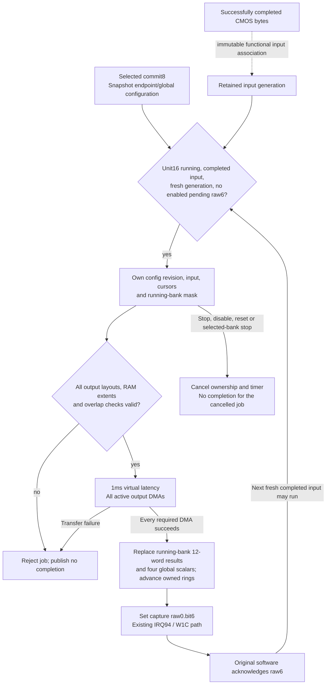

# Finite capture statistics processing

`statistics.c` supplies a complete-bundle-only functional processing profile.
It connects original unit16 commit/run, ten configured output routes,
completed CMOS input bytes, numerical result sinks, capture raw0.bit6 and
its own processing-stage completion raw3.bit5 and endpoint1 ring completion
raw3.bit7.
It does not write software roots, queues, event objects, callbacks or GUI
pixels. Addresses below are board PAs, code/data symbols are original MAS
VAs, offsets/masks are hexadecimal, and dimensions/C indices are decimal.
Source projections and raw runs remain in
`run capturecompletion/`.

## One processing generation

The solid arrows describe the implemented finite transaction. The dashed
input association, grayscale arithmetic and 1ms latency are functional
hypotheses. Hardware completion and software root retirement remain distinct;
the device does not invoke the guest consumer itself.

While raw6 is pending and enabled in the capture mask, the next job is
backpressured. ACK permits a later job
even if software did not read the preceding results; empty queues can discard
a completed frame.
The diagram follows the data-consumer IRQ94 route. The separate stage-fence
IRQ96 below belongs to the same successful transaction; it does not submit a
second processing job.

Input-ready is emitted only after the pipeline owns a successful immutable
MAIN snapshot or auxiliary DMA publication. It replaces the earlier requirement
to wait for a further TG before admitting these already completed bytes. This
is a functional scheduling association; it does not bypass pending raw6, create
input credits, or turn acquisition completion into statistics completion.

## Established protocol and geometry

`1023c998 -> 1023a6c6/1023a07e -> 1020c802` programs the output family,
commits mask8 through the shared100/104 ports, then starts unit10 hex.
`1023a63c` supplies two address sets, initial slot, count-minus1 and stride.
`1020b16a` stores a two-bit parameter in endpoint3c bits2:1 independently of
bit0; `1020b1da` stores the two address sets. The current normal family has
four equal pointers within each sparse address set at endpoints2/3/4/9.
Unequal pointers describe an unimplemented layout, not extra buffers to fill.

| Endpoint | Dimension word | Encoding | Cell bytes / aligned pitch | Source metadata |
|---|---|---|---|---|
|0|`a278`|low8 columns, next8 rows|16 / align16|`102ce5aa`|
|1|`a2d0`|same|2 / align16|`102ce622`|
|2/3/4|`a2e8/a300/a318`|same|2 / align16|`102ce676`|
|5/6/7|`a338`|low10 columns, remaining rows|1 / align16|`102ce800`|
|8|`a354`|low11 columns, remaining rows|1 / align16|`102ce868`|
|9|`a370`|low10 columns, remaining rows|1 / align16|`102ce8e4`|

The cold-neutral source descriptors independently report30x20,30x20,
60x40,176x118,672x448 and384x256 respectively. In particular, `a268/a26c`
values30/18 are source ROI coordinates, not endpoint0 output dimensions.
The earlier audit's30x18 inference is superseded. The pool constructors
establish RGB-family plane displacements12000/24000 for kind19, and
5a00/b400 for kind20; each endpoint still receives its own programmed base.
No enclosing DDR class is mapped or written.

The independent main-input continuation encounters a different mode1 packet:
the packed extents for endpoints0/8/9 are zero while their endpoint routes
remain configured. Endpoint1 instead requests30 by12, with the large-count
kind32 destination. **Finite partial-output hypothesis:** a completely zero
packed extent disables that output without touching its old RAM; one zero
dimension with a nonzero other dimension is malformed and rejects the job.
At least one output must perform actual DMA before numerical results or a
completion can be published. Other active outputs still undergo every route,
extent, RAM and overlap check. A disabled endpoint1 cannot produce ring bit7.
This replaces the previous requirement that endpoints0 and1 both be present.
The masked-stream fixture retains a ROM route for disabled endpoint0, completes
three real frames through the remaining outputs and rejects a later all-disabled
job without publishing another completion. Unknown addresses are not mapped
or treated as zero data by this output-selection rule.

`10209f4a` reads the twelve bank results as four
`{signed24,unsigned29,unsigned17}` triples, reordered by original software.
The physical register orders are `{00,08,10}`, `{04,0c,14}`,
`{18,20,28}`, `{1c,24,2c}` relative to `a100` or `bf00`.
The two original service objects independently own units40/80 hex; only
effectively running banks receive new results. `10238a62 -> 1020c876(0)`
reads global result `a3e0` into kind18's descriptor+30. Selectors0..3 address
`a3e0/e4/e8/ec`; this does not identify endpoint0 or recover scalar meaning.

Raw6 reaches `102391b2 -> b1888164 / owner4 -> 10238d4a -> 10238c40`.
The latter may pop empty queues and return without reading either result
family. Therefore result-read masks cannot gate the next processing job.
Only actual queued roots can be retired through041a0002, pending40000 and
041a0008; a produced frame and a retired root are not interchangeable counts.

## Processing-stage completion

The original software unit8 path closes a specific configuration/consumer
relationship. `1023aed8` selects `1023a07e`, sets shared commit mask8, and
the latter calls `1020c862/c86c/c880/c894/c89e`. These write the same global
and ten-endpoint configuration family used by this model. `10239480` handles
capture event `41072802`; raw word3 bit5 marks processed unit8 at
`b26b38c4` and sets event flag800000 at `b188814c`. These are MAS VAs;
word indices are zero-based and masks/addresses hexadecimal.

**Functional completion hypothesis:** after every required DMA and numerical
result publication succeeds, publish raw3.bit5 through the existing
capture device's third event (IRQ96), in addition to raw0.bit6/IRQ94. This
joins actual work to its source-associated stage consumer; physical completion
granularity remains unverified. The immutable input/configuration revision,
generation consumption, failure and cancellation laws are unchanged. Commit,
TG, missing input, invalid destinations and cancelled jobs cannot publish it.
Existing capture masks and W1C independently control both causes. A blocked
data job cannot replay a cleared stage cause, and stage ACK does not ACK raw6.
No other processing stage or FE synchronization bit is inferred from this work.

The [fence receipt](/evidence/imagerequest/fence.json) records native red→green
and original-firmware consumption:734 completed processing jobs correspond to
734 observed original event setters from `102394c9` in the30-host-second
`end` window. The full05b00000 fence still times out because this stage alone
does not satisfy the other requested causes. This is an observed ISR join,
not GUI startup or proof of a complete physical processing pipeline.

## Endpoint ring completion and first-read mode

**Source facts:** the same `10239480` callback independently maps raw3.bit7
to owner event80. `10238d4a` consumes that event through
`1023c57a(1, b26b44cc)`, where the second argument is the endpoint1 software
record. With lane flags at VA `b26b38cc` containing4 and mode byte at VA
`b1888147` equal to1, its first invocation toggles the record's byte1,
clears its word at+28, rewrites the endpoint through `1020c8be/c8f0`, and
commits8. Those stores select endpoint3c bit0 and set endpoint80 to0. Its
second invocation stops the selected capture units through `10238680` and
calls the registered callback with `041a0003`. That callback can post FE
worker8 when the first-read latch is set. None of these software actions is
performed by the host model.

`1023a6c6` supplies the mode from its input byte2 and the count from its second
argument. `1023a63c` writes count-minus1, initial slot0, both address sets and
the allocation stride. The observed first-read configuration has mode1,
count255 and endpoint1 stride12000. The per-frame raw0.bit6 consumer explicitly
skips unit8 retirement in mode1; its mode2 path instead decrements the software
count. Producing more ordinary frame notifications cannot substitute for the
mode1 completion route.

**Finite functional hypothesis:** endpoint3c bit0 selects one of the two
address sets. Bits2:1 values0/1 retain the same bounded grayscale address
formula; values2/3 remain unsupported. A zero stride addresses the same
buffer on successive jobs, as required by the original mode1 reconfiguration.
A nonzero stride must fit the entire output. Only after all required DMAs and
numerical results succeed, the job whose endpoint1 cursor equals its committed
count-minus1 also publishes raw3.bit7. Other endpoint completion bits and
physical bank timing are not inferred. This corrects the earlier profile's
use of bits2:1 as the address-set selector.

The later [resource35 input audit](../../inputs/nor/descriptor.md#resource35-first-read-region-input)
finds that255 was the low byte of an erased temporal parameter, not a recovered
normal sample count. Its bounded virtual record selects64, which the original
producer requests normally. This still exceeds RGB's six allocated slots;
the separate storage/completion contract below applies to both counts.

### Completion sequence and bounded output storage

**Source facts:** the original constructors independently reserve6 kind17
slots (`1023b8ee`),6 kind19 slots (`1023b87e`),4 kind20 slots (`1023b852`),
4 kind21 slots (`1023b81a`) and4 kind22 slots (`1023b7e2`). Their full RAM
extents and plane displacements are unchanged. Only endpoint1's `1030ad70`
chooses the large kind32 pool when the requested count exceeds6. In contrast,
`1023a6c6 ->1023a63c` passes the first-read request count255 to several
endpoints, including RGB, while retaining the source descriptor slot index
in word44 and the allocation stride in word80. Thus that configuration does
not allocate255 RGB slots.

**Finite cyclic-storage hypothesis:** retain the existing completion sequence
modulo `word48+1`, initialized by word44. For address generation only, use
`slot = sequence % min(word48+1, storage period)`. The source-associated
storage periods are6 for endpoint0 and RGB endpoints2/3/4,4 for endpoints5..9,
and the configured count for endpoint1 (up to the8-bit field's256 slots).
The resulting address remains `selected base + slot * stride`; zero stride
continues to reuse the selected base. All geometry, address-set, RAM,
overlap and actual DMA checks still precede numerical results and events.
No destination address, guest queue, callback or IRQ mask selects this rule.

The source bounds justify the available storage, not physical automatic
cycling, phase or control-bit encoding. Word44 still initializes the entire
completion sequence; this model does not introduce an independent storage
phase. When a non-divisible completion cycle such as255/6 ends, sequence
wrap also restarts storage phase. Those are explicit functional choices,
not recovered physical hardware semantics. Endpoint1's tail event still
requires the full configured completion count and successful work; wrapping
a four- or six-slot output cannot generate it early.

The [storage-period receipt](/evidence/imagerequest/storage.json) records a
native red at the first required four-slot reuse, then99 passing applicable
cases. The fixture processes255 real input generations across all ten outputs,
checks that wrapped slots receive new data while the next slot stays untouched,
and sees ring bit7 only on the255th completion. Its expanded256th-frame check
also verifies the chosen completion-cycle phase reset. Existing short-count,
nonzero-start, bank/zero-stride, failed-DMA, cancellation and reset fixtures
remain passing. These fixtures establish the finite model, not hardware fidelity.

The event uses the owned job configuration and cursor, independent of staging,
IRQ masks and guest wait state. A new commit alone publishes nothing. The
existing W1C/mask behavior applies independently to raw3.bit5/bit7 and raw0.bit6.
Invalid geometry, failed DMA, stop/disable/reset cancellation and absent input
produce no ring notification. Source callback behavior supports the association;
the ring-end timing remains a functional hypothesis rather than physical-camera
evidence.

The native ring fixture fails on the preceding implementation at the second
remaining slot: expected raw3.bit7=1, observed0 after successful DMA. With the
finite model it checks a silent non-tail slot, completion latency, actual
destination writes, IRQ/W1C, low-bit address-set selection with zero stride,
cancellation, ROM rejection and reset. The applicable native batch passes
28 CMOS,33 sensor and32 memory cases. Original execution remains separately
reported in the [payload receipt](/evidence/capturegroup/payload.json).

## Explicit functional assumptions

The provider copies completed, successfully owned primary CMOS DMA bytes
before another auxiliary request can overwrite their RAM. It retains no
borrowed guest pointer. The coordinator claims the latest such immutable
input once per eligible automatic TG rise, copies it for its job, and never
reuses that input generation, including after rejection/cancellation. This
associates auxiliary transport with processing input as a finite functional
hypothesis, not a recovered physical sensor topology. Inputs are LE16
grayscale with the existing transport geometry, bounded to4M samples.

Each destination cell covers its proportional input box. Upsampling uses
at least one input sample in each dimension. Wide integer integral sums
produce rounded box means. Endpoint1..4 store LE16 means;5..9 store their
high byte. RGB-related endpoints use the same grayscale projection, with
no inferred Bayer order, color calibration or proprietary filtering.

Endpoint0's16-byte cells contain four LE32 words: horizontal signed
neighbor-difference sum, intensity sum, sample count and rounded mean.
The difference telescopes to the rightmost-column sum minus the leftmost;
it saturates to signed24 before low24 packing. The sum/count saturate to
unsigned29/17. Four input quadrants supply the same three quantities to
the twelve result words. Their rounded means, computed from unsaturated
sums/counts, supply the four global scalars. Padding bytes are zeroed only
inside each actual output extent.

These numerical meanings are declared functional choices. Original result
packing, output geometry and descriptor ownership are established; the
physical meaning of the global scalar and16-byte cell words is not recovered.
Bank ROI/calibration words remain retained configuration; this simplified
profile does not implement their proprietary numerical effects. It supplies
measured functions of input bytes, not fixed identity/zero/success values.

## Generation, publication and cancellation

Selected commits snapshot endpoint/global configuration. The two commit
ports do not independently enqueue jobs. An unchanged snapshot does not
rewind rings. A changed snapshot initializes each cursor from44; successful
jobs advance once modulo48+1, using80 as unit stride and3c bit0 as the
selected address set0/1 under the finite hypothesis above. There is no second TG
cursor added on top of the committed initial slot.

A job owns immutable configuration, input, cursor and running-bank masks.
Later staging/commits cannot alter it. A newer committed snapshot retains
its own initial cursors when the older job finishes. A commit revision,
incremented only on changed configuration, distinguishes A-to-B-to-A commits
from the still-running old A job. Effective unit16 stop,
disable or reset cancels its timer. A selected statistics bank stopping
before completion also cancels the job. Machine reset clears job ownership,
result validity and pending causes through the existing device resets.

The1ms virtual computation latency is a timing assumption, not a guarantee
that guest software has queued a root. Before any write, all enabled output
geometries, slot extents, address arithmetic, writable direct RAM and pairwise
output overlap are checked. Empty dimensions, unsupported control/layout,
overflow, ROM, holes and undersized slots reject the whole job. Each output
is transferred by QEMU DMA; a transfer failure produces no result packet or
completion, even if earlier RAM writes occurred.

Only after every required DMA succeeds are the bank/scalar packages replaced
and raw3.bit5/raw0.bit6 ORed into the existing IRQ96/94 pending/W1C paths.
The endpoint1 ring tail additionally publishes raw3.bit7.
Published packages
survive staging, commit and stop until a new successful replacement or reset.
While enabled raw6 is pending, a new TG is backpressured. Once software ACKs it,
a new input/TG may replace unread values: an empty software queue may discard
a completed frame. No historical event is replayed to a later root. Read
masks are read-only QOM diagnostics and never qualification for another job.
An asynchronous consumer can see newer values; multiple MMIO reads are not
claimed to constitute an atomic historical-frame transaction.

The later [independent main acquisition](../sensor/protocol.md#independent-main-acquisition)
closes a mode1 distinction: its original mask10000020 excludes raw0.bit6,
and its consumer uses endpoint1 ring completion. Masked raw6 remains retained
status but does not backpressure new jobs. Tests using per-frame ACKs explicitly
enable bit6; the main masked-stream fixture completes three real frames and
the ring without ACKing either raw0.bit0 or bit6. This changes neither W1C nor
the capture IRQ mask law, and does not synthesize a ring completion from a mask.

## Separate software image-request condition

`103250f2 -> 10324f04(root+8)` sets root[16] only for state `b1868af6=1`
with unequal counters `b1868b94/b1868b98`. Direct request API
`103f27ba -> 10328ca6` accepts only service state `b1868af1=9`, property1053
equal1, and either AF6=0 or AF6=2 with queue `b23ef3c8` shorter than25.
It queues `10323a7e` through `10319d56`. That worker increments the requested
count up to25, or chooses25 for setting5888 values1/3 with property1052
not1, then writes AF6=1. It does not bypass state/property checks.

The cold-neutral checkpoint has service state2 and AF6=0. The request API
and worker are absent from the focused normal trace; the per-root setter
does execute. Their physical-control/UI meaning is not established, and
this mode9 conditional delivery path is not proven necessary for the normal
GUI main image. No guest state is set to enter it.

The later [image request audit](../../runtime/imagerequest.md) identifies
separate normal information-publication and display-activation producers.
Its observed image tasks fail a software period/phase check before submission;
that result does not justify setting AF6 or forcing service state9.

## Validation scope

The scoped old-model fixture fails because `/machine/capture-statistics`
does not exist. The final native CMOS fixtures cover all ten outputs,
selected address sets, immutable input/configuration, duplicate commits,
changed-commit revision ownership including A-to-B-to-A during an active job,
ring advance, raw6 ACK backpressure and unread-frame replacement, cancellation,
reset, selected-bank stop/restart cancellation, independent bank replacement,
output conflict/ROM/overflow/layout/extent rejection, and signed24/
unsigned29/unsigned17 saturation with an explicit image input. The Sensor
configuration/negative suite and exact-memory suite remain separate checks.
The added stage-completion fixture first fails on the old model with raw3=0
after real DMA. It covers no-input/commit silence, pre-completion timing, real
RAM and numerical results before stage publication, mask/W1C independence,
data backpressure, invalid-ROM rejection, cancellation, subsequent valid work,
reset and cancellation by reset before completion. The applicable batch passes
18 CMOS and33 Sensor cases; this supersedes no historical receipt's scope.
The A-to-B-to-A cursor fixture first fails against byte-equality ownership,
then all four statistics cases pass with revision ownership. The final
unchanged-firmware run also uses that corrected implementation.
Original-firmware progression, final counters and the next boundary are
recorded in the [startup frontier](../../validation/frontier.md).
