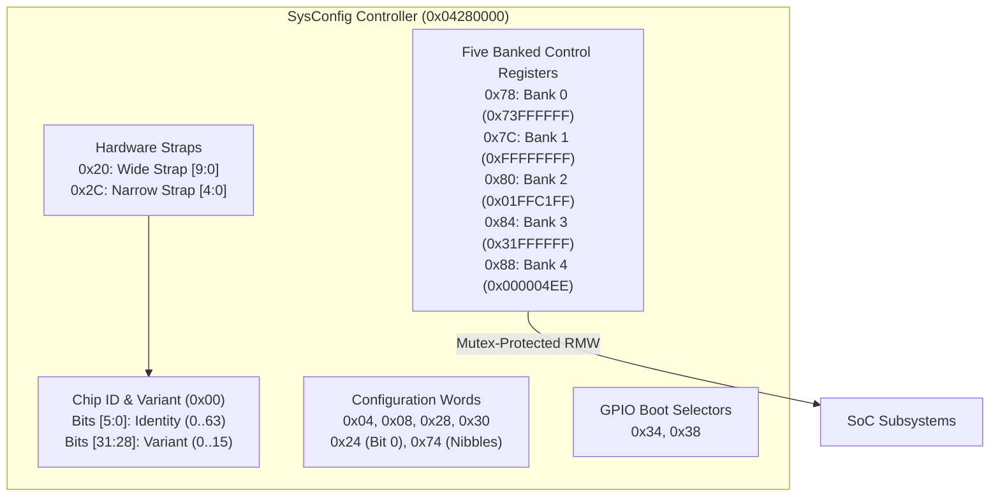

# Second System Configuration Controller (SysConfig)

The Second System Configuration Controller at physical base `0x04280000` manages hardware strapping pins, chip variant identification, early boot parameters, and multi-bank control registers.

## Register Layout

All accesses require strictly aligned 32-bit operations.

| Offset | Register Name | Width | Access | Description |
|---|---|---|---|---|
| `0x00` | `SYS_ID_VARIANT` | 32-bit | R | Read-only chip identity (`bits [5:0]`) and silicon variant (`bits [31:28]`). |
| `0x04`, `0x08` | `SYS_CFG0`, `SYS_CFG1` | 32-bit | R/W | Full-word system configuration registers. Read requires prior write. |
| `0x20` | `SYS_STRAP_WIDE` | 32-bit | R | Read-only wide hardware strap register (`bits [9:0]`). |
| `0x24` | `SYS_BIT0_CFG` | 32-bit | R/W | Single-bit control register (bit 0 writable). |
| `0x28`, `0x30` | `SYS_CFG2`, `SYS_CFG3` | 32-bit | R/W | Full-word configuration registers. |
| `0x2C` | `SYS_STRAP_NARROW`| 32-bit | R | Read-only narrow hardware strap register (`bits [4:0]`). |
| `0x34`, `0x38` | `SYS_GPIO_SEL0..1`| 32-bit | R/W | GPIO pin selection and multiplexing registers. |
| `0x74` | `SYS_NIBBLE_CFG` | 32-bit | R/W | Dual-nibble configuration setter. |
| `0x78` | `SYS_BANK0` | 32-bit | R/W | Bank 0 control register (initialized to `0x73FFFFFF`). |
| `0x7C` | `SYS_BANK1` | 32-bit | R/W | Bank 1 control register (initialized to `0xFFFFFFFF`). |
| `0x80` | `SYS_BANK2` | 32-bit | R/W | Bank 2 control register (initialized to `0x01FFC1FF`). |
| `0x84` | `SYS_BANK3` | 32-bit | R/W | Bank 3 control register (initialized to `0x31FFFFFF`). |
| `0x88` | `SYS_BANK4` | 32-bit | R/W | Bank 4 control register (initialized to `0x000004EE`). |

## Operational Protocols

1. **Bootstrap Initialization**: During early reset handling, firmware performs five sequential full-word stores to `0x78..0x88`, programming the baseline SoC bus widths, clock multipliers, and interface polarities.
2. **Runtime Mutex-Protected RMW**: Subsequent subsystem drivers update specific bitfields within Banks 1 to 4 through the kernel's indexed setter helper, preserving all unrelated bits configured during bootstrap.
3. **Chip Identification**: Firmware at `0x103C5CF0` reads `0x00` and extracts the variant nibble (`bits [31:28]`) to select device driver parameter tables.
