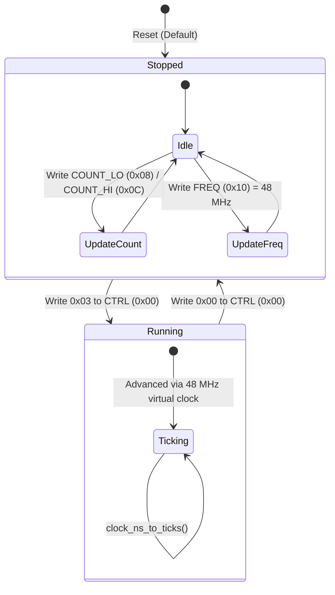

# 64-Bit System Timestamp Counter

The Nikon System Timestamp Counter at physical base `0x04266000` provides a monotonically advancing 64-bit microsecond timebase driven by a nominal 48 MHz clock.

## Register Layout

All accesses require strictly aligned 32-bit transactions. Access to non-32-bit widths or undefined holes returns `MEMTX_ERROR`.

| Offset | Register Name | Width | Access | Description |
|---|---|---|---|---|
| `0x00` | `TIMESTAMP_CTRL` | 32-bit | R/W | Control register: `0x03` = running, `0x00` = stopped. |
| `0x08` | `TIMESTAMP_COUNT_LO` | 32-bit | R/W | Lower 32 bits of 64-bit tick counter. Writable only when stopped. |
| `0x0C` | `TIMESTAMP_COUNT_HI` | 32-bit | R/W | Upper 32 bits of 64-bit tick counter. Writable only when stopped. |
| `0x10` | `TIMESTAMP_FREQ` | 32-bit | R/W | Nominal counter frequency in Hz (`0x02DC6C00` = 48,000,000 Hz). |

## Architectural Behavior

1. **Virtual Time Epoch**: Counter progression uses QEMU virtual time:
   $$\text{ticks} = \text{ticks}_{\text{then}} + \text{clock\_ns\_to\_ticks}(\Delta t_{\text{ns}})$$
2. **Read Invariance**: Reading the counter registers (`0x08` or `0x0C`) never mutates internal state or advances ticks. Halting the virtual machine freezes counter progression.
3. **Carry Propagation**: Upper 32 bits reflect natural overflow carry from the lower word.
4. **Configuration Safety**: Frequency and counter values can only be updated while the counter is stopped (`CTRL != 3`). Writes attempted while running are rejected with `MEMTX_ERROR`.
