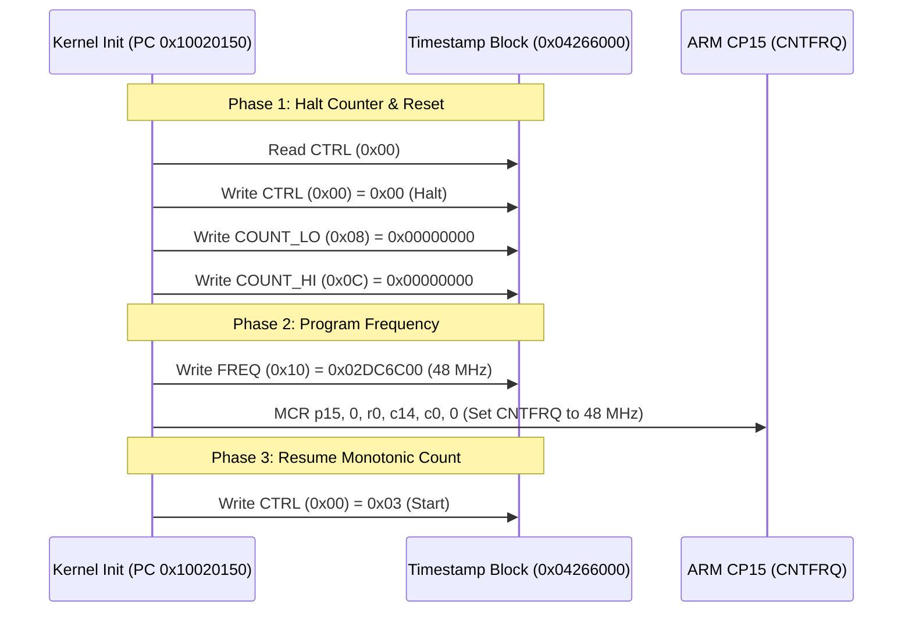

# Timestamp Counter Kernel Runtime Protocol

The camera kernel initializes and coordinates the 64-bit hardware timestamp counter during early RTOS bootstrap.

## Bootstrap Synchronization
1. **Early Polling**: During initial bootstrap, firmware samples `TIMESTAMP_COUNT_LO` (`0x04266008`) in tight spin loops to implement microsecond-scale hardware settling delays.
2. **Kernel Initialization**: Once the memory subsystem is established, the kernel halts the counter, zeroes both 32-bit count words, explicitly programs `48 MHz` into `TIMESTAMP_FREQ`, synchronizes ARM architectural timer `CNTFRQ`, and restarts the counter with control value `0x03`.
