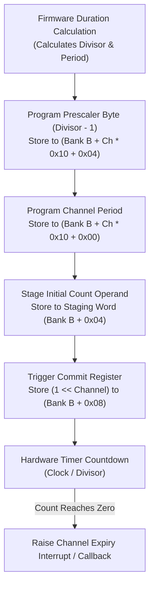

# Hardware timing divider and initial-count load protocol

This specification details the clock division formula, initial-count staging, and channel commit mechanics for the 12-channel hardware timing engine (`timing.c`), mapped at `PA 0x2c010000` (Bank A) and `PA 0x2c011000` (Bank B).

## Timing channel configuration and commit flow

Each timing channel operates from a nominal high-speed base clock, dividing frequency according to a programmed prescaler byte before loading counter registers.

## Clock division law

The prescaler byte at offset `(Bank B + channel_offset + 0x04)` encodes the divider as:

$$\text{Divisor} = \text{ByteValue} + 1$$
$$f_{\text{channel}} = \frac{f_{\text{base}}}{\text{ByteValue} + 1}$$

| Programmed Byte (Hex) | Decimal Value | Resulting Divisor | Common Architectural Role |
|---|---|---|---|
| `0x00` | 0 | 1 | High-precision event timing |
| `0x01` | 1 | 2 | Capture setup and sensor sync |
| `0x03` | 3 | 4 | Background task counter |
| `0x31` | 49 | 50 | Channel 7 standard periodic timer |
| `0xf9` | 249 | 250 | Long-interval duration timers |
| Other `0x00..0xff` | $N$ | $N + 1$ | Generic linear prescaler |

## Staged initial-count commit protocol

Loading an initial counter value requires a two-step transactional handshake:
1. **Stage Value**: Guest software writes the 32-bit initial count operand to global staging register `Bank B + 0x04`.
2. **Commit Channel**: Guest software writes a one-hot channel bitmask (`1 << channel`) to commit register `Bank B + 0x08`.
3. **Commit Invariants**:
   - The targeted channel must be stopped, reset-deasserted, with capture/compare disabled.
   - The staged count must not exceed the channel's programmed period ($0 \le \text{Count} \le \text{Period}$).
   - Attempting to commit multiple channels simultaneously or committing to an active running channel rejects the transaction with `MEMTX_ERROR` to prevent race conditions.
