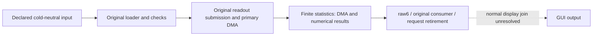

## Handbook Navigation

The handbook keeps the project's source contracts, explicit functional
assumptions and execution evidence together. For a new investigation, read
the [current frontier](/validation/frontier), then follow the corresponding
device contract and input profile.

For contributions and review, follow the [documentation standards](/writing).
They define article scope, evidence, notation, diagrams and validation.

### Current GUI startup boundary

The [cold-neutral resource80 input](/inputs/nor/virtual) passes the original
loader and version check. The [finite statistics profile](/devices/statistics/protocol)
now produces ten DMA outputs, bank results, scalars and bit6 completion;
original software consumes results and retires requests. Normal GUI output
is still unresolved under that input. Earlier error-GUI output belongs to a
different input profile and does not establish normal-menu startup.



Geometry and consumer packing are source-backed; numerical processing and
input association are declared functional assumptions. See the
[validation receipt](/validation/frontier) for the exact run and test scope.

### Core Sections

1. **[Architecture & Design Principles](/architecture)**
   - System CPU topologies, memory maps, inter-core communication, build infrastructure, and strict evidence criteria.
2. **[Startup Sequence](/startup/first)**
   - Firmware loader contracts, reset vectors, dual-core SMP parking, and coprocessor execution domains (`MAS`, `SLA`, `EX`, `VR`, `TPJ`).
3. **[Peripheral Contracts](/devices/gate/protocol)**
   - Finite device contracts, DMA, interrupts, serial buses, capture and processing; each page records its producer and unsupported boundary.
4. **[Runtime Subsystems](/runtime/policy)**
   - OS kernel services, memory allocation, battery authentication and UART peer protocol, graphics composition pipeline, and display readiness gates.
5. **[Explicit Inputs](/inputs/nor/descriptor)**
   - NOR descriptors, cold-neutral module data, battery/RNG inputs and camera inputs.
6. **[Address Reference Map](/refmap/README)**
   - Master address database (`REFS.tsv`), end-to-end execution chain graphs (boot, provider, display, input, readout), and active research frontiers.
7. **[Verification & Test Matrix](/validation/budgets)**
   - Native C qtests, timing budgets, synthetic fixture contracts, and boundary receipts.

---

### Quick Launch

For emulator build and launch instructions, see [native build](/build) and
the [execution domains](/startup/components). To read this handbook locally:

```sh
pnpm install --frozen-lockfile
pnpm docs:dev
```
