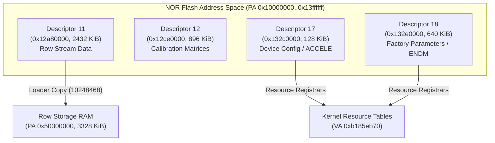

# NOR flash descriptors and external calibration inputs

The Nikon Z7II C1.70 firmware resource subsystem defines external NOR flash apertures for factory parameters, lens tables, sensor calibration profiles, and system settings.

## NOR descriptor memory layout

The flash memory subsystem maps descriptors into the upper address regions of physical NOR flash (`0x10000000..0x13ffffff`):

## Supported machine properties

The machine exposes explicit QEMU properties to populate these regions from verified container images or synthetic test fixtures:

| Machine Property | NOR Base Address | Required Size | Destination / Purpose |
|---|---|---|---|
| `descriptor11-input=FILE` | `0x12a80000` | Exactly 2,432 KiB (`0x260000`) | Row stream definitions; copied to row storage at `0x50300000` |
| `descriptor12-input=FILE` | `0x12ce0000` | Exactly 896 KiB (`0x0e0000`) | Sensor calibration tables and optical parameters |
| `descriptor17-input=FILE` | `0x132c0000` | Exactly 128 KiB (`0x020000`) | Hardware configuration records (accelerometer, board settings) |
| `descriptor18-input=FILE` | `0x132e0000` | Exactly 640 KiB (`0x0a0000`) | Factory calibration matrices and persistent parameters |

### Operational semantics
1. **Strict File Size Verification**: Input files must match their declared extents byte-for-byte. Omitting an input property leaves the corresponding flash cells in their erased state (`0xff`).
2. **Persistence and Reset Lifecycle**: Properties inject initial flash contents at machine creation. The CFI command model permits guest erase/program cycles; however, inputs are not reloaded on soft reset.
3. **Firmware Integrity Validation**: The original loader at `0x10248468` validates the trailing 4-byte `ENDM` footer and record headers before publishing resource callbacks. The model never fabricates resource callbacks or injects prefilled tables.

## Row storage memory region (`0x50300000`)

To support descriptor 11/12 operations, the diagnostic machine provisions source-backed row storage RAM:

- **Physical Base**: `0x50300000`
- **Region Size**: `0x00340000` (3,328 KiB)
- **Contract**: Mapped as dedicated memory region `z7ii.row-storage`. Firmware code copies stream records from descriptor 11 to this buffer before sensor readout staging begins.

## Acceleration configuration and calibration

The resource registrar at `0xb185eb70` copies:
- Resource 21 from descriptor 17 (offset `0xa400`, 256 bytes)
- Resource 57 from descriptor 18 (offset `0x100`, 192 bytes)

Both resources must be populated for accelerometer and orientation sensors to initialize. The firmware callback requires both completion status bits before activating I2C2 sensor polling and transitioning to application state 2.
