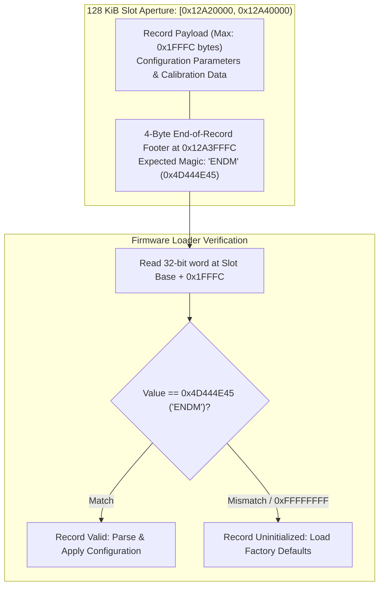

# NOR Flash Footer Validation & Slot Integrity

The camera firmware validates persistent configuration and descriptor records stored in external NOR flash by verifying a 4-byte ASCII footer marker (`ENDM`) at the end of each slot aperture.

## Hardware & Validation Protocol

1. **Footer Address Calculation**: For a 128 KiB (`0x20000`) descriptor slot starting at base address $B$, the footer marker is located at:
   $$\text{Footer Address} = B + 0x20000 - 4 = B + 0x1FFFC$$
2. **Footer Marker**:
   - The valid terminal marker is the 4-byte ASCII string `ENDM` (`0x4D444E45` in little-endian format).
   - If the slot is erased or unprogrammed, the memory returns `0xFFFFFFFF`.
3. **Firmware Reaction**:
   - Firmware comparator (`0x103E0AD2`) loads the 4 bytes at `0x12A3FFFC` (Descriptor 8) and `0x132DFFFC` (Descriptor 17).
   - If the footer equals `0x4D444E45`, firmware unpacks the record into kernel memory.
   - If uninitialized or mismatched, the loader bypasses the slot, falling back to safe built-in defaults without crashing.
4. **Write Protection**: Unprogrammed external NOR slots are backed as read-only ROMD regions. Attempts to write to these apertures without explicit MEMC unlock sequences fail with `MEMTX_ERROR`.
