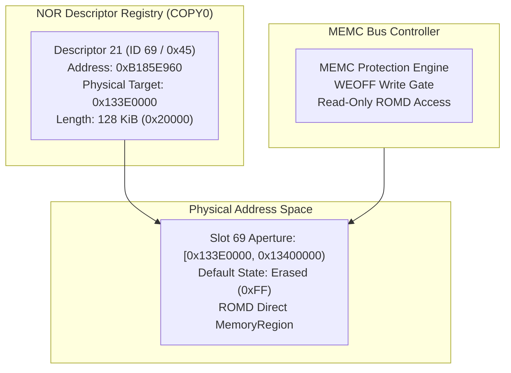

# Non-Volatile Memory Slot 69 Architecture

The camera firmware accesses persistent non-volatile configuration data mapped via NOR flash descriptor 21 to physical memory aperture `[0x133E0000, 0x13400000)`.

## Hardware Specification

| Field | Parameter | Description |
|---|---|---|
| **Physical Base** | `0x133E0000` | Start address of Non-Volatile Slot 69. |
| **Physical End** | `0x13400000` | Exclusive end address (128 KiB capacity). |
| **Descriptor Index** | 21 (ID `0x45`) | Registered in the 81-entry NOR descriptor table at `0xB185E960`. |
| **Erased Representation** | `0xFF` | Default factory state representing unprogrammed NOR flash memory cells. |
| **Memory Classification** | ROMD | Mapped as direct-read memory with write protection enforced via MEMC. |

## Access & Validation Protocols

1. **Header Validation**: During boot, firmware reads the initial 8-byte header from `0x133E0000`. If erased (`0xFF`), firmware executes its fallback path, loading safe default calibration parameters.
2. **Write Protection**: Any write attempted before explicit MEMC write-enable configuration triggers an immediate bus access fault (`MEMTX_ERROR`).
3. **Boundary Integrity**: Addresses outside the 128 KiB span (`< 0x133E0000` or $\ge$ `0x13400000`) remain unmapped holes.
