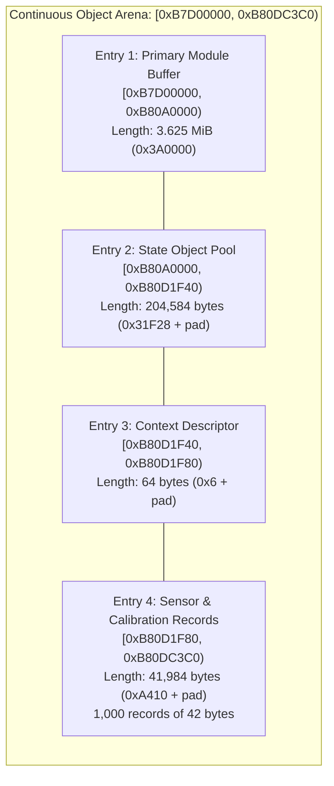

# Early Guest Object Allocations

Following the initialization of the module bump allocator, the firmware issues four sequential allocations creating the primary object and record pools in DDR RAM.

## Allocation Entries Specification

| Entry | Initiating Core | Requested Size | Base Address | End Address | Caller LR | Purpose |
|---|---|---|---|---|---|---|
| **1** | CPU 0 | `0x003A0000` (3.625 MiB) | `0xB7D00000` | `0xB80A0000` | `0x10248473` | Primary module staging and execution memory |
| **2** | CPU 1 | `0x00031F28` (200 KiB) | `0xB80A0000` | `0xB80D1F40` | `0x1023EDB1` | Runtime state and subsystem structures |
| **3** | CPU 1 | `0x00000006` (6 bytes) | `0xB80D1F40` | `0xB80D1F80` | `0x10382FE7` | Subsystem context descriptor (aligned to 64 bytes) |
| **4** | CPU 1 | `0x0000A410` (41 KiB) | `0xB80D1F80` | `0xB80DC3C0` | `0x1038343F` | 1,000 records of 42 bytes each (offset `0xA3E6` end) |

## Initialization and Zeroing

1. **Zero Initialization**: After allocating Entry 4 (`[0xB80D1F80, 0xB80DC3C0)`), firmware calls the zeroing wrapper (`0x10361038`), clearing the logical `0xA410` bytes from `0xB80D1F80` to `0xB80DC390`. The remaining 48 bytes represent allocator alignment padding.
2. **Record Pool Layout**: The 1,000 calibration and configuration records in Entry 4 are initialized with structured markers and checksums.
3. **Hardware Backing**: The entire continuous span `[0xB7D00000, 0xB80DC3C0)` is backed as unified RAM in the MXIC memory controller, accessible to both CPUs and peripheral bus masters.
