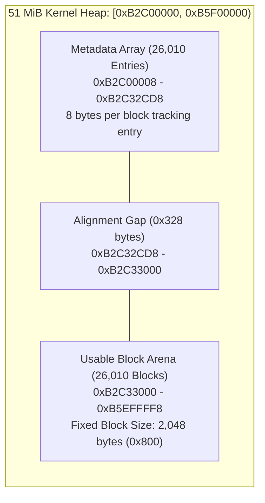

# Kernel Heap Allocator Architecture

The RTOS kernel manages a 51 MiB heap arena located between `0xB2C00000` and `0xB5F00000`, providing fixed-size 2048-byte block allocation for kernel services, tasks, queues, and message envelopes.

## Heap Geometry & Sizing Formula

The kernel heap constructor (`0x000E8494`) calculates pool dimensions from the configured boundaries:

$$\text{Total Blocks} = \left\lfloor \frac{\text{End} - \text{Start} - 8}{0x808} \right\rfloor = \frac{0x03300000 - 8}{0x808} = 0x659A \quad (26,010 \text{ blocks})$$

- **Unit Size ($0x808$)**: Each allocated unit consists of an 8-byte tracking header and a 2048-byte (`0x800`) data payload.
- **Metadata Placement**: The kernel groups all 26,010 tracking headers into a contiguous array starting immediately above the base (`0xB2C00008` to `0xB2C32CD8`).
- **Usable Arena Base**: Usable block data begins at aligned address `0xB2C33000`.

## Memory & System Integration

1. **MXIC Mapping**: Backed by physical DDR RAM through the MXIC memory controller.
2. **Access Security**: The heap resides within storage Class 21, mapped with full supervisor read/write permissions in the kernel L1 page table.
3. **Consumer Usage**: All kernel dynamic objects—including task control blocks (`TCB`), event flags, semaphore tokens, and communication ring buffers—are carved out of this 51 MiB block pool.
