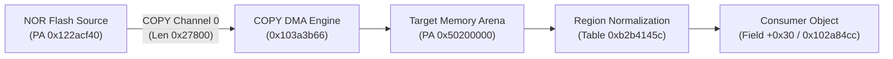

# Physical address 0x50200000 and object+0x30 contract

This specification unifies the verified hardware boundaries, software address normalization, and consumer lifecycle for physical memory region `0x50200000` and its associated `object + 0x30` descriptor field in the Nikon Z7II C1.70 MAS firmware.

## Architecture and dataflow

During multi-thread system initialization, MAS worker routines configure hardware DMA copy operations to populate operational memory buffers from NOR flash storage.



## Hardware COPY request parameters

The firmware COPY submit wrapper at `0x103a3b66` (called from `0x10244966`) issues the following transfer request:

| Parameter | Observed Value | Description |
|---|---|---|
| Channel | `0` | Primary hardware byte-copy engine |
| Source Address | `0x122acf40` | NOR flash parameter arena |
| Destination Address | `0x50200000` | Operational staging buffer in physical RAM |
| Transfer Length | `0x00027800` (160 KiB) | Total payload bytes |
| Descriptor Pointer | `0x122d4740` | Command descriptor block |
| Descriptor Word 0 | `0x00027800` | Byte count / control |
| Descriptor Words 1–3 | `0x00000000` | Reserved / chaining parameters |
| Page Table Entry | `0x50214422` | Secure TTBR0 (`0xb2b74000`), L1 entry at `0xb2b75408` |
| Address Translation | `VA 0x50200000 → PA 0x50200000` | Direct 1:1 identity physical mapping |

## Software address normalization

The MAS kernel maintains a memory region translation table rooted at `0xb2b4145c` composed of 12-byte records:

```text
[ uint32_t input_base, uint32_t enabled, uint32_t output_base ]
```

The normalization function at `0x103c5a7a` performs interval queries (`0x103c5ad8`), verifying enablement flags (`+4`) and output bases (`+8`):

$$\text{Address}_{\text{normalized}} = \text{output\_base} + (\text{input} - \text{input\_base})$$

Active conversion callers relevant to this boundary include:
- `0x102416c4`, `0x10241728`, `0x1024173c`
- `0x102418e0`, `0x10241914`, `0x1024192a`

## Object construction and the `+0x30` field

The object generator at `0x10241c6e` calculates destination object instances from resource pointer `0x10221ed0` (`0xb2a9adac`):

$$\text{Object}_{\text{ptr}} = \text{base} + 0x20 + (\text{index} \times 0x58)$$

Routine `0x102415d6` initializes the object structure:
- Offsets `0x00..0x2c`: Common header, flags, and size fields.
- Offset `0x30`: Primary memory arena reference holding the normalized target address.
- Offsets `0x34..0x64`: Mode-specific dispatch and callback handles.

The recovered reader routine at `0x102a84cc` consumes `object + 0x30` to validate buffer boundaries before dispatching downstream service tasks.

## Emulation and boundary criteria

1. **Deterministic RAM Backing**: Complete bundles provide deterministic memory backing for `0x50200000` to allow the COPY engine to finalize without generating spurious `MEMTX_ERROR` bus faults.
2. **Read-Only Invariants**: Descriptors and region translation tables are populated strictly by guest code and verified loader sequences without synthetic host memory overwrites.
3. **Completion Signaling**: The copy engine raises its architectural completion interrupt (IRQ130) upon transferring the verified `0x27800` bytes, enabling normal guest task scheduling.
