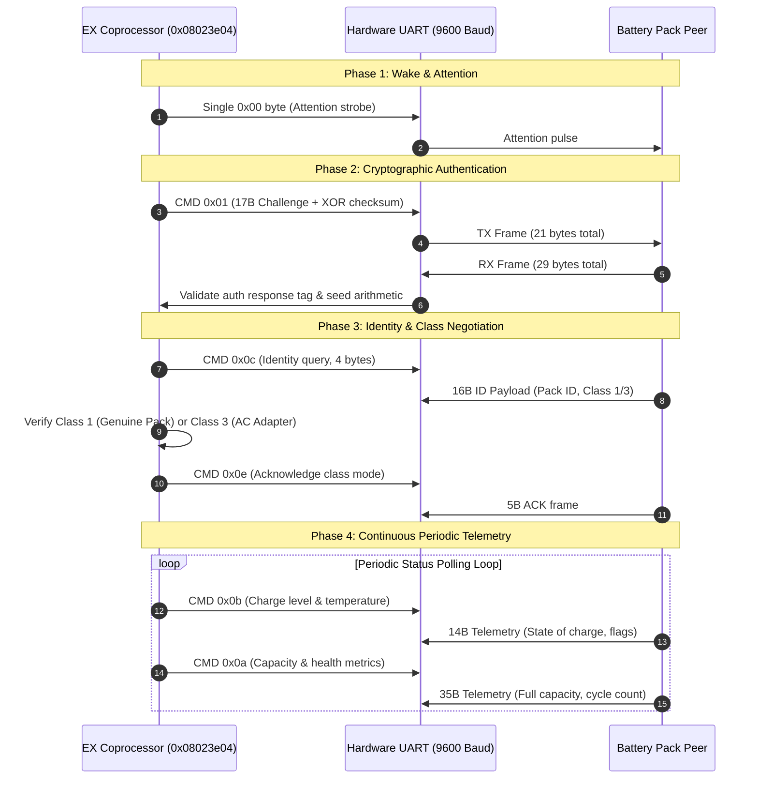

# Battery UART communication and authentication protocol

This specification documents the low-level serial communication protocol between the Nikon EX Cortex-M4 coprocessor and the intelligent battery pack over dedicated UART at 9600 baud.

## Protocol architecture and handshake flow

The battery interface employs packetized, checksummed binary frames. The protocol proceeds through three distinct phases: initial wake/attention, cryptographic challenge-response authentication, and periodic metric polling.

## Packet framing and checksum rules

1. **Frame Header**: All multi-byte packets begin with packet length / command indicators (`0x02`, followed by command identifier).
2. **Checksum Law**: Every packet terminates with an 8-bit longitudinal redundancy check (XOR checksum):
   $$\text{Checksum} = \bigoplus_{i=0}^{N-1} \text{Byte}_i$$
3. **Generic Acknowledgment**: Successful control operations return a 4-byte or 5-byte ACK envelope where byte 1 is `0x06` (ASCII ACK) and the final byte is the XOR sum of preceding bytes.
4. **Hardware Timing & Pacing**: Transmission requires byte-paced serialization at 9600 baud (~1.04 ms per byte). Rapid burst transmission without hardware byte pacing causes guest UART receiver overrun.

## Command inventory

| Command Byte | Frame TX/RX | Timeout | Function & Protocol Meaning | Handshake Phase |
|---|---|---|---|---|
| `0x00` | 1 / 0 | 0 ticks | Attention pulse / wake strobe | Wakeup |
| `0x01` | 21 / 29 | 440 ticks | Cryptographic challenge exchange; authenticates genuine pack | Authentication |
| `0x0c` | 4 / 16 | 100 ticks | Identity request: reads pack serial, model class (Class 1 / 3) | Initialization |
| `0x0e` | 5 / 5 | 100 ticks | Mode selection acknowledgment (argument byte 1) | Initialization |
| `0x0b` | 4 / 14 | 100 ticks | Dynamic telemetry: state-of-charge percentage, temperature, status | Periodic Polling |
| `0x0a` | 4 / 35 | 100 ticks | Static metrics: full capacity, design voltage, cycle count, health | Periodic Polling |
| `0x02` | 6 / 4 | 100 ticks | Debit control: decrements internal energy consumption counters | Periodic Control |
| `0x89` | 18 / 4 | 100 ticks | Operating mode and camera state parameter broadcast | Periodic Config |
| `0x07` | 4 / 4 | 100 ticks | Auxiliary power gate enable / standby acknowledge | State Transition |
| `0x25` | 4 / 4 | 100 ticks | Sleep command acknowledgment | Power Down |
| `0x26` | 4 / 4 | 100 ticks | Resume / wake confirmation | Power Up |

## Telemetry payload definitions

### Command `0x0b` (Charge state)
- Offset `3`: State of charge percentage (clamped to 100%).
- Offset `5`: Operational flags.
- Offset `6..7`: Internal battery pack temperature sensor reading (LE16).
- Offset `10..11`: Instantaneous terminal voltage (LE16).
- Offset `12`: Current drain status byte.

### Command `0x0a` (Capacity and health)
- Offset `12..13`: Remaining capacity in milliampere-hours (LE16).
- Offset `14..15`: Full charge capacity (LE16).
- Offset `18..19`: Pack cycle count (LE16).
- Offset `32`: Cell health classification indicator (mapped to health states 0..4).

## Wire-only battery tool (`nikon-battery`)

The repository builds an autonomous host tool at `work/build/qemu/tools/nikon/nikon-battery` using QEMU utility primitives:

- **Socket / PTY Emulation**: Connects to QEMU's `-serial chardev` to serve paced UART responses.
- **Dynamic Challenge Solving**: Employs the verified seed permutation algorithm to calculate valid 29-byte authentication responses in real time.
- **Configurable Profiles**: Supports healthy battery state (`100%`, `BatCk=1`), depleted state (`BatCk=2`, warning screen trigger), and AC adapter profile (`Class 3`).
