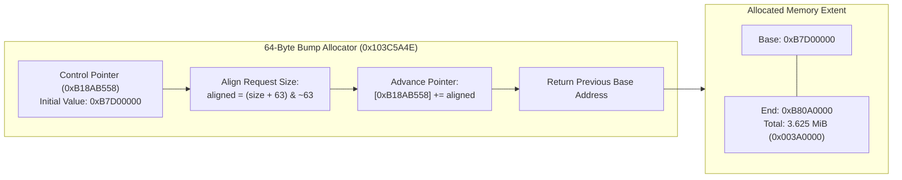

# Initial Module Buffer Allocation

During early application startup, the camera firmware initializes a fast 64-byte bump allocator in BSS to allocate the primary module execution buffer.

## Bump Allocator Architecture

The leaf allocation routine (`0x103C5A4E`) operates directly on the control pointer stored at `0xB18AB558`:
1. **Entry Arguments**: Register `R0` contains requested byte count; `LR` contains return address.
2. **Alignment Rule**: The requested length is rounded up to the nearest 64-byte boundary:
   $$\text{aligned\_len} = (\text{req\_len} + 63) \ \& \ \sim 63$$
3. **Atomic Update**: The allocator locks the scheduler, loads the current base pointer $P$, computes $P_{\text{new}} = P + \text{aligned\_len}$, stores $P_{\text{new}}$ back to `0xB18AB558`, and returns $P$ in `R0`.

## Memory Extent & MMU Mapping

- **Physical Extent**: `[0xB7D00000, 0xB80A0000)` (length `0x003A0000` = 3.625 MiB).
- **L1 Section Descriptors**: Mapped identity in the ARM L1 page table via 4 short section descriptors at offsets `0x12DF4` - `0x12E00`:
  - `0xB7D14422` (VA `0xB7D00000` $\to$ PA `0xB7D00000`)
  - `0xB7E14422` (VA `0xB7E00000` $\to$ PA `0xB7E00000`)
  - `0xB7F14422` (VA `0xB7F00000` $\to$ PA `0xB7F00000`)
  - `0xB8014422` (VA `0xB8000000` $\to$ PA `0xB8000000`)
- **MXIC Bus Decode**: System interconnect routes accesses within this range to physical DDR RAM cells shared across CPU cores and DMA engines.
